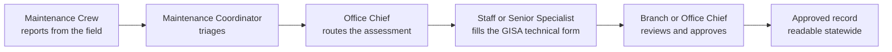

# ERIS — Emergency Response Information System

ERIS is how Caltrans Geotechnical Services and district Maintenance handle
slope, embankment and drainage incidents on the state highway system, from the
first field report to an approved geotechnical assessment.



## Documentation

**Start at [docs/README.md](docs/README.md).** It is organized by who you are:

| You are | Start with |
| --- | --- |
| Taking over ERIS (IT owner, new maintainer) | [Handover guide](docs/handover/README.md) |
| A developer or intern | [Developer guide](docs/development/README.md) |
| Operating the servers | [Operations: dev, test and prod](docs/operations/README.md) |
| Reviewing security | [Security architecture](docs/security/README.md) |
| Using ERIS | [User guides](docs/user-guides/README.md) |
| Fixing something | [Troubleshooting FAQ](docs/handover/troubleshooting.md) |

## Repository layout

| Folder | What it holds | Stack |
| --- | --- | --- |
| [`backend/`](backend) | API, terrain worker, Alembic migrations, tests | Python 3.12, FastAPI, SQLAlchemy Core, MariaDB, SeaweedFS (S3) |
| [`web/`](web) | Web app and its nginx configuration | React 19, TypeScript, Vite, Tailwind, ArcGIS Maps SDK for JavaScript |
| `ios/` (branch `claude/ios-swift-app`) | Native iPhone app and the `ERISKit` package | Swift, SwiftUI, MSAL, APNs |
| [`mobile/`](mobile) | Expo app, kept as the reference while the Swift app replaces it | Expo / React Native, ArcGIS Runtime for iOS |
| [`database/`](database) | Init SQL for a new database; development mock accounts | MariaDB 11 |
| [`deploy/podman/`](deploy/podman) | Caltrans production: one rootless Podman pod, release with automatic rollback, backups, verification | Podman, bash |
| [`deploy/ci/`](deploy/ci) | Jenkins pipeline and the SBOM, vulnerability and signing gate | Jenkins, Trivy, cosign, Harbor |
| [`deploy/compose/`](deploy/compose) | Development services (MariaDB, SeaweedFS, Adminer) and the older server stack | Docker Compose |
| [`docs/`](docs) | All documentation | Markdown, Mermaid |
| [`scripts/docs/`](scripts/docs) | Documentation generators and checks | Python |
| [`.github/`](.github) | CI workflows, pull request template | GitHub Actions |

## Quick start (development)

```bash
cd deploy/compose && cp .env.example .env && docker compose up -d   # MariaDB + SeaweedFS
# load database/dev/030_mock_accounts.sql, then from backend/:
alembic stamp 0001_baseline && alembic upgrade head && ./run.sh     # API on :8000
# from web/:
npm ci && npm run dev                                              # http://localhost:5173
```

Full steps, including Windows commands: [getting started](docs/development/getting-started.md).

## Production

Caltrans runs ERIS as one rootless Podman pod behind the Caltrans TLS gateway,
with images built, scanned and signed by Jenkins and stored in Harbor, and
sign-in through Microsoft Entra ID only. Start with
[operations](docs/operations/README.md) and the
[Caltrans Podman runbook](docs/operations/caltrans-podman.md).

## Contributing and security

- How to make a change: [CONTRIBUTING.md](CONTRIBUTING.md).
- How to report a vulnerability: [SECURITY.md](SECURITY.md).
