# ERIS documentation

ERIS (Emergency Response Information System) is how Caltrans Geotechnical
Services and district Maintenance turn a field report of a slope, embankment or
drainage problem into a routed, reviewed geotechnical assessment.

This documentation is written so that the people who maintain ERIS (Caltrans IT
and the engineers and interns who look after the code) never need to ask the
original author. **If something you needed is missing, add it here**: see
[how to change the docs](development/conventions.md#documentation).

## Start here

| You are… | Read, in order |
| --- | --- |
| **Taking over ERIS** (IT owner, new maintainer) | [Handover guide](handover/README.md) → [System overview](overview/README.md) → [Operations](operations/README.md) |
| **A developer or intern** | [Handover guide: first week](handover/README.md#first-week-for-a-new-developer) → [Getting started](development/getting-started.md) → [Development guide](development/README.md) → [Architecture](architecture/README.md) |
| **Running the servers** (Caltrans IT, operators) | [Operations: dev, test and prod](operations/README.md) → [Caltrans Podman runbook](operations/caltrans-podman.md) → [Monitoring and troubleshooting](operations/monitoring-and-troubleshooting.md) |
| **Reviewing security** | [Security architecture](security/README.md) → [Authentication and sessions](security/authentication-and-sessions.md) → [Supply chain](security/supply-chain.md) |
| **Using ERIS** (field staff, coordinators, GeoTech, administrators) | [User guides](user-guides/README.md) |
| **Fixing something broken** | [Troubleshooting FAQ](handover/troubleshooting.md) → [Security incident response](security/incident-response.md) |

## Map of the documentation

```mermaid
flowchart TB
    root["docs/README.md<br/>(you are here)"]
    root --> handover["handover/<br/>what you own, recurring tasks,<br/>troubleshooting FAQ"]
    root --> overview["overview/<br/>what ERIS is, who uses it,<br/>glossary"]
    root --> arch["architecture/<br/>diagrams at every layer,<br/>request flows, workflows"]
    root --> data["data/<br/>ERD, schema reference,<br/>migrations, storage"]
    root --> sec["security/<br/>trust boundaries, sign-in,<br/>roles, secrets, incidents"]
    root --> dev["development/<br/>set up, test, change<br/>backend, web, iOS"]
    root --> ops["operations/<br/>dev, test, prod environments,<br/>runbooks, configuration"]
    root --> users["user-guides/<br/>one guide per role,<br/>use-case diagrams"]
    root --> ref["reference/<br/>API (generated), GISA<br/>dictionary, road glossary"]
    root --> adr["decisions/<br/>architecture decision records"]
    root --> caltrans["caltrans/<br/>IT briefing, readiness audit,<br/>PDF handout"]
```

| Folder | Contents |
| --- | --- |
| [handover/](handover/README.md) | [Handover guide](handover/README.md), [maintenance calendar](handover/README.md#recurring-maintenance-calendar), [troubleshooting FAQ](handover/troubleshooting.md) |
| [overview/](overview/README.md) | [System overview](overview/README.md), [glossary](overview/glossary.md) |
| [architecture/](architecture/README.md) | [Architecture](architecture/README.md) (context, containers, components, layers), [request flows](architecture/request-flows.md) (sequence diagrams), [deployment topologies](architecture/deployment-topologies.md), [workflows](architecture/workflows.md) (state machines), [offline terrain](architecture/offline-terrain.md) |
| [data/](data/README.md) | [Data model](data/README.md), [ERD](data/erd.md) and [schema reference](data/schema-reference.md) (both generated), [migrations](data/migrations.md), [MinIO to SeaweedFS migration](data/storage-migration.md) |
| [security/](security/README.md) | [Security architecture](security/README.md), [authentication and sessions](security/authentication-and-sessions.md), [roles and permissions](security/roles-and-permissions.md), [supply chain](security/supply-chain.md), [secrets and keys](security/secrets-and-keys.md), [incident response](security/incident-response.md) |
| [development/](development/README.md) | [Development guide](development/README.md), [getting started](development/getting-started.md), [testing](development/testing.md), [backend](development/backend.md), [web](development/web.md), [iOS app](development/ios.md), [Expo app (reference)](development/mobile-expo.md), [conventions](development/conventions.md) |
| [operations/](operations/README.md) | [Environments: dev, test, prod](operations/README.md), [Caltrans Podman runbook](operations/caltrans-podman.md), [Compose deployment](operations/compose-deployment.md), [configuration](operations/configuration.md), [monitoring and troubleshooting](operations/monitoring-and-troubleshooting.md), [offline scene packages](operations/offline-scene-packages.md), [history](operations/history/proxmox-podman-cutover.md) |
| [user-guides/](user-guides/README.md) | [By role](user-guides/README.md), [administration](user-guides/administration.md), [maintenance workflows](user-guides/maintenance-workflows.md) |
| [reference/](reference/api.md) | [API](reference/api.md) (generated), [GISA data dictionary](reference/gisa-data-dictionary.md), [road inventory glossary](reference/road-inventory-glossary.md) |
| [decisions/](decisions/README.md) | Architecture decision records |
| [caltrans/](caltrans/it-deployment-brief.md) | [IT deployment briefing](caltrans/it-deployment-brief.md), [readiness audit](caltrans/readiness-audit.md), [PDF handout](caltrans/eris-caltrans-it-briefing.pdf) |

## Documentation that cannot drift

Three checks keep the references honest. CI ([`docs.yml`](../.github/workflows/docs.yml))
fails when a committed copy is stale or a link is broken:

| What | Generated or checked from | Command |
| --- | --- | --- |
| [API reference](reference/api.md) | The FastAPI routes and their role guards | `python scripts/docs/generate_api_reference.py` |
| [ERD](data/erd.md) and [schema reference](data/schema-reference.md) | A fully migrated MariaDB | `python scripts/docs/generate_schema_docs.py --url …` |
| Every relative link and `#anchor` in every Markdown file | The files themselves | `python scripts/docs/check_links.py` |

Diagrams are [Mermaid](https://mermaid.js.org/) in the Markdown, so they render on
GitHub and in most editors, and change in the same pull request as the code.
