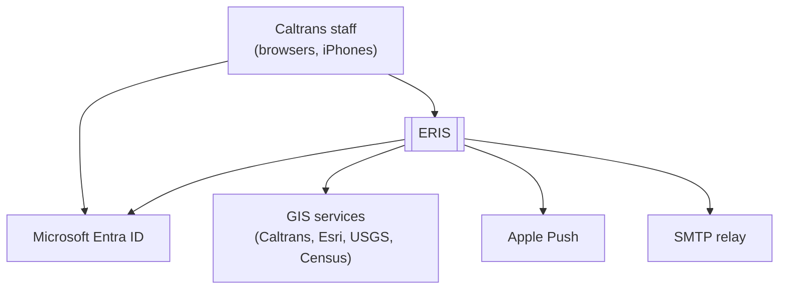
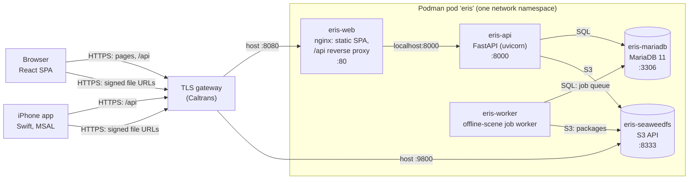
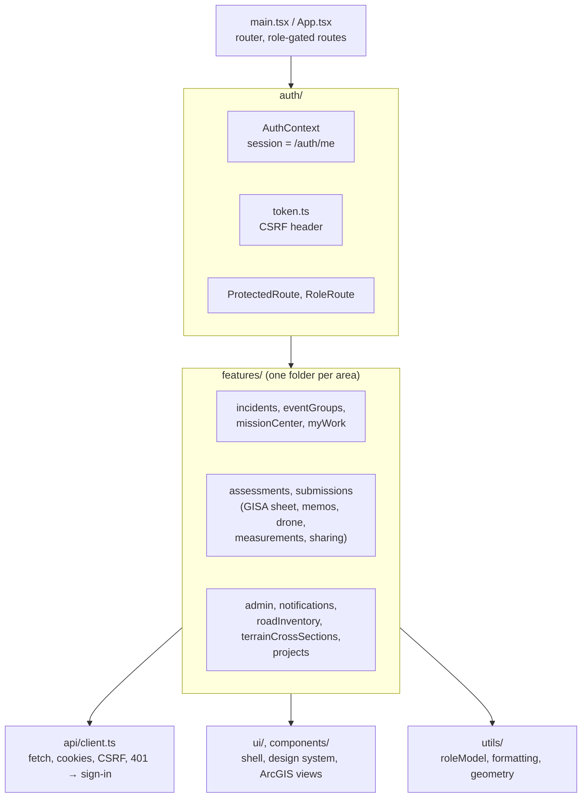
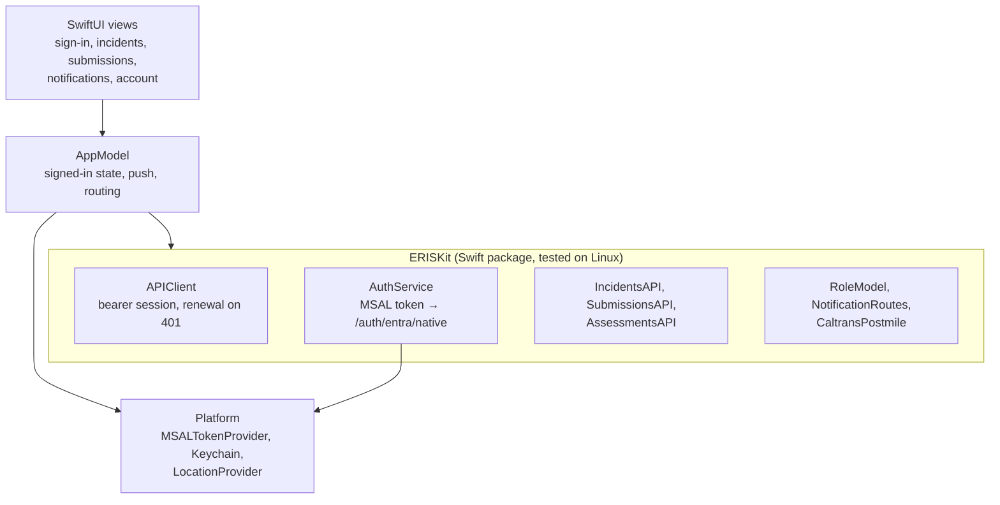
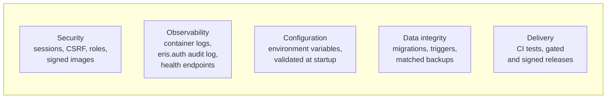

# Architecture

ERIS (Emergency Response Information System) is how Caltrans Geotechnical
Services and district Maintenance turn a field report of a slope, embankment or
drainage problem into a routed, reviewed geotechnical assessment.

This page describes the system from the outside in, following the
[C4 model](https://c4model.com/): context, containers, components, then the
cross-cutting layers. Companion pages:

| Page | Shows |
| --- | --- |
| [Request flows](request-flows.md) | Sequence diagrams: sign-in, an API call, uploads and downloads, background jobs, push |
| [Deployment topologies](deployment-topologies.md) | Where each container runs in development, test and production; ports; the release pipeline |
| [Workflows](workflows.md) | State machines for incidents, assessments, forms and Incident Groups |
| [Data model](../data/README.md) | Domains, ERD, object storage |
| [Security architecture](../security/README.md) | Trust boundaries and controls |

## Level 1: system context



The [system overview](../overview/README.md#system-context) has the full
context diagram, including Jenkins, Harbor, Intune and backups.

## Level 2: containers



Only host ports 8080 (web and API) and 9800 (S3) are published, on loopback or
a private interface. The database, API port and SeaweedFS admin ports are never
published. Details per environment: [deployment topologies](deployment-topologies.md).

| Container | Image | Code | State |
| --- | --- | --- | --- |
| `eris-web` | `web` (nginx + built SPA) | `web/`, `web/nginx.conf` | None |
| `eris-api` | `api` | `backend/app/` (entry `app/asgi.py`) | None (sessions in MariaDB) |
| `eris-worker` | `worker` (API code + GIS stack) | `backend/app/worker/` | None (jobs in MariaDB) |
| `eris-mariadb` | MariaDB 11 (mirrored) | `database/init/`, `backend/migrations/` | Volume `eris-mariadb` |
| `eris-seaweedfs` | SeaweedFS 4.50 (mirrored) | — | Volume `eris-seaweedfs` |

## Level 3: components of the API

```mermaid
flowchart TB
    subgraph edge["Edge (every request)"]
        cors["CORS"]
        origin["Cross-site write refusal<br/>(sessions.check_origin)"]
        authn["Authentication<br/>deps.current_session →<br/>sessions.authenticate:<br/>cookie or bearer, CSRF,<br/>idle/absolute expiry"]
        authz["Authorization<br/>require_roles / deny_public_only<br/>+ record rules in handlers"]
    end
    subgraph routes["Routes (HTTP layer)"]
        r_auth["routes/auth.py, entra.py<br/>sign-in, sessions"]
        r_inc["main.py, routes/incidents.py,<br/>incident_approval, event_groups,<br/>mission_center_*"]
        r_assess["routes/assessments.py"]
        r_form["main.py submissions,<br/>routes/gisa.py, sharing,<br/>form_presence, photo_map"]
        r_admin["admin_users.py,<br/>routes/org*.py,<br/>maintenance_workflows"]
        r_gis["routes/road_inventory*,<br/>terrain_cross_sections,<br/>drone_surveys, arcgis"]
        r_notify["routes/notifications.py"]
    end
    subgraph services["Services (domain logic)"]
        s_org["org_tree, org_directory,<br/>office_routing"]
        s_form["form_access, form_saves,<br/>sharing, share_rules,<br/>gisa_validation, rich_text"]
        s_vis["public_visibility,<br/>workflow_tree"]
        s_notify["notification_feed,<br/>notifications (email),<br/>push, apns"]
        s_gis["offline_scene_*, terrain_grid,<br/>elevation_profile, road_*,<br/>roadway_context"]
        s_media["field_media_*,<br/>photo_metadata_export"]
    end
    subgraph infra["Infrastructure"]
        db["db.py<br/>SQLAlchemy sessions,<br/>hand-written SQL"]
        storage["storage.py<br/>S3 client, presigned URLs"]
        config["config.py<br/>validated settings"]
        cred["entra_credential.py<br/>certificate assertions"]
    end
    edge --> routes --> services --> infra
    routes --> infra
```



| Layer | Rule |
| --- | --- |
| Edge | Every route is authenticated except sign-in, configuration and health; a test walks the route table to enforce it ([testing](../development/testing.md)). |
| Routes | Thin: parse, call services, shape the response. Role guards are declared on the route. |
| Services | Domain rules that more than one route needs (organization, sharing, visibility, notifications, GIS). |
| Infrastructure | Database sessions, object storage, settings, credentials. Settings are validated at startup; production refuses unsafe values. |
| Database | Business rules that must never break are also MariaDB triggers (for example an ERIS number never changes). |

The API is SQLAlchemy Core with hand-written SQL, not an ORM. Each request gets
a database session from `db.get_db`; handlers commit explicitly.

## Level 3: components of the web app



The browser never holds the session credential: it is an HttpOnly cookie. See
the [web guide](../development/web.md).

## Level 3: components of the iPhone app



Details: [iOS app](../development/ios.md).

## Cross-cutting concerns



| Concern | Where it lives | Read |
| --- | --- | --- |
| Security | `app/sessions.py`, `app/deps.py`, `app/entra.py`, `deploy/ci/` | [Security architecture](../security/README.md) |
| Observability | `podman logs`, `/healthz`, `/api/health`, `eris.auth` logger | [Monitoring](../operations/monitoring-and-troubleshooting.md) |
| Configuration | `app/config.py`, `deploy/podman/*.env` | [Configuration](../operations/configuration.md) |
| Data integrity | `backend/migrations/`, triggers in the schema, `eris-pod.sh backup` | [Data](../data/README.md) |
| Delivery | `.github/workflows/`, `deploy/ci/Jenkinsfile.podman` | [Supply chain](../security/supply-chain.md) |

## How a request is handled (summary)

- **Sign-in.** Caltrans signs in through Entra OIDC (`/auth/entra/*`); password
  sign-in (`POST /auth/login`, Argon2) exists for development and rehearsals
  only. Either way the API creates a server-side session (`user_sessions`,
  `app/sessions.py`). Browsers hold it in an HttpOnly, SameSite=Strict cookie
  and send a CSRF token on writes; the phone holds it as a bearer token in
  secure storage. Sessions expire after 30 idle minutes (web) and 12 hours.
- **Authorization.** On every request the backend loads the account's roles
  from the database, so role changes apply immediately. Each route names the
  roles it admits (`require_roles`), refuses read-only Guests (`deny_public_only`),
  or is one of a reviewed list of routes Guests may read. A test walks the whole
  route table to keep that true. Beyond the role, handlers check scope (district,
  office, assignment) and ownership. See [roles-and-identity.md](../security/roles-and-permissions.md).
- **Files.** Uploads go through the API into SeaweedFS. Downloads are short-lived
  signed SeaweedFS URLs, so file bytes do not pass through the API.
- **Startup.** The API checks the SeaweedFS bucket (fatal outside `ENV=dev`), refuses
  to start unless the database is at the latest Alembic revision, then retries
  any undelivered email.
- **API documentation** is generated by FastAPI at `/docs` and `/openapi.json`.
  It is on in development and off in production unless `API_DOCS_ENABLED=true`.

## Data

The schema is created by `database/init/010_schema.sql` and moved forward by the
Alembic revisions in `backend/migrations/versions/`. Business rules that must
never be broken are enforced by MariaDB triggers as well as by the API: for
example, a report cannot leave triage without an Incident Group and an ERIS number
unless it is closed at triage, an ERIS number never changes, and an assessment
can only be assigned to someone who holds the right role.

| Area | Tables |
| --- | --- |
| Accounts | `users`, `roles`, `user_roles`, `user_external_identities` (Entra ID links), `role_consolidation_audit`, `user_saved_layouts` (each person's saved screen layouts) |
| Organization | `org_offices`, `org_office_districts`, `org_branches`, `org_branch_districts`, `org_user_profiles` (with each person's `tree_position`), `org_coordinator_coverage`, `org_district_crew`, `org_classifications`; `geotech_office_routing` is kept as a mirror of the office-district map |
| Incidents | `incidents`, `incident_locations`, `incident_assignments`, `incident_routing_assignments`, `incident_attachments`, `incident_submission_links`, `incident_notifications` (in-app and email notices), `workflow_events` |
| Incident Groups | `event_groups`, `event_group_events`; the views `projects` and `project_events` keep the older `/projects` API working |
| Assessments | `assessments`, `assessment_assignments`, `assessment_events`, `assessment_submissions` |
| Technical forms | `submissions`, `submission_gisa`, `submission_gisa_actions`, `submission_gisa_incident_types`, `submission_visibility` and `submission_editors` (per-form reader and editor permits) |
| Files | `attachments`, `attachment_links`, `attachment_capture_metadata`, `attachment_capture_corrections` |
| Terrain and roads | `offline_scene_jobs`, `offline_scene_packages`, `offline_scene_orphaned_objects`, `offline_scene_worker_heartbeats`, `road_inventory_datasets`, `road_segments`, `road_inventory_packages`, `road_inventory_import_jobs`, `caltrans_projects`, `terrain_cross_sections`, `terrain_cross_section_points` |

SeaweedFS buckets: `eris-uploads` (photos, attachments, generated PDFs),
`eris-offline-scenes` (private, versioned, object-locked terrain packages) and
`road-inventory` (road inventory imports and phone packages).

## The web app

Each role sees only what it can use:

| Role | Navigation |
| --- | --- |
| Maintenance Crew | Incidents (their own reports, and "Report an incident"), Settings |
| Maintenance Coordinator, Office Chief, Branch Chief, Senior Specialist, Staff | My Work, Mission Center, Incident Groups, Incidents, Assessments, Terrain Cross Sections, Settings. Staff can also report incidents. Office chiefs also get My office, and branch chiefs My branch (their part of the organization tree). |
| Guest | Incidents and Assessments (approved records only), Settings |
| Administrator | Everything above, plus Users, Organization (every office tree and the maintenance lists) and Road Inventory |

Work roles land on **My Work**, the list of steps waiting on them; Maintenance
Crew and Guests land on **Incidents**. The routes and their role gates are in
`web/src/App.tsx` and `web/src/utils/roleModel.ts`. The client hides what a role
cannot use, and the server enforces it.

## The Expo mobile app (reference)

Tabs by role (`mobile/app/(tabs)/_layout.tsx`):

- **Incidents** for every work role: Maintenance Crew and Staff file reports with
  the phone's GPS, route and postmile, or a map; coordinators and chiefs follow
  their cases.
- **Drafts** and **Submissions** for Staff, Senior Specialists and
  administrators, who fill technical forms, with offline drafts that sync when
  the phone is back online.
- **Assessments** for work roles other than the Maintenance Crew.
- A Guest who signs in is told to use the web app.

Maps, the site photo map and offline 3D terrain use native iOS screens
(`mobile/plugins/arcgis-ios/`). See [offline-terrain.md](offline-terrain.md).

## External services

| Service | Used by | For |
| --- | --- | --- |
| Caltrans SHN Postmiles Tenth (ArcGIS FeatureServer) | web, mobile, backend | Coordinates ↔ district, county, route and postmile; road inventory packages |
| Caltrans CRS Functional Classification | web (optional overlay), worker (optional road source) | Freeway and expressway lines |
| Esri ArcGIS basemaps and World Elevation | web, mobile | Maps and the 3D terrain view |
| Google Maps | web | Street View (embedded with an API key, otherwise in a new tab) |
| USGS 3DEP elevation (ImageServer and EPQS) | worker, backend | Terrain packages, elevation profiles, terrain grids |
| USGS 3DEP Elevation Index; Esri World Elevation Data Extents | web | Which lidar the terrain at a map's center comes from, and when it was flown |
| USGS NAIP imagery | worker (optional) | Aerial imagery in terrain packages |
| U.S. Census TIGERweb | worker (optional) | Road context in terrain packages |

## Repository layout

```
backend/     API, worker, migrations, tests (pytest), backend/.env.example
web/         Web app, its Dockerfile and nginx.conf
mobile/      Mobile app, native iOS plugin, source-contract scripts
database/    init/ (first-boot schema and seed) and dev/ (mock accounts, dev-only scripts)
ios/         Native Swift iPhone app (branch claude/ios-swift-app): ERISKit + SwiftUI app
deploy/      podman/ (Caltrans pod scripts, env templates, tests), ci/ (Jenkinsfile,
             release gate), compose/ (Docker Compose for development and the legacy stack)
docs/        This documentation; decisions/ holds architecture decision records
.github/     CI workflows (ci.yml, docs.yml, ios.yml, contract checks)
scripts/     docs/ (doc generators, link checker, PDF handout), validate-all.ps1
```
