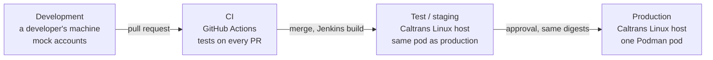
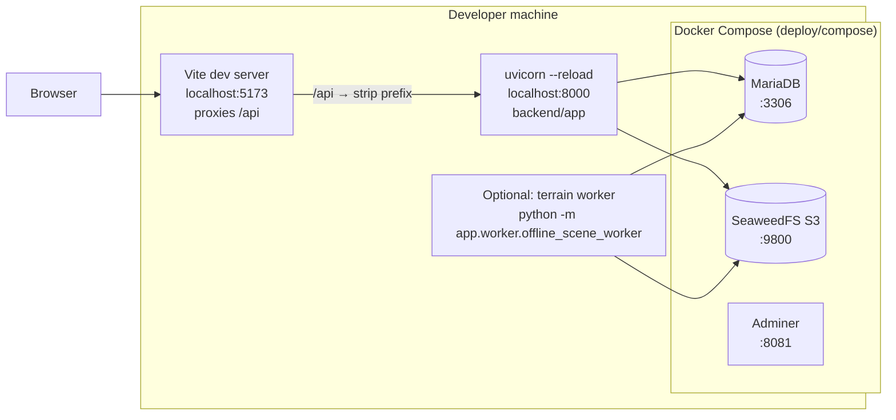
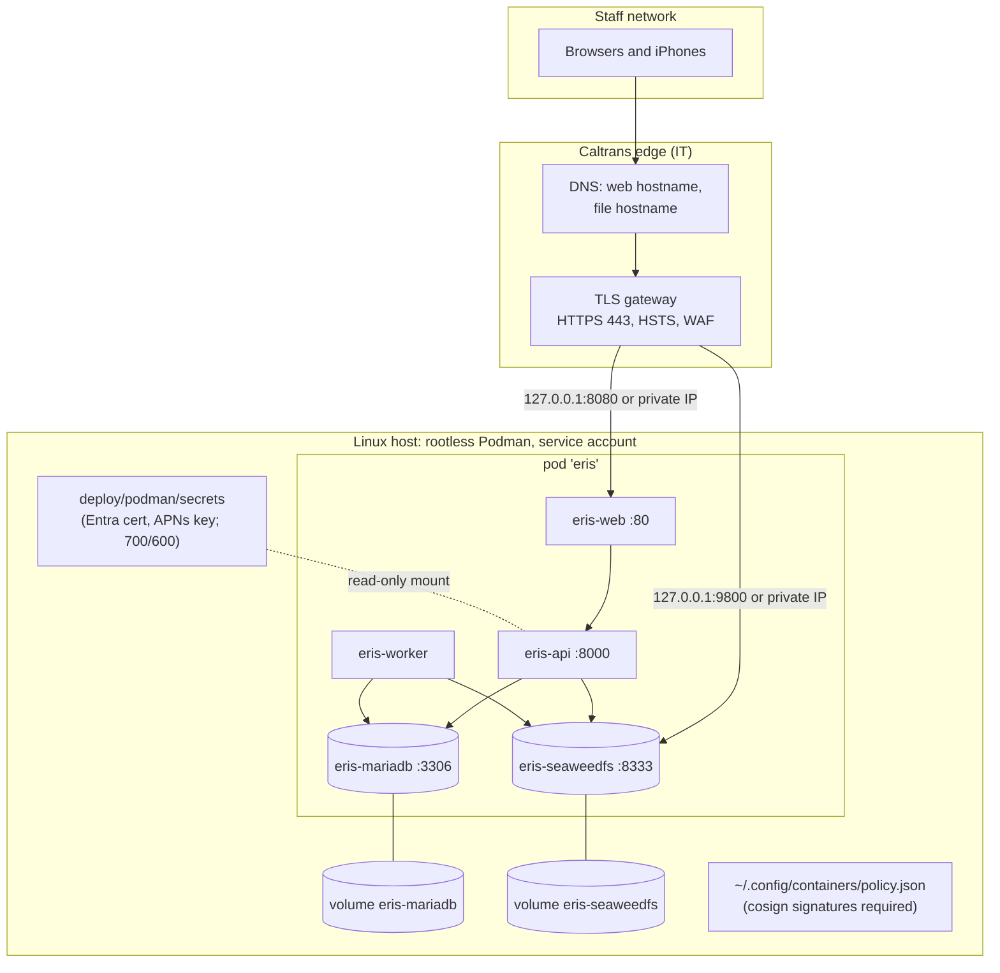
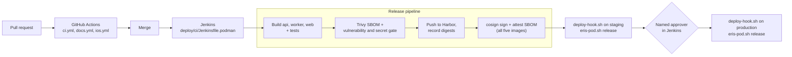

# Deployment topologies

Where each part of ERIS runs in each environment, which ports are open, and how
a change travels from a commit to production. How to launch each environment:
[operations](../operations/README.md).

## Environments at a glance

| | Development | Test / staging | Production |
| --- | --- | --- | --- |
| Where | Laptop | Caltrans host (separate from production) | Caltrans host |
| Runtime | Docker Compose for MariaDB + SeaweedFS; API and web run directly | One rootless Podman pod | One rootless Podman pod |
| Images | Built locally or none | Signed digests from Jenkins/Harbor | The same signed digests, after approval |
| Sign-in | Mock accounts with passwords (`LOCAL_LOGIN_ENABLED=true`) | Entra test tenant or staging app registration | Entra only |
| Data | Disposable | Disposable, or a copy for rehearsals (authorized) | Live |
| Guide | [Getting started](../development/getting-started.md) | [Operations](../operations/README.md#test-staging) | [Caltrans Podman runbook](../operations/caltrans-podman.md) |

## Development

The Vite proxy keeps the browser on one origin, exactly like production, so the
HttpOnly session cookie works in development too.

## Caltrans production (and staging)

### Ports

| Port | Where | Exposed to | Purpose |
| --- | --- | --- | --- |
| 443 | TLS gateway | Staff network | `eris.<domain>` (web + `/api`) and `eris-files.<domain>` (signed files) |
| 8080 | Host (loopback or private IP) | The gateway only | Pod port 80: nginx, SPA and `/api` |
| 9800 | Host (loopback or private IP) | The gateway only | Pod port 8333: SeaweedFS S3 |
| 8000, 3306, 8333, 9333, 8888, 23646 | Inside the pod | Nothing | API, MariaDB, SeaweedFS internals (`verify-rehearsal.sh` fails if published) |

### Outbound traffic the host needs

| To | For | Required |
| --- | --- | --- |
| `login.microsoftonline.com` (or `.us`) | Entra sign-in, signing keys | Yes |
| Harbor | Pulling the five signed images | Yes |
| `api.push.apple.com:443` | iPhone push | If push is enabled |
| SMTP relay | Email notifications | If email is enabled |
| USGS, Esri, Caltrans GIS, Census | Terrain packages, elevation, postmiles | For those features |
| Backup target | Off-host backups | Yes |

## The release path

Each `release` on a host pulls under the signature policy, takes a matched
backup, migrates, verifies, and rolls back by itself on failure
([runbook](../operations/caltrans-podman.md#releases-one-command-automatic-rollback)).

## Legacy and rehearsal stacks

- **Docker Compose server stack** (`deploy/compose/docker-compose.yml` +
  `docker-compose.proxmox.yml`): how ERIS ran before the Podman pod. Kept for
  development parity and history; documented in [Compose deployment](../operations/compose-deployment.md).
- **Campos Labs Proxmox rehearsal**: a rehearsal of the Caltrans pod on personal
  infrastructure, recorded in [history](../operations/history/proxmox-podman-cutover.md).
  Not a Caltrans environment; see the [handover checklist](../handover/README.md#before-the-original-author-leaves-checklist).
