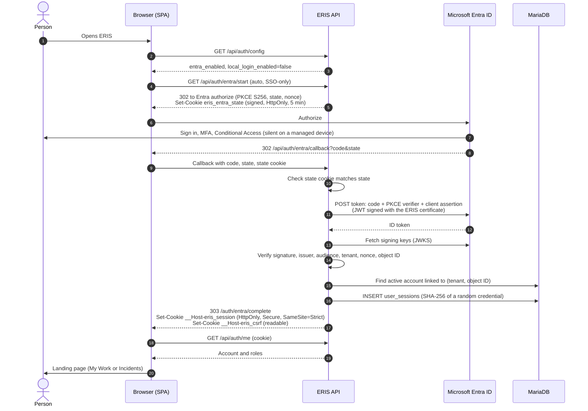
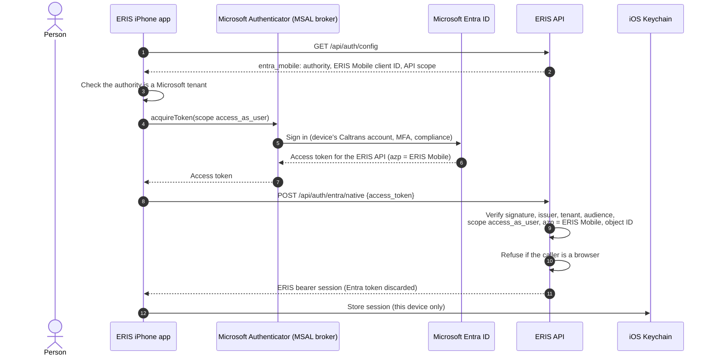
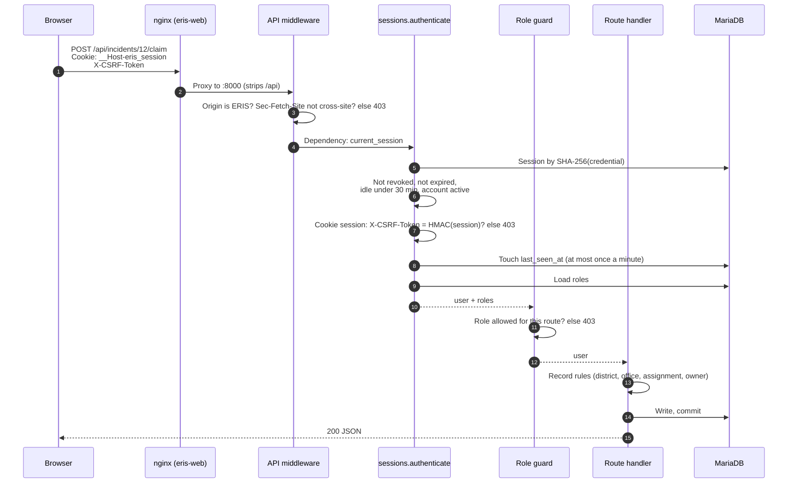
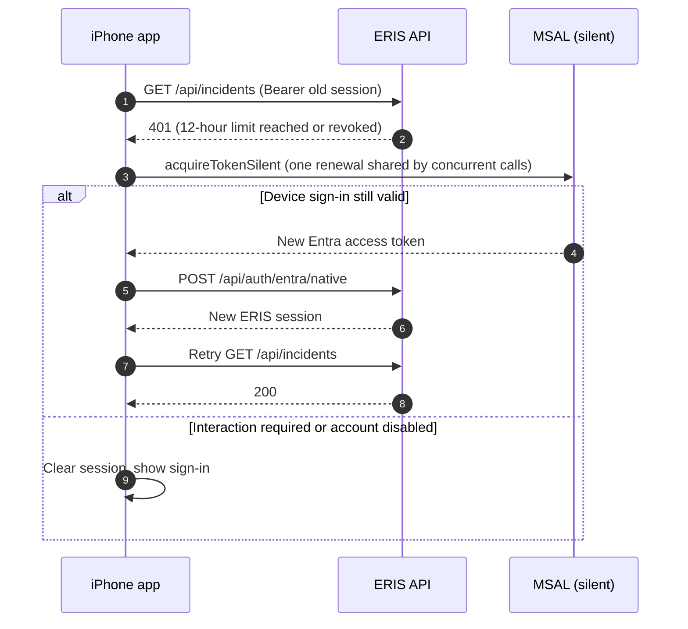
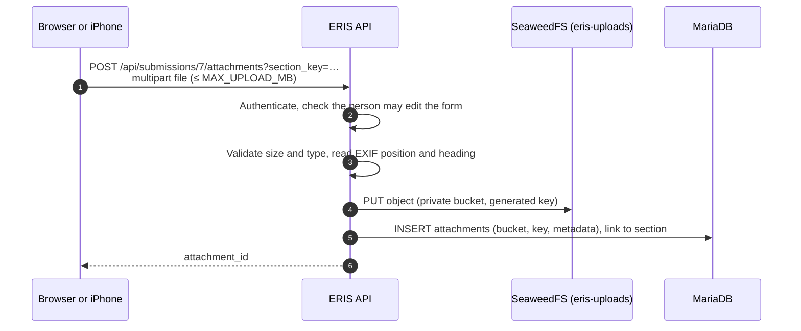
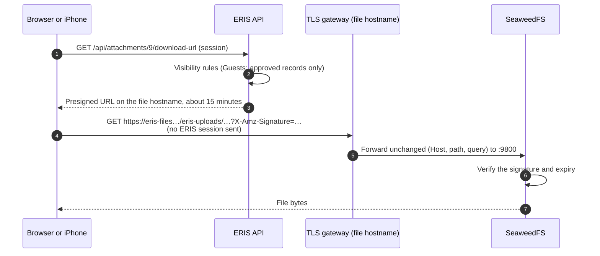
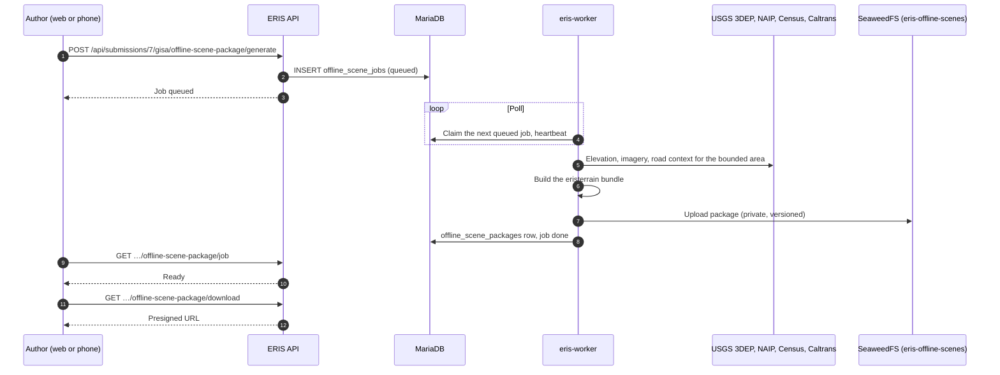
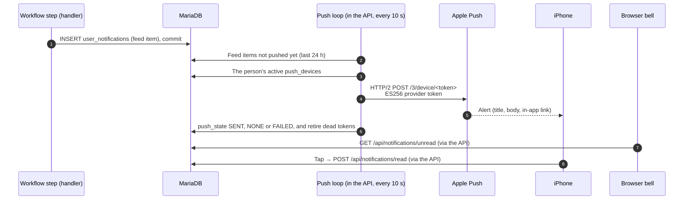
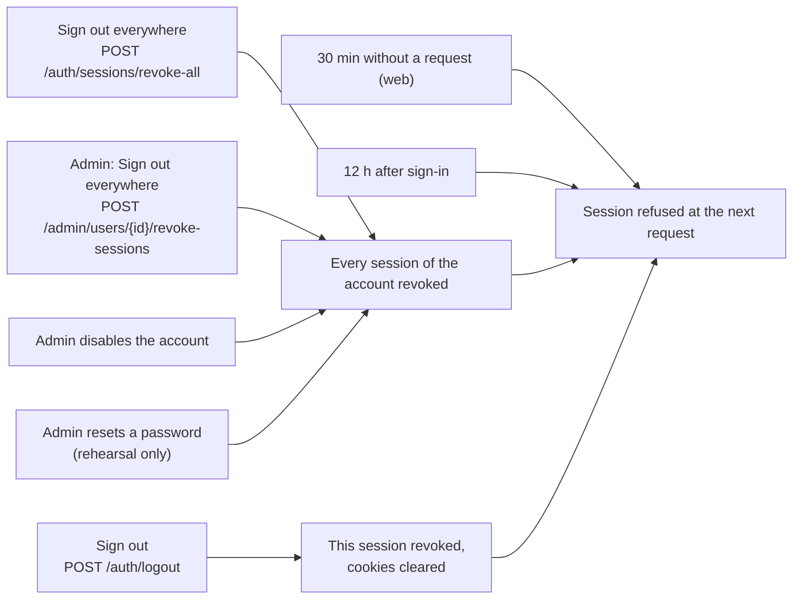

# Request flows

How a request travels through ERIS, step by step. Each diagram names the code
that does the work, so you can follow it in the source.

- [Web sign-in through Entra](#web-sign-in-through-entra)
- [iPhone sign-in through MSAL](#iphone-sign-in-through-msal)
- [An authenticated write from the browser](#an-authenticated-write-from-the-browser)
- [Session expiry and silent renewal on the iPhone](#session-expiry-and-silent-renewal-on-the-iphone)
- [Uploading a photo](#uploading-a-photo)
- [Downloading a file through a presigned URL](#downloading-a-file-through-a-presigned-url)
- [Generating an offline terrain package](#generating-an-offline-terrain-package)
- [Notifications and push](#notifications-and-push)
- [Sign-out and revocation](#sign-out-and-revocation)

## Web sign-in through Entra

Code: `backend/app/entra.py`, `backend/app/routes/auth.py` (`start_session`),
`backend/app/sessions.py`, `backend/app/entra_credential.py`,
`web/src/pages/LoginPage.tsx`, `web/src/pages/EntraCompletePage.tsx`.

If anything fails, the API redirects to `/login?entra=cancelled|failed|not_linked|unavailable`
and logs the reason on the `eris.auth` logger. Nothing in the URL or page script
can carry a session.

## iPhone sign-in through MSAL

Code: `ios/ERISKit/Sources/ERISKit/Auth/AuthService.swift`,
`ios/ERIS/Platform/MSALTokenProvider.swift`, `backend/app/entra.py` (`native`).

## An authenticated write from the browser

Code: `backend/app/main.py` (`refuse_cross_site_writes`), `backend/app/sessions.py`
(`check_origin`, `authenticate`), `backend/app/deps.py`, `web/src/api/client.ts`.

## Session expiry and silent renewal on the iPhone

Code: `ios/ERISKit/Sources/ERISKit/API/APIClient.swift` (`RenewalGate`).

## Uploading a photo

Code: `backend/app/main.py` (submission attachments), `backend/app/routes/incidents.py`
(incident attachments), `backend/app/storage.py`, `backend/app/services/field_media_*.py`.

File bytes are never stored in MariaDB; tables hold the bucket and key.

## Downloading a file through a presigned URL

Code: `backend/app/main.py` (`/attachments/{id}/download-url`), `backend/app/storage.py`.

Anyone holding an unexpired presigned URL can fetch the file, so gateways should
not log query strings.

## Generating an offline terrain package

Code: `backend/app/services/offline_scene_jobs.py`, `backend/app/worker/offline_scene_worker.py`,
`backend/app/services/offline_scene_*.py`. Operator detail:
[offline scene packages](../operations/offline-scene-packages.md).

## Notifications and push

Code: `backend/app/services/notification_feed.py`, `push.py`, `apns.py`,
`notifications.py` (email), `backend/app/routes/notifications.py`.

Email (when `SMTP_*` is set) goes through an outbox table and is retried at
startup and by `app.tools.flush_email_outbox`.

## Sign-out and revocation

Code: `backend/app/routes/auth.py`, `backend/app/admin_users.py`, `backend/app/sessions.py`.

