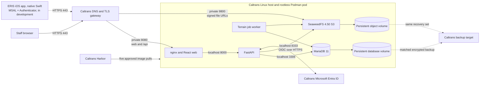
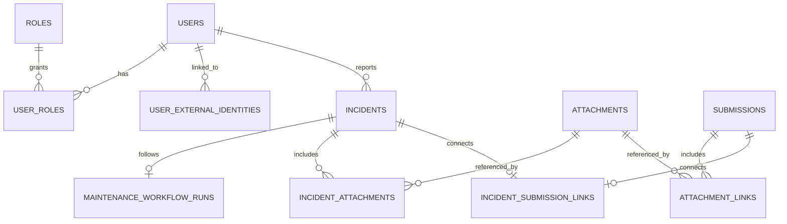

# ERIS deployment briefing for Caltrans IT

**Discussion copy — 2026-10-26, updated 2026-10-28.** This describes the proposed Caltrans deployment, not an approved Caltrans production service. The [four-page PDF handout](../output/pdf/eris-caltrans-it-briefing.pdf) is for calls (regenerated 2026-10-28 with `scripts/build_caltrans_it_briefing.py`; see the [readiness audit](caltrans-readiness-audit.md)); the [operator runbook](caltrans-podman.md) has commands and configuration details. Record Caltrans decisions in the table near the end before a production date is set.

## The 60-second explanation

ERIS is a browser-based incident and geotechnical assessment system. Staff sign in only through Caltrans Entra single sign-on (no ERIS passwords). The proposed deployment is **one rootless Linux Podman pod containing five containers**: nginx/web, FastAPI, a background terrain worker, MariaDB, and SeaweedFS object storage. MariaDB and SeaweedFS each have a persistent named volume. Caltrans IT would own the host, DNS/TLS gateway, Jenkins, Harbor, Entra registration, secrets, monitoring, and backups. The ERIS team supplies the source, container build pipeline, deployment scripts, configuration templates, and application support.

Our [Campos Labs Proxmox deployment](proxmox-podman-cutover.md) exercises this pod with migrated ERIS data. It currently uses local image tags, Cloudflare/Caddy, and password sign-in. It **does not** prove Caltrans Harbor, Jenkins, Entra, network policy, or recovery. The first decision is whether Caltrans's “single pod” requirement actually means a Podman pod on a Linux host; if it means a Kubernetes/OpenShift Pod, the deployment artifacts need adaptation.

## Diagram 1 — runtime and trust boundaries

The gateway and Harbor are **outside** the pod. The gateway may run on the same host, using loopback `127.0.0.1:8080/9800`, or elsewhere, using a private interface and firewall rules. MariaDB port 3306, API port 8000, and SeaweedFS internal S3 port 8333 are not published on the host. The browser reaches the web/API origin and a second HTTPS S3 hostname; signed S3 requests must preserve Host, path, query string, and encoding through the gateway.

| Flow | Needed for | Decision/owner |
| --- | --- | --- |
| Staff browser → web hostname, HTTPS 443 | App and same-origin `/api/*` | Caltrans DNS/TLS owner |
| Browser → file hostname, HTTPS 443 | Signed downloads issued by the API | Caltrans DNS/TLS owner |
| TLS gateway → host 8080 and 9800 | Web/API and S3 proxy | Firewall/gateway owner; loopback if co-hosted |
| Host → Harbor | Pull five approved images | Registry/network owner |
| API → Entra authority, HTTPS 443 | Web sign-in and signing keys | Identity/network owner; choose commercial or Government cloud |
| Worker/API/browser → GIS services | Optional maps and terrain jobs | Approve the actual source list for enabled features |
| API → SMTP / Apple Push (APNs) | Optional email / iPhone push (`api.push.apple.com:443`, HTTP/2) | Push is approved; permit APNs egress. SMTP if email is enabled |
| Host → backup/logging services | Recovery and operations | Storage/SIEM owners |

## Diagram 2 — how images reach the pod

```mermaid
flowchart LR
    Source[Approved ERIS source commit] --> Jenkins[Caltrans Jenkins agent<br/>Podman build and tests]
    ThirdParty[IT-approved MariaDB and SeaweedFS mirrors] --> Gate
    Jenkins --> Gate[SBOM + vulnerability and secret gate<br/>Trivy, all five images]
    Gate -->|pass only| Sign[Push, sign digests and attest SBOMs<br/>cosign, Caltrans key]
    Sign --> Harbor[Caltrans Harbor project]
    Harbor --> Review[IT review and approval<br/>of digests, SBOMs and reports]
    Review --> Host[Podman host pulls five digests<br/>signature policy enforced]
    Host --> Configure[IT supplies runtime secrets<br/>through approved process]
    Configure --> Start[Create pod and volumes<br/>apply Alembic schema migrations, create buckets, seed admin]
    Start --> Verify[Health, Entra, permissions,<br/>file transfer, restart and restore tests]
```

The supplied [`Jenkinsfile.podman`](../Jenkinsfile.podman) **builds, gates, signs and publishes**, and can optionally release to staging and then production (below). After the deployment-script and backend security tests, [Trivy](https://trivy.dev/) writes a CycloneDX **SBOM** for each image and **fails the release** on a fixable HIGH/CRITICAL vulnerability or an embedded secret, before anything is pushed. Exceptions need a reasoned, expiring entry in `.trivyignore`. The two IT-approved third-party mirrors pass the same gate. All five digests are then **signed with cosign** using a Caltrans-held key, each SBOM is attached as a signed attestation in Harbor (no public transparency log), and each signature is verified. The build archives `release-images.env` (five digests), the SBOMs, the scan reports and the public key. On the host, a Podman signature policy rejects any ERIS image whose signature does not verify, and `ERIS_REQUIRE_DIGESTS=true` refuses tags. Jenkins needs an approved **Linux** agent with Podman, Harbor reachability, memory for the web build's 4 GiB Node heap, and three credentials: the `harbor-eris-robot` push robot, the cosign key file and its password. The tool images should be mirrored into Harbor; an offline agent also needs the Trivy database mirrored. The host gets a separate pull-only robot. [Harbor supports project robot permissions](https://goharbor.io/cli-docs/cli-docs/harbor-project-robot-create/), [vulnerability scanning](https://goharbor.io/docs/main/administration/vulnerability-scanning/) and cosign signature enforcement as additional gates, subject to Caltrans configuration.

## Stack and data

| Layer | Proposed component | What persists |
| --- | --- | --- |
| Web | nginx 1.27 Alpine serving React 19 / Vite 7 / Tailwind 4 | No application data; replaceable image |
| API | Python 3.12, FastAPI, SQLAlchemy, Alembic | Reads/writes MariaDB and S3 |
| Worker | Separate Python/GIS image, background terrain job processor | Jobs/results in MariaDB and S3 |
| Relational database | MariaDB 11 | Users and ERIS roles, organizations, incidents, assessments, workflow state, metadata, audit/event records, object references |
| Object store | SeaweedFS 4.50 S3 interface | Photos, attachments, generated PDFs, offline terrain/road packages |
| Outside pod | Caltrans TLS gateway, Jenkins, Harbor, Entra, backup/monitoring | Owned and operated per Caltrans policy |

The [SeaweedFS 4.50 source tag carries an Apache-2.0 license](https://github.com/seaweedfs/seaweedfs/blob/4.50/LICENSE); the [MariaDB Server project states GPLv2](https://mariadb.org/about/). These references are a starting point for Caltrans's review of the **exact images, dependencies, redistribution obligations, and support model**, not a completed license approval. The proposed SeaweedFS image is the community project, not SeaweedFS Enterprise.

### Simplified relational view

This is a discussion diagram, not the complete schema. Organization, assessments, events, terrain jobs, and other tables are omitted. `attachments` holds metadata and an S3 bucket/key; file bytes are in SeaweedFS. The [schema](../database/init/010_schema.sql) and [Alembic migrations](../backend/migrations/versions) are the authoritative physical model. Typical records include employee names/emails, incident locations, photos, technical reports, and audit events; Caltrans must classify them before deciding retention and export policy.

On a **fresh** install, initialization creates the database schema, eight roles, and minimum organization structure, with **no demo users**. Alembic moves the schema to the current revision; storage bootstrap creates private buckets; then a one-time admin is created or linked. The bootstrap marker prevents a later restart from recreating a disabled initial admin. A populated, unversioned database is deliberately refused. The schema and migrations are in [`database/init`](../database/init) and [`backend/migrations`](../backend/migrations). An import from the Campos Labs environment would be a **separate data migration and authorization decision**; it is not part of the fresh-install procedure.

The persistent set is the MariaDB volume **plus** the SeaweedFS volume **plus** their runtime secrets/configuration. Back up and restore them together. The `eris-uploads` bucket is private. The `eris-offline-scenes` bucket is private and versioned with Object Lock capability, but no retention duration is set automatically. File URLs are normally presigned for 15 minutes; anyone holding an unexpired signed URL can use it, so gateway logs should avoid recording query strings. Caltrans sets data classification, retention, legal hold, encryption at rest, backup encryption, RPO/RTO, and restore-test frequency. A single host is a single point of failure; this proposal is not an HA design.

The Proxmox rehearsal used 4 vCPU, 8 GiB RAM, and an 80 GB disk. The runbook budgets **at least 8 GiB runtime RAM**; Caltrans should size CPU and disk from expected users, evidence, and terrain packages. Jenkins build resources are separate from runtime sizing; the web build uses a 4 GiB Node heap.

## Identity, access, and security facts

| Topic | What ERIS implements today | Caltrans decision or acceptance test |
| --- | --- | --- |
| Entra web sign-in | Single-tenant OIDC authorization code with PKCE. The API validates signing key, issuer, audience, tenant, nonce, and the user's object ID. The exact web redirect is `https://<web-host>/api/auth/entra/callback`. | Choose tenant/cloud and create a **Web** app registration and credential; test real accounts, MFA/Conditional Access, and callback through Caltrans TLS. [Microsoft requires an exact registered redirect URI](https://learn.microsoft.com/en-us/entra/identity-platform/v2-oauth2-auth-code-flow). |
| Authority | Code permits `login.microsoftonline.com` or `login.microsoftonline.us`. | Identity team confirms which tenant/cloud applies. [Microsoft documents the Government authority](https://learn.microsoft.com/en-us/troubleshoot/entra/entra-id/app-integration/error-aadsts900439-usgclientnotsupportedonpublicendpoint). |
| Entra credential | **Certificate credential, no client secret.** The API signs a short-lived client assertion (PS256, `x5t#S256`) with a private key kept on the host and mounted only into the API container. Production refuses to start with Entra on and no certificate, and refuses a secret. `eris-pod.sh cert-check` shows the thumbprint and expiry, and verification fails within 30 days of expiry. It does not call Microsoft Graph for sign-in. | Issue the certificate (Caltrans PKI or self-signed, per policy), upload it to the app registration, and own its rotation. |
| User provisioning | Entra proves identity; ERIS holds roles. An admin explicitly links an active ERIS account by tenant ID + Entra **user object ID**. No email-based auto-link or automatic provisioning. The Caltrans template is **Entra-only**: `LOCAL_LOGIN_ENABLED=false`, the first admin is seeded by object ID, and the API refuses to set any password. Opening ERIS goes straight to Entra sign-in. | Recommended: set the enterprise app to **Assignment required** with an ERIS group, and a Conditional Access policy requiring MFA. Decide provisioning/offboarding owner and procedure; test linked, unknown, unassigned and disabled users. |
| ERIS session | **Server-side sessions** (OWASP Session Management): a random 256-bit credential in a `__Host-` cookie marked HttpOnly, Secure, SameSite=Strict, with no expiry set. Page scripts cannot read it and the database stores only its hash. Writes need a signed double-submit CSRF token, and cross-origin browser writes are refused. Sessions end after 30 idle minutes and 12 hours in total (NIST SP 800-63B AAL2; configurable down). **Sign out** ends that browser's session. **Sign out everywhere**, disabling the account, or an admin revoke ends all of them. Roles and the active flag are checked on every request. | Confirm the idle/absolute limits against Caltrans policy. Disabling only the Entra identity does not end an existing ERIS session; offboarding must also disable the ERIS account. |
| Network/TLS | The pod speaks localhost HTTP/TCP internally; external HTTPS is terminated by an IT gateway. DB is not host-published. S3 buckets are private with presigned URLs. nginx sends `nosniff`, a referrer policy, and same-origin framing limits. | Gateway certificates, HSTS, a full script/style CSP (needs the ArcGIS/map source list), rate limits/WAF, upload limit (at least configured `MAX_UPLOAD_MB`, default 95 MB), and firewall policy. nginx does not set HSTS, a full CSP, or an application rate limit. |
| Secrets | Runtime `app.env`, `db.env`, `storage.env`, `bootstrap.env` are mode 600 files; Jenkins uses a credential for Harbor push. No secrets belong in images or `VITE_*` build values. | Approved vault/injection and rotation process; host access controls; keep the JWT key stable unless intentionally ending sessions. No vault integration is supplied. |
| Logging/recovery | Application events and container logs exist, including an `eris.auth` log of sign-ins, refusals, sign-outs and revocations (no tokens). `eris-pod.sh backup`/`verify-backup`/`restore` produce and restore a checksummed, matched DB + object + config set into new volumes. A read-only script checks containers against pinned images, exposed ports, env file modes, health, API docs, the Entra redirect, bucket privacy and Alembic head. | SIEM forwarding, log retention/redaction, alerting, encryption and off-host transfer of backups, and a restore drill on Caltrans storage. The backup scripts are tested against a stub Podman only; the current Campos Labs backups are not yet an off-host recovery proof. |

The web never holds a token: the Entra callback puts the session straight into HttpOnly cookies, so nothing usable appears in a URL, browser history, or page script. Do not describe Entra integration as approved until Caltrans tests it in their tenant. A failed or refused Entra sign-in returns to the ERIS sign-in page with a short reason rather than an API error, and never redirects in a loop. ERIS does not verify MFA itself; it relies on Caltrans's Conditional Access. **Mobile sign-in** is implemented as a separate **public** Entra client, following [RFC 8252](https://www.rfc-editor.org/rfc/rfc8252): the system browser, authorization code + PKCE, and no secret in the app (as [Microsoft requires](https://learn.microsoft.com/en-us/entra/identity-platform/v2-oauth2-auth-code-flow)). The app gets an access token for the ERIS API scope. ERIS checks that the token was issued to the ERIS mobile app for that scope in the tenant, then exchanges it once for a revocable ERIS session. It has unit tests but has **not** been tested on a device against a Caltrans tenant.

## How a clean Caltrans deployment would proceed

1. **Agree on the platform and controls.** Confirm Podman versus Kubernetes/OpenShift, whether MariaDB and S3 may live in the same pod, data classification, host/network design, Entra policy, Harbor/Jenkins gates, and RPO/RTO. Identify release, security, DB, identity, network, and application owners.
2. **Create a staging lane.** Caltrans supplies a Linux host, rootless Podman service account, two persistent volumes, approved backup target, two HTTPS names, gateway/firewall rules, Entra test app registration, Jenkins agent, and Harbor project. Allow only agreed outbound destinations.
3. **Build and approve images.** Check out an immutable ERIS commit. IT mirrors MariaDB/SeaweedFS. Jenkins builds API/worker/web, gates all five (SBOM, vulnerabilities, secrets), pushes, and signs and attests them. IT reviews the SBOMs and reports (licenses included), approves the five digests, and installs the signature policy on the host, which proves pull access with its separate robot account.
4. **Set runtime configuration securely.** Use the examples in [`deploy/podman`](../deploy/podman). IT supplies DB/S3/JWT/Entra secrets through its approved mechanism. Match the database and S3 credentials across files; set exact public URLs, CORS origin, and Entra callback. Do not send populated env files in email or tickets.
5. **Run first installation.** As the dedicated service account, run `bash deploy/podman/eris-pod.sh up`. It creates the pod/volumes, initializes MariaDB, applies migrations, verifies buckets, seeds one initial administrator, and starts API, worker, and web. Install the user systemd unit for reboot recovery. The [runbook](caltrans-podman.md#first-installation) has exact commands and failure handling.
6. **Prove the entire path in staging.** Run [`verify-rehearsal.sh`](../deploy/podman/verify-rehearsal.sh) with the web and file URLs, then test the public HTTPS web/API, an evidence upload through the ERIS API and signed download through the S3 hostname, Entra linked/unknown/disabled users, administrator creation, incident workflow, pod restart, reboot, matched backup/restore, and a failed-release rollback. Record results and any accepted exceptions.
7. **Handover and production.** Create and verify at least two named Entra-linked administrators, delete `bootstrap.env` (ERIS refuses to disable the last active administrator), rotate any handover secrets, and record a passing `eris-pod.sh handover-check`. Repeat the approved release process for production. Caltrans sets the cutover/change window and monitoring.

For an **update**, Jenkins builds, gates and signs new images. With `DEPLOY_TO=staging-then-production`, it releases them to staging and then, after a named approval, the same digests to production. Each host runs `eris-pod.sh release` through an SSH forced command, so Jenkins has no shell on the host. That command pulls under the signature policy, takes a matched backup, migrates, verifies in production mode, and **rolls itself back** (previous images plus the pre-release data) if anything fails. Without Jenkins access to the hosts, an operator runs the same single command. Previously this was a manual sequence: build and approve new immutable images, capture a matched DB/S3 backup with `eris-pod.sh backup`, apply the release in staging, then update pinned references on the host. The supplied Jenkinsfile does not execute that host step. A web-only rollback can restore the previous web image. API/database rollback after a forward migration may require restoring both data volumes and config together; do not assume an older API understands a newer schema.

## What to ask Caltrans IT in the first call

Write down a named owner and answer for each row. An unresolved item is a deployment gate, not an assumed default.

| Priority | Ask them | Why it matters / answer to capture |
| --- | --- | --- |
| 1 | Does “single pod” mean **Podman on one Linux VM**, or Kubernetes/OpenShift? Are stateful MariaDB and S3 allowed in that pod? | Determines whether these scripts are usable as written. |
| 1 | Which Caltrans network/security zone and data classification will ERIS use? Is this a clean install or an authorized import of existing data? | Controls connectivity, retention, reviews, and migration scope. |
| 1 | Who owns the Linux host, rootless service account, disk, SELinux policy, and updates? What CPU/RAM/storage are approved? | Host prerequisites and operational ownership. |
| 1 | Who provides the **web** and **file** DNS names, TLS certificates, gateway, WAF, and firewall rules? Is the gateway co-hosted or remote? | Determines `WEB_BASE_URL`, `S3_PUBLIC_ENDPOINT`, callback, and bind address. |
| 1 | Which Entra tenant/cloud is used? Who owns the Web app registration, exact redirect URI, client **certificate** (PKI or self-signed) and its rotation, first admin object ID, and Conditional Access tests? | Production requires a certificate credential; no client secret is used. |
| 1 | Do the 30-minute idle and 12-hour absolute session limits meet policy? Who disables ERIS accounts at offboarding? | Session settings and the offboarding procedure. |
| 1 | Who owns the Harbor project, Jenkins agent, cosign signing key, mirrored tool images and the vulnerability-exception approvals? May Jenkins reach the hosts over SSH (forced-command deploy key) and who approves production releases? | The pipeline signs with a Caltrans-held key and fails on fixable HIGH/CRITICAL findings; releases self-verify and roll back. Without SSH from Jenkins, operators run one command. |
| 1 | Where will encrypted **matched DB + S3 + config** backups go? What are retention, RPO/RTO, and restore-test requirements? | Single-host failure otherwise loses the service. |
| 1 | Is a single-host service interruption acceptable, or does Caltrans require a failover target? | This deployment has no automatic failover; RPO/RTO alone does not settle availability. |
| 1 | Is browser 3D ArcGIS or Esri offline processing required in the first release? Who supplies a restricted browser API key? | The current Podman web build does not pass `VITE_ARCGIS_API_KEY`; Esri-specific worker sidecars need configuration and a staged test. |
| 2 | Which outbound services may the host and clients reach: Entra, Harbor, GIS, SMTP, Expo? Are proxies required? | Core sign-in needs Entra; optional features have different egress. |
| 2 | Who receives logs/alerts, owns incidents and patch windows, and approves go-live/rollback? | Defines the operating model. |
| 2 | What penetration test, accessibility, privacy, records-retention, and change-control evidence is required? | Prevents a late approval surprise. |
| 2 | For the ERIS iOS app: confirm the Conditional Access grant (a Caltrans iPhone check suggests **compliant device**, not app protection); allow the ERIS bundle ID in the Enterprise SSO plug-in; register ERIS Mobile (iOS platform, bundle ID); and name owners for the Enterprise distribution certificate, the yearly provisioning profile renewal, the APNs auth key and the Intune line-of-business assignment. | The app will be native Swift with MSAL, and push uses APNs; the server side is done. |

## What to hand out

**Before the technical call:** this briefing; the [Podman runbook](caltrans-podman.md); [architecture/data model](architecture.md); [role model](roles-and-identity.md); [Jenkinsfile](../Jenkinsfile.podman); [`deploy/podman` templates and scripts](../deploy/podman); a specific source commit and the [Campos Labs rehearsal record](proxmox-podman-cutover.md) labeled as rehearsal evidence. Offer a live screen share of the web workflow.

**After Caltrans settles the design:** an agreed network diagram with real hostnames, port/egress allowlist, five approved image digests, signed/scan/SBOM evidence if required, a completed **non-secret** configuration worksheet, staging test record, backup/restore record, release and rollback steps, administrator handover record, support contacts, and open-risk decisions. Pass credentials and populated env values only through Caltrans's approved secret channel.

## Questions they are likely to ask you

| Question | Direct answer today |
| --- | --- |
| “Is this one image?” | No. It is one Podman pod with five containers and two persistent volumes. |
| “Where do the images come from?” | Caltrans Jenkins builds our three application images from an approved commit and pushes them to Caltrans Harbor. IT mirrors the MariaDB and SeaweedFS images. The host pulls five approved digests. |
| “What about SeaweedFS licensing?” | The upstream 4.50 source tag carries Apache-2.0; Caltrans must review the exact image and dependency inventory. No SeaweedFS Enterprise image is in this design. |
| “Do you require a managed database?” | The supplied design uses MariaDB 11 in the pod. If policy requires a managed DB or external object store, we must adjust and test the topology. |
| “What leaves the network?” | Entra and Harbor are required for the proposed flow. GIS, SMTP, and Expo depend on enabled features. Browsers also fetch map/data sources where configured. We need an approved egress inventory for their environment. |
| “Do people use passwords?” | No. Caltrans production is Entra SSO only; ERIS refuses to create or reset passwords. MFA and device rules come from Caltrans Conditional Access. |
| “Who can become an administrator?” | Only an authorized ERIS admin grants ERIS roles. Entra authentication alone does not grant ERIS access; users are prelinked by tenant and object ID. |
| “Will disabling an Entra user immediately stop ERIS?” | It blocks new sign-ins at once. An existing ERIS session lasts until its 30-minute idle limit, unless the ERIS account is also disabled or signed out everywhere, which takes effect at the next request. |
| “Is this highly available?” | No. A single host is a single point of failure; recovery is from a tested matched backup. |
| “Is the mobile app ready?” | Not yet. It will be a native Swift iPhone app (no Android), signed with Caltrans's Enterprise developer account and delivered through Intune and Company Portal. It signs in with MSAL through Microsoft Authenticator and receives push through APNs. The server side (token exchange, sessions, revocation, APNs sender) is implemented and tested; see the [iOS app specification](ios-native-app.md). |
| “Is security approval complete?” | No Caltrans approval is claimed. Implemented and tested in code: server-side sessions, SSO-only sign-in, certificate credential, signed and SBOM-attested images with a vulnerability gate, and backups. Caltrans identity, scan policy, gateway, logging, recovery and governance checks remain. |

## Decision record for the call

| Decision | Answer / owner / due date |
| --- | --- |
| Podman pod accepted; stateful services accepted |  |
| Caltrans environment and data import scope |  |
| Host OS, Podman version, capacity, service account |  |
| Web and S3 DNS/TLS names; gateway placement |  |
| Entra tenant/cloud, app registration, first admin object ID |  |
| Client certificate issuer, rotation owner and expiry monitoring |  |
| Session idle/absolute limits and offboarding procedure |  |
| Harbor/Jenkins owner and supply-chain gates |  |
| Backup target, RPO/RTO, retention, restore-test owner |  |
| Single-host availability accepted or failover target defined |  |
| Browser ArcGIS / Esri offline scope and API key owner |  |
| Egress, logging, WAF and security review owner |  |
| Staging date, acceptance owner, production change window |  |

## Source of truth and limits

The [Podman runbook](caltrans-podman.md), [`eris-pod.sh`](../deploy/podman/eris-pod.sh), [runtime env examples](../deploy/podman), [Entra implementation](../backend/app/entra.py), and [Jenkinsfile](../Jenkinsfile.podman) define the shipped behavior. This briefing is for discussion and does not replace a Caltrans architecture/security review. The Podman worker currently runs the **generic** terrain job entrypoint; Esri-specific high-fidelity offline sidecars require additional runtime configuration and a staged job test. The Podman web build does not currently pass `VITE_ARCGIS_API_KEY`, so browser 3D ArcGIS requires a build change and a restricted key. Do not promise these features as part of the first deployment until they pass staging. The mobile Entra flow likewise needs a device test and acceptance before release.
