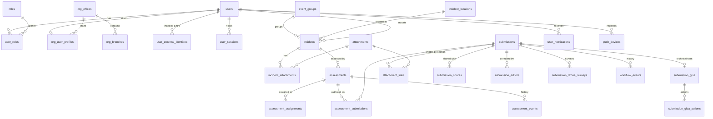
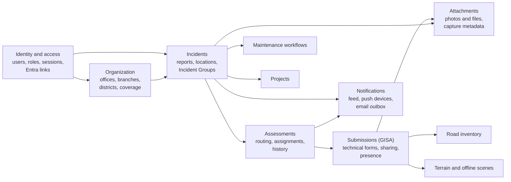
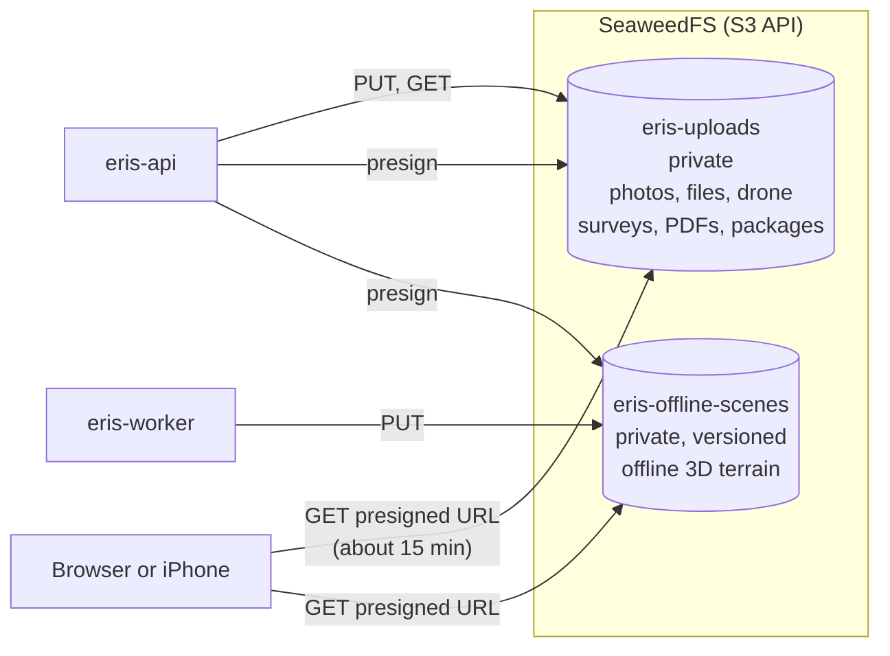

# Data model

ERIS keeps structured data in **MariaDB 11** (61 tables) and file bytes
in **SeaweedFS** object storage (S3 API). Tables hold the bucket and key of
each file, never the bytes.

| Page | Content |
| --- | --- |
| [Entity-relationship diagrams](erd.md) | Generated from a fully migrated database: one diagram per domain, every table and foreign key |
| [Schema reference](schema-reference.md) | Generated: every table, column, type, key and index |
| [Migrations](migrations.md) | How the schema is created and changed; Alembic rules |
| [GISA data dictionary](../reference/gisa-data-dictionary.md) | Meaning of every technical-form field |
| [Storage migration](storage-migration.md) | Moving an older deployment from MinIO to SeaweedFS |

The generated pages are rebuilt by
`python scripts/docs/generate_schema_docs.py --url <database URL>` and checked
in CI, so they cannot drift from the migrations.

## Core entities

The heart of the model, simplified (the [generated ERD](erd.md) is complete):

| Entity | Table | Key facts |
| --- | --- | --- |
| Account | `users` | Email, name, active flag; `metadata_json` holds district coverage. No password in production. |
| Role | `roles`, `user_roles` | Eight current codes; see [roles](../security/roles-and-permissions.md). |
| Entra link | `user_external_identities` | `(tenant_id, object_id)` unique; how sign-in finds the account. |
| Session | `user_sessions` | SHA-256 of the credential, expiry, revocation ([sessions](../security/authentication-and-sessions.md#the-session-model)). |
| Organization | `org_*` | Offices, branches, districts served, coordinator coverage, where each person sits. |
| Incident | `incidents` | Location, district/county/route/postmile, `current_stage`, `status`; `incident_key` is the permanent ERIS number. |
| Incident Group | `event_groups` | Groups incidents from one event; open, closed, archived. |
| Assessment | `assessments` | Routing state, branch chief, assigned author; links to its submission. |
| Technical form | `submissions` + `submission_gisa` | Form status and the GISA fields ([data dictionary](../reference/gisa-data-dictionary.md)). |
| File | `attachments` | Bucket, key, MIME type, size, capture metadata; linked through `incident_attachments` and `attachment_links`. |
| Notification | `user_notifications` | Feed items, read state, push state. `incident_notifications` is the email outbox. |
| Push device | `push_devices` | APNs device tokens per account; retired when Apple reports them dead. |

## Domains

Each domain has its own diagram in the [generated ERD](erd.md).

## Database rules that live in MariaDB

Some rules are enforced by triggers so that no code path, script or manual
edit can break them:

| Trigger | Rule |
| --- | --- |
| `trg_incident_identity_bu` | The ERIS number (`incident_key`) never changes once assigned; leaving coordinator review requires an Incident Group and stamps approval provenance |
| `trg_incident_permanent_delete_bd` | Accepted incidents (with an ERIS number) cannot be hard-deleted |
| `trg_incident_event_group_*`, `trg_event_group_close_active_incidents_bu` | Incidents join only open groups; a group cannot close while any of its incidents is unresolved |
| `trg_*_engineer_elig_*` | Only eligible accounts can be assigned as authors |
| `trg_assessment_no_new_finalize` | The retired `FINALIZED` state cannot be entered again |
| `trg_incident_project_*`, `trg_project_close_active_incidents_bu` | Same rules for the older project grouping |

A trigger refusal surfaces as a database error with `SQLSTATE 45000` and a
readable message. The API checks the same rules first and answers with a clear
error; the trigger is the backstop.

## Object storage

| Bucket | Setting | Holds | Notes |
| --- | --- | --- | --- |
| `eris-uploads` | `S3_BUCKET` | Photos, documents, drone survey rasters, generated PDFs, road inventory packages | Private; anonymous listing and reads are refused (`verify-rehearsal.sh` checks) |
| `eris-offline-scenes` | `S3_OFFLINE_SCENES_BUCKET` | Offline 3D terrain packages | Private; **versioning must be on** (`eris-pod.sh` creates both buckets and turns it on) |

- Clients download through **presigned URLs** (default 900 seconds) on the
  separate file hostname (`S3_PUBLIC_ENDPOINT`), so large files never pass
  through the API. Visibility rules are checked before a URL is issued.
- The database and the buckets are one recovery set: `eris-pod.sh backup`
  captures both at the same moment. A database-only backup leaves records
  pointing at missing files.

## Data lifecycle and retention

| Data | Created | Removed |
| --- | --- | --- |
| Field reports closed at triage | Report | Kept (no ERIS number) so each decision can be traced |
| Accepted incidents | Triage | Never hard-deleted (trigger); resolved, not erased |
| Assessments and forms | Routing | Kept as the engineering record |
| Files | Upload | With their parent record, when that record may be deleted. Offline-scene objects left by a cancelled job are recorded in `offline_scene_orphaned_objects`; the count appears in `GET /api/ops/offline-scene/health` |
| Sessions | Sign-in | Ended sessions deleted after 90 days |
| Notifications | Workflow steps | Kept as the feed history |
| Backups | `eris-pod.sh backup` | Per Caltrans backup retention |

Caltrans records-retention schedules for engineering records apply; confirm
the schedule with the records officer before deleting any accepted record
under change control.

## Sensitive data

ERIS holds staff names, work emails, Entra object IDs, roles, IP addresses and
user agents of sessions, photo locations, and engineering records of state
assets. It holds no public-member personal data, no passwords in production,
and no payment data. Treat backups and database exports as confidential.
