# Database entity-relationship diagrams

> **Generated** by `scripts/docs/generate_schema_docs.py` from a fully migrated database. Do not edit by hand; CI fails when this file is stale. Column-level detail is in the [schema reference](schema-reference.md).

ERIS has **61 tables** in MariaDB. File bytes (photos, PDFs, terrain packages) are in S3 object storage; tables hold only their bucket and key. One diagram per domain follows; a table from another domain appears with its key only, so the links between domains stay visible.

## How the domains connect

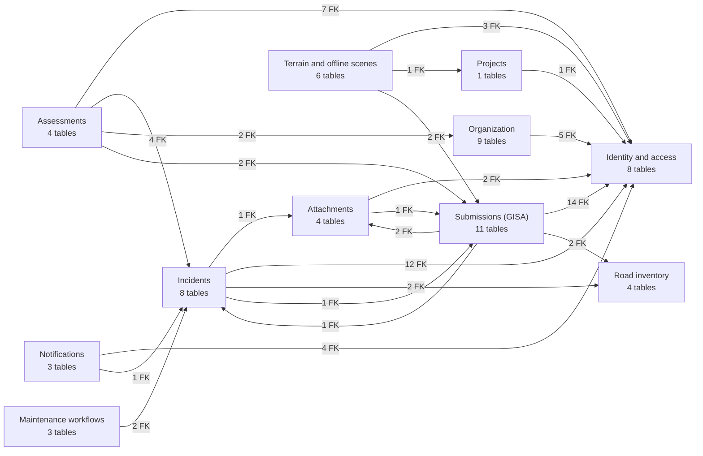

An arrow points from the domain holding the foreign key to the domain it references.

## Contents

- [Identity and access](#identity-and-access) (8 tables)
- [Organization](#organization) (9 tables)
- [Incidents](#incidents) (8 tables)
- [Assessments](#assessments) (4 tables)
- [Submissions (GISA)](#submissions-gisa) (11 tables)
- [Attachments](#attachments) (4 tables)
- [Notifications](#notifications) (3 tables)
- [Maintenance workflows](#maintenance-workflows) (3 tables)
- [Projects](#projects) (1 tables)
- [Road inventory](#road-inventory) (4 tables)
- [Terrain and offline scenes](#terrain-and-offline-scenes) (6 tables)

## Identity and access

Accounts, roles, sessions, Entra links, first-admin marker.

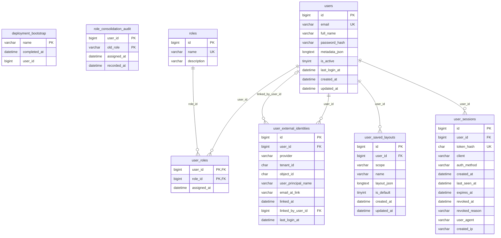

## Organization

GeoTech offices, branches, districts, coverage and where people sit.

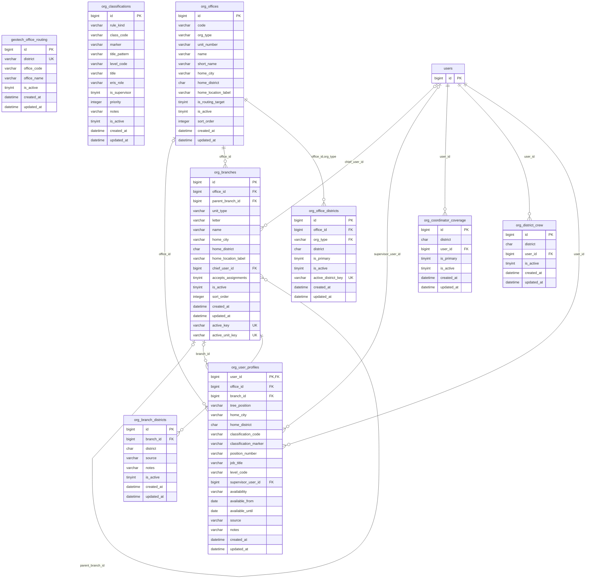

## Incidents

Field reports, locations, routing, assignments and event groups.

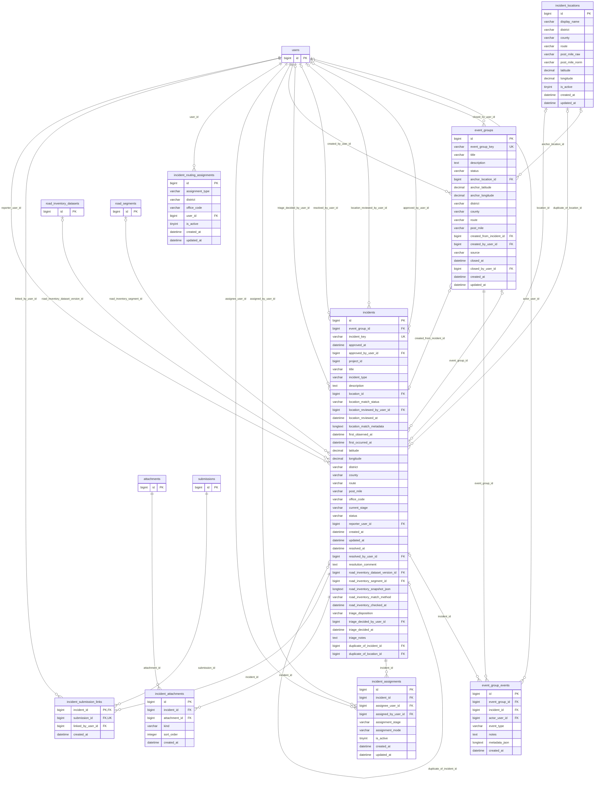

## Assessments

Technical assessments routed to Staff or Senior Specialists.

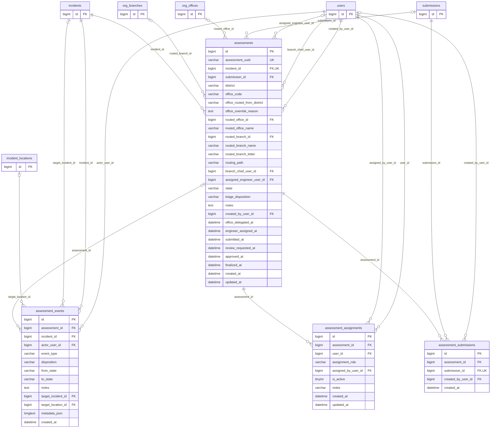

## Submissions (GISA)

The GISA technical form, its sharing, editors and workflow history.

```mermaid
erDiagram
    submission_drone_surveys {
        bigint id PK
        bigint submission_id FK
        varchar label
        varchar source
        date captured_on
        bigint created_by_user_id FK
        datetime created_at
        datetime updated_at
        varchar dsm_filename
        varchar ortho_filename
        bigint dsm_attachment_id FK
        bigint ortho_attachment_id FK
        varchar source_crs
        double west
        double south
        double east
        double north
        integer cols
        integer grid_rows
        double resolution_m
        varchar patch_object_key
        integer patch_size_bytes
        varchar overlay_object_key
        varchar overlay_mime
        longtext overlay_corners_json
        double vertical_offset_m
        varchar offset_mode
        longtext stats_json
        longtext comparison_json
        longtext points_json
        bigint compare_with_survey_id FK
    }
    submission_editors {
        bigint submission_id PK,FK
        bigint user_id PK,FK
        bigint granted_by_user_id FK
        datetime created_at
    }
    submission_gisa {
        bigint submission_id PK,FK
        bigint location_id FK
        date report_date
        varchar district
        varchar county
        varchar route
        varchar post_mile
        varchar ea
        varchar project_id
        date date_incident_reported
        text district_contact
        decimal latitude
        decimal longitude
        varchar distribution_code
        text highway_status_cause
        varchar highway_status_code
        integer lanes_closed_count
        integer open_highway_traffic_lanes_count
        longtext pavement_ground_annotation_layout_json
        tinyint pavement_ground_cracks
        decimal crack_length_ft
        decimal crack_horizontal_in
        decimal crack_vertical_in
        decimal crack_depth_in
        decimal settlement_in
        decimal bulge_in
        tinyint indented_by_rocks
        tinyint failure_rock_fall
        tinyint failure_topple
        tinyint failure_slide
        tinyint failure_spread
        tinyint failure_flow
        tinyint failure_compound
        tinyint failure_erosion
        tinyint failure_surficial_failure
        tinyint failure_scoured_toe
        tinyint failure_washout
        text incident_type_description
        tinyint distribution_advancing
        tinyint distribution_retrogressive
        tinyint distribution_enlarging
        tinyint distribution_widening
        tinyint distribution_moving
        tinyint distribution_confined
        tinyint material_rock
        tinyint material_soil
        tinyint material_bedding
        tinyint material_joints
        tinyint material_fractures
        varchar material_pavement_type
        decimal est_soil_pct
        decimal est_rock_pct
        decimal est_clay_pct
        decimal est_silt_pct
        decimal est_sand_pct
        decimal est_gravel_pct
        decimal est_boulder_pct
        decimal est_debris_clay_silt_pct
        decimal est_debris_sand_pct
        decimal est_debris_gravel_pct
        decimal est_debris_boulder_pct
        tinyint water_dry
        tinyint water_moist
        tinyint water_wet
        tinyint water_flowing
        tinyint water_seep
        tinyint water_spring
        decimal vegetation_trees
        decimal vegetation_bushes_shrubs
        decimal vegetation_groundcover
        tinyint drainage_clogged_inlet
        tinyint drainage_compromised_drains
        tinyint drainage_surface_runoff
        tinyint drainage_torrent_surge_flood
        tinyint impact_impacted_adj_utilities
        tinyint impact_maybe_adj_utilities
        varchar impact_adj_utilities
        tinyint impact_impacted_adj_properties
        tinyint impact_maybe_adj_properties
        varchar impact_adj_properties
        tinyint impact_impacted_adj_structure
        tinyint impact_maybe_adj_structure
        varchar impact_adj_structure
        decimal measure_slope_height_ft
        decimal measure_original_slope_deg
        decimal measure_landslide_width_ft
        decimal measure_landslide_length_ft
        decimal measure_main_scarp_height_ft
        decimal measure_landslide_slope_deg
        decimal measure_roadway_length_ft
        decimal measure_roadway_width_ft
        text record_of_event_notes
        text maintenance_history_notes
        text geotechnical_assessment_notes
        text recommendations_notes
        text sketchpad_notes
        text observations_notes
        longtext geometry_json
        longtext elevation_terrain_grid_json
        varchar elevation_terrain_source
        datetime elevation_terrain_checked_at
        text elevation_terrain_error
        mediumtext observations_notes_html
        mediumtext geotechnical_assessment_notes_html
        mediumtext recommendations_notes_html
        mediumtext sketchpad_notes_html
        bigint updated_by_user_id FK
        integer revision
        datetime created_at
        datetime updated_at
        bigint road_inventory_dataset_version_id FK
        bigint road_inventory_segment_id FK
        longtext road_inventory_snapshot_json
        varchar road_inventory_match_method
        datetime road_inventory_checked_at
        longtext elevation_profile_json
        varchar elevation_profile_source
        datetime elevation_profile_checked_at
        varchar elevation_profile_classification
        float elevation_profile_confidence
        text elevation_profile_error
    }
    submission_gisa_actions {
        bigint submission_id PK,FK
        varchar action_group PK
        varchar action_code PK
        datetime created_at
    }
    submission_gisa_incident_types {
        bigint submission_id PK,FK
        varchar incident_type_code PK
        datetime created_at
    }
    submission_presence {
        bigint submission_id PK,FK
        varchar session_id PK
        bigint user_id FK
        varchar area
        varchar field
        varchar memo_keys
        datetime memo_active_at
        datetime seen_at
    }
    submission_share_reviews {
        bigint id PK
        bigint share_id FK
        varchar unit_type
        bigint unit_id
        varchar kind
        varchar decision
        bigint decided_by_user_id FK
        datetime decided_at
        varchar note
        datetime created_at
    }
    submission_shares {
        bigint id PK
        bigint submission_id FK
        bigint sharer_user_id FK
        bigint recipient_user_id FK
        varchar status
        datetime created_at
        datetime activated_at
        datetime ended_at
        bigint ended_by_user_id FK
        varchar end_note
    }
    submission_visibility {
        bigint submission_id PK,FK
        bigint user_id PK,FK
        bigint granted_by_user_id FK
        datetime created_at
    }
    submissions {
        bigint id PK
        bigint created_by_user_id FK
        varchar status
        varchar client_submission_uuid UK
        varchar title
        datetime submitted_at
        datetime reviewed_at
        bigint reviewed_by_user_id FK
        text review_comment
        datetime created_at
        datetime updated_at
    }
    workflow_events {
        bigint id PK
        bigint submission_id FK
        bigint actor_user_id FK
        varchar event_type
        varchar from_status
        varchar to_status
        text comment
        datetime created_at
    }
    attachments {
        bigint id PK
    }
    incident_locations {
        bigint id PK
    }
    road_inventory_datasets {
        bigint id PK
    }
    road_segments {
        bigint id PK
    }
    users {
        bigint id PK
    }
    attachments |o--o{ submission_drone_surveys : "dsm_attachment_id"
    attachments |o--o{ submission_drone_surveys : "ortho_attachment_id"
    incident_locations |o--o{ submission_gisa : "location_id"
    road_inventory_datasets |o--o{ submission_gisa : "road_inventory_dataset_version_id"
    road_segments |o--o{ submission_gisa : "road_inventory_segment_id"
    submission_drone_surveys |o--o{ submission_drone_surveys : "compare_with_survey_id"
    submission_shares ||--o{ submission_share_reviews : "share_id"
    submissions ||--o{ submission_drone_surveys : "submission_id"
    submissions ||--o{ submission_editors : "submission_id"
    submissions ||--o{ submission_gisa : "submission_id"
    submissions ||--o{ submission_gisa_actions : "submission_id"
    submissions ||--o{ submission_gisa_incident_types : "submission_id"
    submissions ||--o{ submission_presence : "submission_id"
    submissions ||--o{ submission_shares : "submission_id"
    submissions ||--o{ submission_visibility : "submission_id"
    submissions ||--o{ workflow_events : "submission_id"
    users |o--o{ submission_gisa : "updated_by_user_id"
    users |o--o{ submission_share_reviews : "decided_by_user_id"
    users |o--o{ submission_shares : "ended_by_user_id"
    users |o--o{ submissions : "reviewed_by_user_id"
    users ||--o{ submission_drone_surveys : "created_by_user_id"
    users ||--o{ submission_editors : "granted_by_user_id"
    users ||--o{ submission_editors : "user_id"
    users ||--o{ submission_presence : "user_id"
    users ||--o{ submission_shares : "recipient_user_id"
    users ||--o{ submission_shares : "sharer_user_id"
    users ||--o{ submission_visibility : "granted_by_user_id"
    users ||--o{ submission_visibility : "user_id"
    users ||--o{ submissions : "created_by_user_id"
    users ||--o{ workflow_events : "actor_user_id"
```

## Attachments

Photos and files (bytes in S3), capture metadata and corrections.

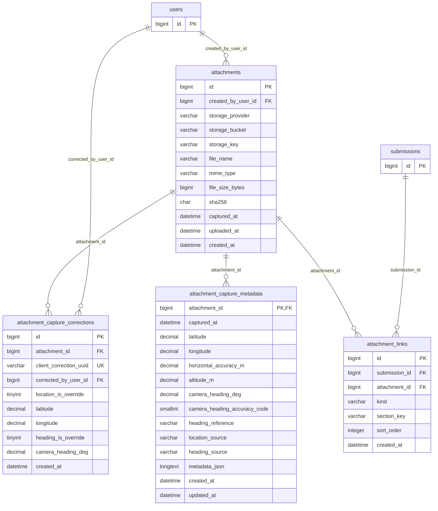

## Notifications

The notification feed, push devices and the email outbox.

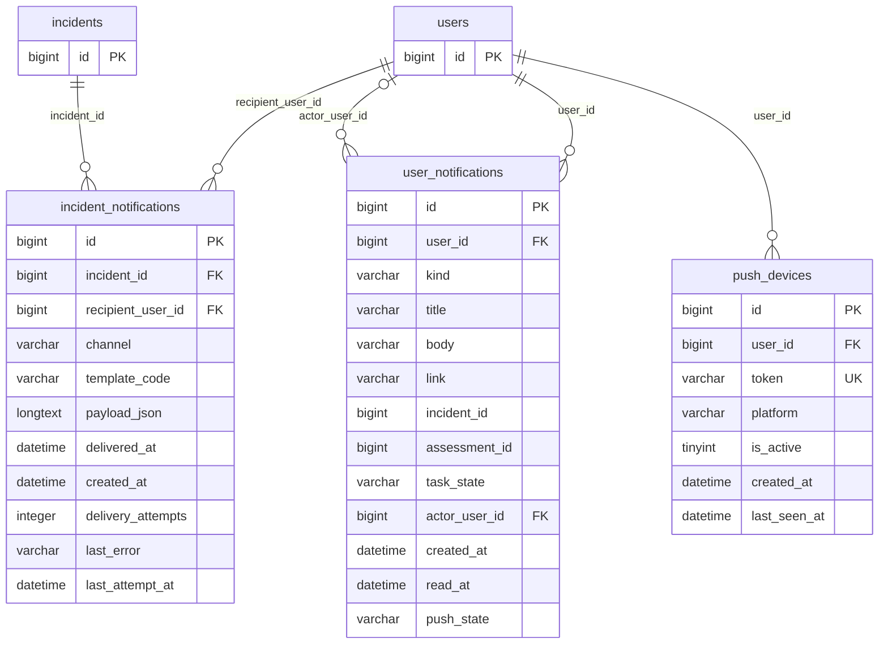

## Maintenance workflows

District maintenance work definitions and runs.

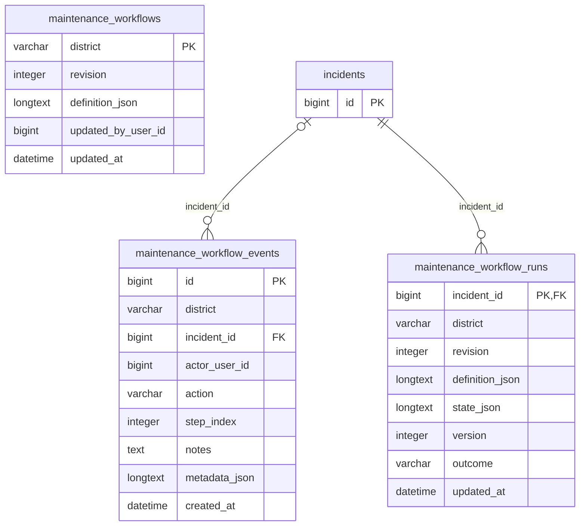

## Projects

Caltrans projects linked to incidents.

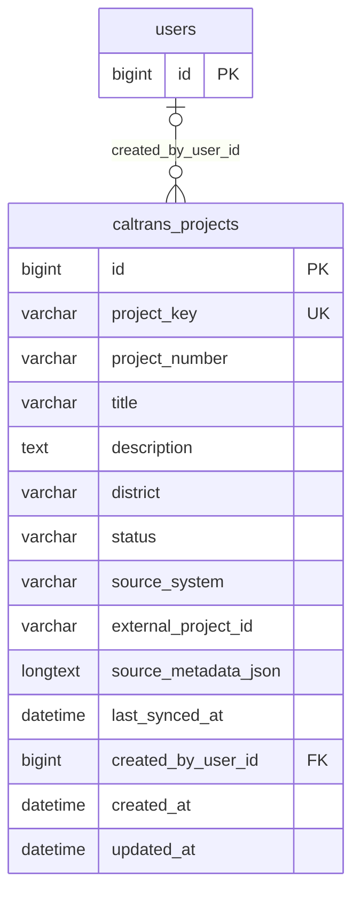

## Road inventory

Imported Caltrans road inventory datasets, segments and mobile packages.

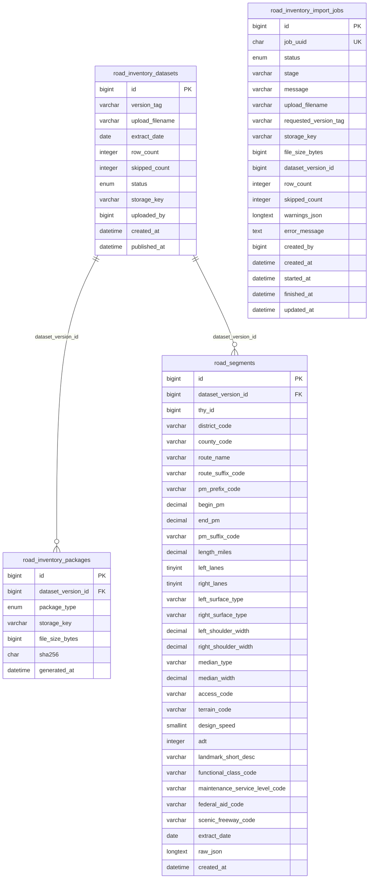

## Terrain and offline scenes

Terrain cross sections and offline 3D scene packages and jobs.

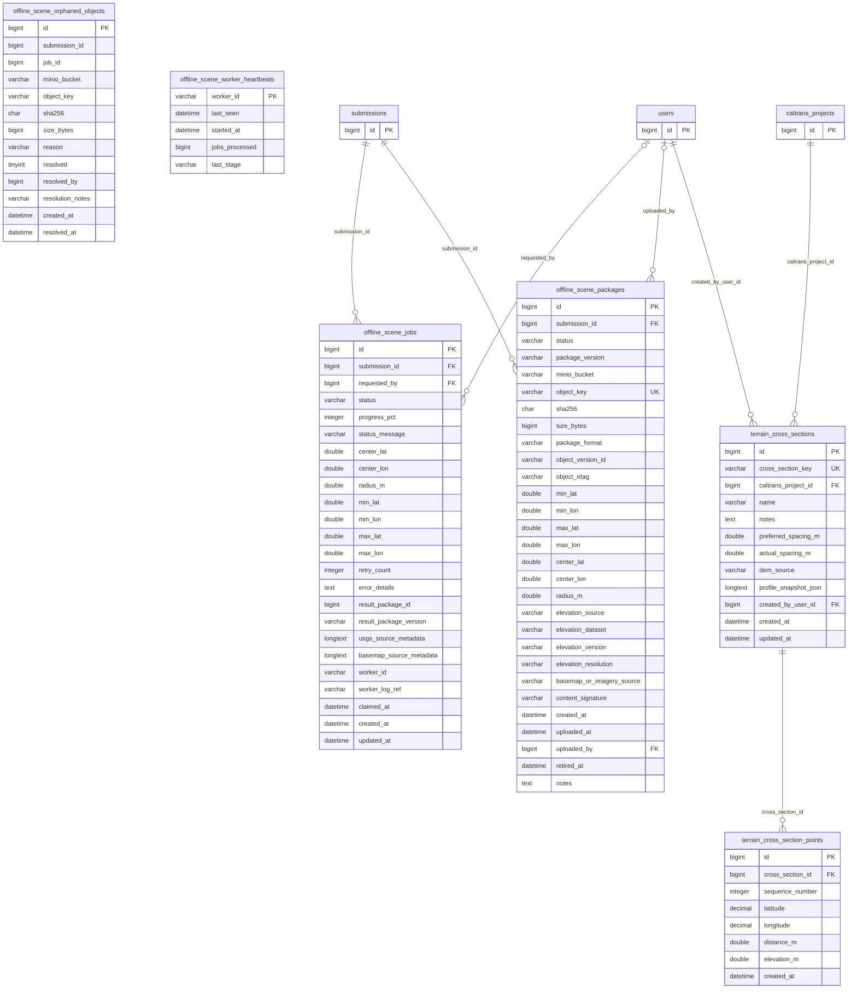
