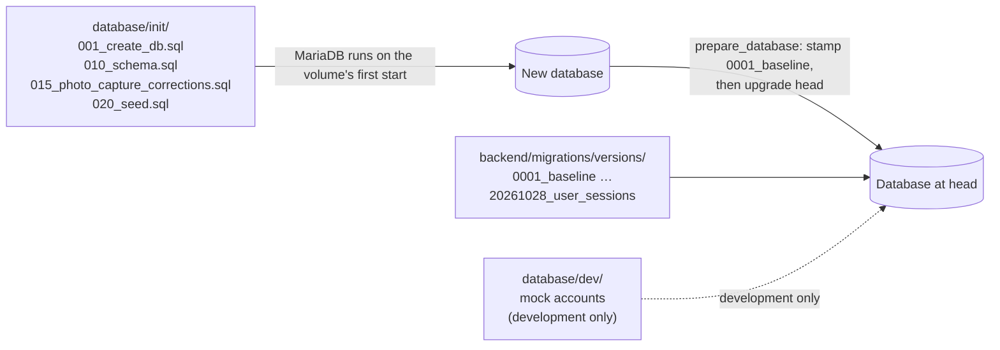
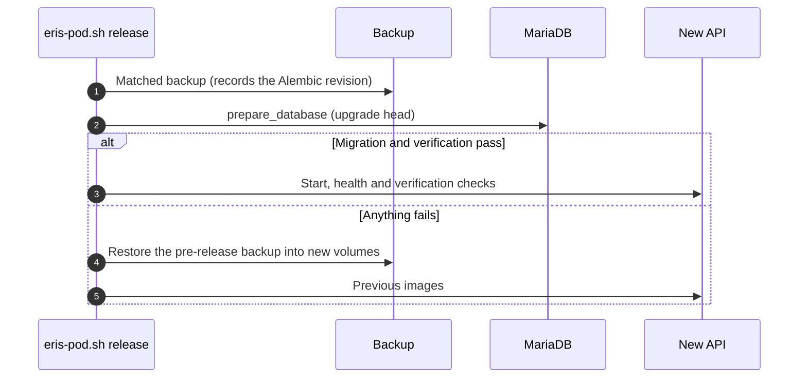

# Database migrations

How the ERIS schema is created and changed. Every schema change is an
[Alembic](https://alembic.sqlalchemy.org/) revision in
`backend/migrations/versions/`, reviewed in a pull request and tested in CI on
a clean MariaDB.

## Two sources, one schema



- `database/init/` is what MariaDB loads the **first time** a volume starts:
  the base schema, then `020_seed.sql` (roles and the organization structure,
  never accounts; a test enforces this).
- The revisions bring that base to the current schema. Many tables and columns
  exist **only** through revisions, so `010_schema.sql` alone is not the full
  schema.
- `database/dev/` holds the mock accounts. Production never loads it.

Because a fresh install applies every revision on top of `010_schema.sql`,
**revisions must be idempotent**: `CREATE TABLE IF NOT EXISTS`, and check before
`ALTER`. They must work whether or not the base already has the object.

## How each environment migrates

| Environment | Who runs it | Command |
| --- | --- | --- |
| Development | You | `cd backend && alembic upgrade head` |
| CI | GitHub Actions `backend-migrations` job | Loads `010_schema.sql` into MariaDB 11, `alembic stamp 0001_baseline`, `alembic upgrade head`, checks head and a re-run no-op |
| Docs CI | GitHub Actions `docs.yml` | Same, then regenerates the [ERD](erd.md) and [schema reference](schema-reference.md) and fails if they differ |
| Staging and production | `eris-pod.sh up` / `release` | `python -m app.tools.prepare_database`: stamps a fresh init database at `0001_baseline` (refuses if unversioned tables already hold data), then `upgrade head` |

The API checks the revision at startup (`app/migrations_check.py`) and refuses
to start if the database is not exactly at head. It never migrates by itself.

## Release and rollback



Rollback restores data, not just code: an older API must not run against a
database a newer release has upgraded, unless that migration is explicitly
backward compatible. Downgrade functions exist for development; production
relies on the backup.

## Writing a revision

```bash
cd backend
alembic revision -m "short description"
# rename the file to YYYYMMDD_short_name.py and set revision = "YYYYMMDD_short_name"
alembic upgrade head
alembic downgrade -1 && alembic upgrade head   # the downgrade must work too
alembic upgrade head                            # a re-run must be a no-op
```

Checklist:

- [ ] One straight line of history: `down_revision` is the current head
      (`alembic heads` prints exactly one).
- [ ] Idempotent: `CREATE TABLE IF NOT EXISTS`, `ADD COLUMN IF NOT EXISTS`
      (MariaDB supports it), or inspect before altering.
- [ ] MariaDB commits each DDL statement on its own, so a revision that fails
      halfway leaves earlier statements applied. Write each step so running
      the revision again finishes the job.
- [ ] Data migrations are batched and safe on a large table; no full-table
      locks during working hours without a change window.
- [ ] New foreign keys name their constraint (`fk_<table>_<column>`) and
      index the column.
- [ ] Triggers: `DROP TRIGGER IF EXISTS` before `CREATE TRIGGER`; mirror the
      rule in the API so users get a readable error.
- [ ] New tables get a domain in `scripts/docs/generate_schema_docs.py`
      (otherwise they land under "Other").
- [ ] Regenerate the [ERD](erd.md) and [schema reference](schema-reference.md)
      (`python scripts/docs/generate_schema_docs.py --url …`) or download them
      from the docs CI run, and commit them with the revision.
- [ ] If the API depends on the new column, deploy order is: migration and
      code together in one release (`release` migrates before starting the
      new API).

## Useful commands

| Command | Does |
| --- | --- |
| `alembic current` | Revision of the connected database |
| `alembic heads` | Latest revision in the code (must be one) |
| `alembic history --verbose` | Every revision |
| `alembic upgrade --sql head` | Print the SQL without running it |
| `podman exec eris-api python -m app.tools.prepare_database` | Production-style migrate (on a host) |

Database credentials come from `backend/.env` through the app settings; never
put them in `alembic.ini`.

## Inspecting the schema

- Generated [ERD](erd.md) and [schema reference](schema-reference.md).
- Adminer in development: <http://localhost:8081> (server `mariadb`).
- `SHOW CREATE TABLE incidents;` in the MariaDB client.
- `SHOW TRIGGERS;` lists the business-rule triggers ([data model](README.md#database-rules-that-live-in-mariadb)).
