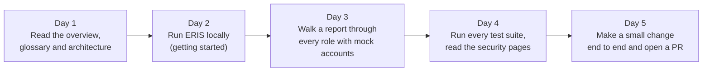
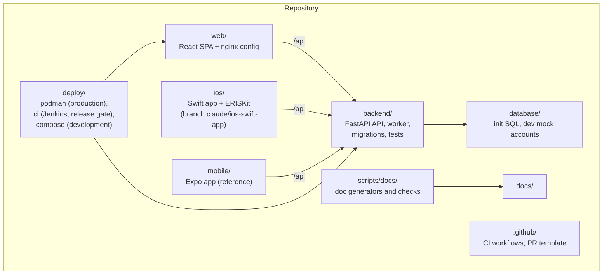

# Developer guide

Everything a developer needs to change ERIS safely. If you are new, follow the
path below in order; it takes about a week.

## Your first week

1. [System overview](../overview/README.md), [glossary](../overview/glossary.md),
   [architecture](../architecture/README.md).
2. [Getting started](getting-started.md): MariaDB and SeaweedFS in Docker, the
   API and web app on your machine, mock accounts.
3. Sign in as each mock account and follow the
   [end-to-end workflow](../architecture/workflows.md#end-to-end-by-role): report,
   triage, route, assign, author, review. The [user guides](../user-guides/README.md)
   describe each screen.
4. [Testing](testing.md) and [security architecture](../security/README.md).
5. Pick a small change, follow [conventions](conventions.md), and open a pull
   request.

## Guides

| Guide | Covers |
| --- | --- |
| [Getting started](getting-started.md) | Run everything locally; database setup; mock accounts |
| [Backend](backend.md) | API layout, request handling, guards, adding endpoints and settings, tools |
| [Web](web.md) | React app layout, sessions in the browser, roles in the UI, styling, adding a page |
| [iOS (Swift)](ios.md) | Native iPhone app: MSAL, APNs, Intune delivery, build specification |
| [Expo app (reference)](mobile-expo.md) | The React Native app being replaced |
| [Testing](testing.md) | Every suite, CI jobs, writing tests |
| [Conventions](conventions.md) | Branches, pull requests, style, documentation, dependency updates |
| [Migrations](../data/migrations.md) | Changing the database schema |
| [API reference](../reference/api.md) | Every route with its access rule (generated) |

## Code map

## How do I…

| Task | Where |
| --- | --- |
| Add an API endpoint | [Backend: adding an endpoint](backend.md#adding-an-endpoint) |
| Add a page to the web app | [Web: adding a page](web.md#adding-a-page) |
| Change the database schema | [Migrations: writing a revision](../data/migrations.md#writing-a-revision) |
| Add a setting | [Backend: adding a setting](backend.md#adding-a-setting) |
| Change who can do what | [Roles and permissions](../security/roles-and-permissions.md), then the route guard and record rule, then `web/src/utils/roleModel.ts` |
| Add a notification | `services/notification_feed.py` (feed + push); email templates in `services/notifications.py` |
| Release to staging or production | [Operations: releasing](../operations/README.md#releasing-a-change) |
| Debug a production problem | [Monitoring and troubleshooting](../operations/monitoring-and-troubleshooting.md) |
| Update dependencies | [Conventions: dependency updates](conventions.md#dependency-updates) |
| Write or fix documentation | [Conventions: documentation](conventions.md#documentation) |

## Tools you need

| Tool | Version | For |
| --- | --- | --- |
| Git | any recent | Source control |
| Docker Desktop (or Podman) | recent | MariaDB, SeaweedFS, Adminer locally |
| Python | 3.12 | API, worker, doc scripts |
| Node.js | 22 (as CI) | Web app, Expo app |
| VS Code (suggested) | — | Python, ESLint, Tailwind, Mermaid preview extensions |
| Xcode | 16+ on macOS | iPhone app only |
