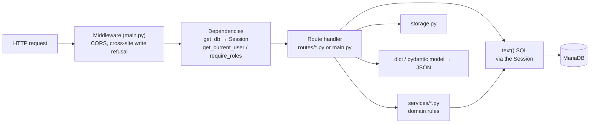

# Backend guide

The ERIS API and terrain worker: Python 3.12, FastAPI, SQLAlchemy Core with
hand-written SQL, Alembic, MariaDB, SeaweedFS. Set up your machine first with
[getting started](getting-started.md).

## Layout

```
backend/
├── app/
│   ├── asgi.py              # entry point: uvicorn app.asgi:app (turns API docs off outside dev)
│   ├── main.py              # FastAPI app, middleware, router registration, older routes
│   ├── config.py            # every setting, validated at startup (pydantic-settings)
│   ├── db.py                # engine, SessionLocal, get_db dependency
│   ├── deps.py              # current_session, get_current_user, require_roles, deny_public_only
│   ├── sessions.py          # server-side sessions, cookies, CSRF, origin check
│   ├── entra.py             # Entra sign-in routes and token validation
│   ├── entra_credential.py  # certificate client assertion
│   ├── roles.py             # role codes and helpers
│   ├── admin_users.py       # /admin/users routes
│   ├── storage.py           # S3 client, presigned URLs
│   ├── migrations_check.py  # refuse to start unless the DB is at Alembic head
│   ├── routes/              # one module per feature area (HTTP layer)
│   ├── services/            # domain logic shared by routes
│   ├── schemas/             # pydantic request/response models
│   ├── constants/           # fixed lists (incident types, GISA options)
│   ├── tools/               # python -m app.tools.<name> operator commands
│   └── worker/              # offline 3D terrain job worker
├── migrations/              # Alembic env and versions/
├── tests/                   # pytest; route_table.py and org_people.py are helpers
├── scripts/                 # developer scripts (demo roster)
├── Dockerfile               # API image
├── Dockerfile.worker        # worker image (adds the GIS stack)
├── requirements.txt         # API dependencies, pinned
└── requirements-worker.txt  # + numpy, rasterio, Pillow …
```

## How a request is handled



Sequence-level detail: [request flows](../architecture/request-flows.md#an-authenticated-write-from-the-browser).

## Conventions

- **SQL is written by hand** with `sqlalchemy.text()` and bound parameters
  (`:name`). Never build SQL with f-strings from user input. The few f-strings
  in the code only insert table or column names from fixed lists.
- **Transactions are explicit**: a handler calls `db.commit()` when its writes
  are complete. Raise `HTTPException` before committing to abandon the work.
- **Routes are thin**; rules used by more than one route live in `services/`.
- **Every route declares who may call it** (see below). The route-guard test
  fails otherwise.
- **Errors**: `HTTPException(status, "Readable message")`. 400/422 for bad
  input, 401 not signed in, 403 not allowed, 404 not found or not visible,
  409 a conflicting state (for example a step already taken).
- **Logging**: `logging.getLogger(__name__)`; security events on `eris.auth`.
  Never log tokens, cookies, authorization codes or passwords.
- **Settings**: add new settings to `config.py` with a safe default and a
  comment, document them in [configuration](../operations/configuration.md),
  and add a production refusal if an unsafe value could reach production.
- **Time**: store UTC `DATETIME`; convert at the edges.

## Authorization: the four guards

| Guard (`app/deps.py`) | Allows |
| --- | --- |
| `Depends(require_roles(["ADMIN", "OFFICE_CHIEF"]))` | Anyone holding at least one listed role. List `ADMIN` explicitly when administrators should pass. |
| `Depends(deny_public_only)` | Anyone signed in with a work role (refuses Guest-only accounts) |
| `Depends(get_current_user)` | Anyone signed in, Guests included. Only for routes listed in `services/public_visibility.VIEWER_READABLE_ROUTES`, which must filter to approved records |
| none | Only the six public routes; adding one needs a security review |

Role guards answer "may this kind of person call this route?". Record rules
answer "may **this** person see or change **this** record?" and live in the
handler or in services: `public_visibility` (Guests see approved records
only), `form_access` (who may read or edit a form), `share_rules`,
`office_routing`. Return 404 rather than 403 when revealing that a record
exists would itself leak information.

## Adding an endpoint

1. Pick the module in `app/routes/` for the feature area (or create one and
   register it with `app.include_router(...)` in `main.py`).
2. Write the handler:
   ```python
   @router.post("/incidents/{incident_id}/notes")
   def add_note(
       incident_id: int = Path(..., ge=1),
       body: NoteIn = Body(...),
       db: Session = Depends(get_db),
       user=Depends(require_roles(["MAINTENANCE_COORDINATOR", "OFFICE_CHIEF"])),
   ):
       incident = db.execute(text("SELECT id, district FROM incidents WHERE id = :id"),
                             {"id": incident_id}).mappings().first()
       if not incident or not may_see_incident(db, user, incident):
           raise HTTPException(404, "Incident not found")
       db.execute(text("INSERT INTO incident_notes (incident_id, author_user_id, body) VALUES (:i, :u, :b)"),
                  {"i": incident_id, "u": int(user["id"]), "b": body.text})
       db.commit()
       return {"ok": True}
   ```
3. Write tests: a no-database test for pure logic, a `@pytest.mark.db` test
   for the route (see [testing](testing.md)).
4. Regenerate the API reference: `python scripts/docs/generate_api_reference.py`.
5. If the iPhone app or web app uses it, add the client call
   (`web/src/api/*.ts`, `ios/ERISKit/.../API/*`).

## Adding a setting

1. `config.py`: `MY_SETTING: int = Field(default=10)`.
2. Validate it (`field_validator` / `model_validator`); refuse unsafe values in
   `_validate_production_session` if relevant.
3. Add it to `backend/.env.example`, `deploy/podman/app.env.example` if
   operators must set it, and [configuration](../operations/configuration.md).

## Background work

| Work | Where | How it runs |
| --- | --- | --- |
| Offline 3D terrain packages | `app/worker/offline_scene_worker.py`, `services/offline_scene_*` | Separate `eris-worker` container polling the `offline_scene_jobs` table |
| Road inventory imports | `services/road_inventory_import_jobs.py` | Jobs table; run in the background inside the API process |
| Push notifications | `services/push.py`, `services/apns.py` | Loop inside the API process every 10 seconds |
| Email | `services/notifications.py` | Outbox flushed at startup and by `python -m app.tools.flush_email_outbox` |

## Operator tools (`python -m app.tools.<name>`)

| Tool | Purpose |
| --- | --- |
| `prepare_database` | Stamp a fresh database and upgrade to head (used by `eris-pod.sh`) |
| `create_admin` | Create or promote an administrator; Entra-only recovery with `--entra-object-id` |
| `bootstrap_initial_admin` | First-start bootstrap from `bootstrap.env` |
| `adopt_existing_admin` | Mark an existing admin as the bootstrap admin (older installs) |
| `handover_status` | Data for `eris-pod.sh handover-check` |
| `entra_credential_check` | Data for `eris-pod.sh cert-check` |
| `flush_email_outbox` | Send queued email now |
| `migrate_object_storage` | Copy objects from MinIO to SeaweedFS ([storage migration](../data/storage-migration.md)) |
| `offline_scene_alignment` | Diagnose terrain package alignment |

Each has `--help`.

## Debugging

- Run with `--reload` (`run.sh` / `run.ps1`) and open
  <http://127.0.0.1:8000/docs> (development only).
- `LOG_LEVEL=DEBUG` in `backend/.env` for verbose logs.
- Sign in from the web app (port 5173) so cookies and CSRF work, or test
  bearer routes with a mock account: `POST /auth/login` from a non-browser
  client returns a bearer token in development.
- The API refuses to start when the database is behind: run `alembic upgrade head`.
- VS Code: a launch configuration running `uvicorn app.asgi:app --reload` with
  `cwd` = `backend` and the `.venv` interpreter works well.

## Common pitfalls

| Pitfall | Do instead |
| --- | --- |
| Adding a column only in `010_schema.sql` | Write a revision ([migrations](../data/migrations.md)) |
| Forgetting `db.commit()` | Changes vanish at the end of the request |
| Checking a role but not the record | Add the record rule (district, office, assignment, sharing) |
| Returning a full user row | Return only the fields the client needs; never `metadata_json` wholesale to others |
| A new public route | Almost never right; talk to security first |
| Long work inside a request | Queue a job (see offline scenes) |
