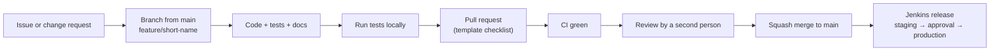

# Conventions

How changes are made to ERIS: branches, commits, reviews, code style,
documentation and dependency updates.

## Change flow

## Branches and commits

- `main` is always releasable. Never commit directly to it.
- Branch names: `feature/…`, `fix/…`, `docs/…`, `chore/…` (short, lowercase,
  hyphens).
- Commit messages: an imperative summary under 72 characters ("Add incident
  notes", "Fix photo download session check"), a blank line, then *why* the
  change was needed if it is not obvious.
- One logical change per pull request. Split refactors from behavior changes.
- Never commit secrets, populated `.env` files, certificates, keys (`*.key`,
  `*.pem`, `*.p8`, `*.p12`) or provisioning profiles; `.gitignore` blocks the
  usual names, but check `git status` before committing.

## Pull requests

Every pull request uses [the template](../../.github/pull_request_template.md):
what changed, why, how it was tested, and the checklist (tests, migrations,
docs, security impact). A reviewer checks:

- Behavior: does it do what the issue asks, for every role affected?
- Security: guards on new routes, record rules, no secrets, no new public
  route, no tokens in logs or URLs.
- Data: migrations idempotent, ERD regenerated, backward compatible with the
  previous release during rollout.
- Tests: new behavior tested; a bug fix has a test that failed before.
- Docs: user guides, configuration, runbook or architecture updated.

Changes to `sessions.py`, `entra*.py`, `deps.py`, `roles.py`, `config.py`
production checks, `deploy/ci/` or `deploy/podman/` need a reviewer familiar
with the [security architecture](../security/README.md).

## Code style

| Area | Style |
| --- | --- |
| Python | PEP 8, 4-space indent, type hints on new functions, f-strings for messages (never for SQL values), docstrings that say *why* |
| SQL | Upper-case keywords, bound parameters (`:name`), explicit column lists |
| TypeScript | Strict mode, functional components and hooks, `*Model.ts` for logic, no `any` in new code where a type is known |
| CSS | Tailwind utilities with theme variables; no hard-coded colors |
| Swift | Swift API Design Guidelines; business logic in `ERISKit`, platform code in the app target |
| Shell | `set -euo pipefail`, quote every variable, `bash -n` clean, test with the stub harness |
| Names | Use ERIS terms from the [glossary](../overview/glossary.md) consistently in code, UI and docs |

`.editorconfig` at the repository root sets indentation and line endings for
editors.

Comments explain intent and constraints the code cannot show ("the trigger is
the backstop", "Safari sends no Sec-Fetch headers before 16.4"), not what the
next line does.

## Documentation

Docs are part of the change, reviewed in the same pull request.

| You changed | Update |
| --- | --- |
| A screen or workflow users see | [User guides](../user-guides/README.md), [workflows](../architecture/workflows.md) |
| A route | `python scripts/docs/generate_api_reference.py` |
| The schema | A migration, then the ERD and schema reference ([migrations](../data/migrations.md)) |
| A setting | [Configuration](../operations/configuration.md), the `.env.example` files |
| Deployment or operations | [Caltrans Podman runbook](../operations/caltrans-podman.md), [operations](../operations/README.md) |
| Security behavior | [Security](../security/README.md) pages |
| An architectural decision | A new record in [decisions](../decisions/README.md) |

Writing rules:

- Write for the reader who has never seen ERIS: the intern and the IT
  administrator after the original author has left.
- Give exact commands and exact paths. Say what success looks like.
- Diagrams are Mermaid in the Markdown, so they are versioned and reviewable.
  GitHub renders them. Keep labels plain text: no semicolons in sequence
  messages and no HTML entities.
- Links are relative. `python scripts/docs/check_links.py` must report none
  broken (CI enforces it).
- Never document a secret value, a real user's details or a personal account.
- Dated, one-off records (rehearsals, cutovers) go in
  [operations/history](../operations/history/) and say so at the top.

## Dependency updates

Monthly, and whenever the release gate reports a fixable vulnerability:

1. **Python:** in a fresh virtualenv, `pip install -r backend/requirements.txt`,
   then upgrade one package at a time (`pip install -U <pkg>`), run the tests,
   and pin the new version in `requirements.txt` (and
   `requirements-worker.txt` if listed there).
2. **JavaScript:** `cd web && npm outdated`, then
   `npm install <pkg>@<version>` for each; commit `package.json` and
   `package-lock.json`. Run `npm test && npm run build`. Major versions of
   React, React Router, Vite, Tailwind or `@arcgis/core` get their own pull
   request and a manual check of the main screens.
3. **Base images:** rebuild to pick up OS patches; bump the pinned base tag in
   the Dockerfiles when a newer patch release exists.
4. **MariaDB / SeaweedFS:** IT mirrors the new version into Harbor; update
   the source references in Jenkins; rehearse on staging (MariaDB minor
   versions only without a migration plan).
5. **iPhone:** update MSAL and other packages in Xcode; build, test on a
   device, and redistribute through Intune.
6. Record why a package is held back (a comment beside the pin).

Never add a dependency from an untrusted source, or one that is unmaintained,
without discussing it in the pull request.

## Versioning and releases

- Releases are tagged by Jenkins with `RELEASE_TAG` (for example
  `2026.11.0`), or `build-<number>` when none is given. Use
  `YYYY.MM.patch` for releases that go to production.
- The source revision is stamped into every image
  (`org.opencontainers.image.revision`), so any running container can be traced
  to its commit.
- Record user-visible changes in the release request to the change board.
