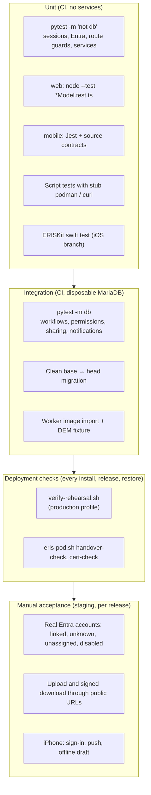

# Testing

What is tested, where, how to run it, and how to add tests. Every pull request
runs the same suites in GitHub Actions; Jenkins runs the security suite again
inside the image it is about to ship.

## Test layers



## Running the suites

| Suite | From | Command | Needs |
| --- | --- | --- | --- |
| Backend unit | `backend/` | `python -m pytest tests -m "not db"` | `backend/.env` (or the env vars below) |
| Backend security subset | `backend/` | `python -m pytest tests/test_session_security.py tests/test_entra_oidc.py tests/test_entra_certificate_and_mobile.py tests/test_route_guards.py tests/test_admin_handover.py tests/test_apns_push.py` | Same |
| Backend database | `backend/` | `python -m pytest tests -m db` | A **disposable** MariaDB at head with mock accounts ([setup](getting-started.md#tests)) |
| Migrations | `backend/` | `alembic upgrade head && alembic upgrade head` | A fresh database loaded with `010_schema.sql` |
| Web | `web/` | `npm test` then `npm run build` | — |
| Expo app | `mobile/` | `npm test`, `npx tsc --noEmit`, `npx expo lint` | — |
| Deployment scripts | repo root | `bash deploy/podman/tests/test-eris-pod.sh`, `bash deploy/podman/tests/test-verify-rehearsal.sh`, `bash deploy/ci/tests/test-release-gate.sh` | bash (stubs replace podman and curl) |
| Docs | repo root | `python scripts/docs/check_links.py`, `python scripts/docs/generate_api_reference.py --check` | Backend virtualenv |
| iPhone core | `ios/ERISKit/` (iOS branch) | `swift test` | Swift 5.10+ (macOS or Linux) |

Without `backend/.env`, set placeholders in the shell for the unit suite:

```bash
export JWT_SECRET=dev_placeholder_secret DB_PASS=x S3_ACCESS_KEY=x S3_SECRET_KEY=x
```

## Continuous integration

| Workflow | Job | Proves |
| --- | --- | --- |
| `ci.yml` | Backend (non-DB) | Every module compiles; Alembic has one head; unit tests pass |
| `ci.yml` | Backend (DB + offline-scene) | Integration tests on fresh MariaDB 11 seeded with mock accounts |
| `ci.yml` | Backend (clean base→head migration) | A brand-new install migrates to head, and re-running is a no-op |
| `ci.yml` | Worker image | The worker image builds and its GIS stack imports and decodes a DEM |
| `ci.yml` | Web | `npm test`, TypeScript check, production build |
| `ci.yml` | Mobile, iOS native compile | Expo source contracts, lint, types, Jest, prebuild, simulator compile |
| `ci.yml` | Compose | Both Compose files render; the backend never receives the browser ArcGIS key |
| `ci.yml` | Dependency audit | No known vulnerability in Python (`pip-audit`) or web (`npm audit`, high and above) dependencies |
| `docs.yml` | Docs | Links resolve; API reference, ERD and schema reference match the code and a migrated database |
| four `*-contract.yml` | Mobile contracts | Offline terrain, incident map and site photo map contracts |
| Jenkins | Validate, Backend security checks | Script tests; the security suite inside the built API image |

A pull request should not be merged with a red check. If a check is flaky,
fix or quarantine it in its own pull request; do not merge around it.

## Important tests to know

| Test | Why it matters |
| --- | --- |
| `test_route_guards.py` | Walks every route: each needs a guard, and only six are public. Catches a forgotten `Depends`. |
| `test_session_security.py` | Cookie flags, CSRF, cross-site refusal, expiry, revocation, production config refusals |
| `test_entra_oidc.py`, `test_entra_certificate_and_mobile.py` | Every token check in the sign-in flows |
| `test_admin_handover.py` | No admin passwords, last-admin protection, handover check |
| `test_rate_limit.py` | Every sign-in route is rate limited; 429 with `Retry-After`; client address from trusted proxies only |
| `test_web_nginx_headers.py` | Every nginx response carries the security headers (nginx drops them in locations with their own) |
| `test_viewer_visibility_db.py` | Guests see approved records only |
| `test_routing_v2_*.py` | Assessment routing authority, eligibility, notifications, transactions |
| `test_seed_shape_db.py`, `test_init_schema_db_agnostic.py` | Seed data never creates accounts; init SQL stays portable |
| `test_docs_runbook_compose_contract.py` | The runbook and Compose files agree |

## Writing tests

### Backend

- Pure logic: a plain `test_*.py` with no marker. It must not touch MariaDB.
- Anything using the database: mark it `@pytest.mark.db`. Create the people
  you need with `tests/org_people.py`: roles come only from where a person
  sits, so a role is never inserted directly.
- Exercise routes through FastAPI's `TestClient` (see
  `test_maintenance_workflows_db.py`), or call the handler and service
  functions directly with a database session, as most `*_db.py` tests do.
- Tests must clean up or use unique names: the database suite shares one
  database for the whole run.
- A security fix comes with a test that fails without the fix.

### Web

- Put logic in a `*Model.ts` and test it in `*Model.test.ts` with
  `node:test` and `node:assert`.
- Add the new file to the `test` script in `web/package.json`.

### Deployment scripts

`deploy/podman/tests/` and `deploy/ci/tests/` replace `podman` and `curl` with
stubs on `PATH` and assert on what the scripts would run. Add a case there for
every new `eris-pod.sh` command or verification check.

## Before you open a pull request

```bash
cd backend && python -m pytest tests -m "not db" -q
cd ../web && npm test && npm run build
cd .. && python scripts/docs/check_links.py
```

Add `pytest -m db` when you touched SQL, routes or permissions, and the script
tests when you touched `deploy/`.
