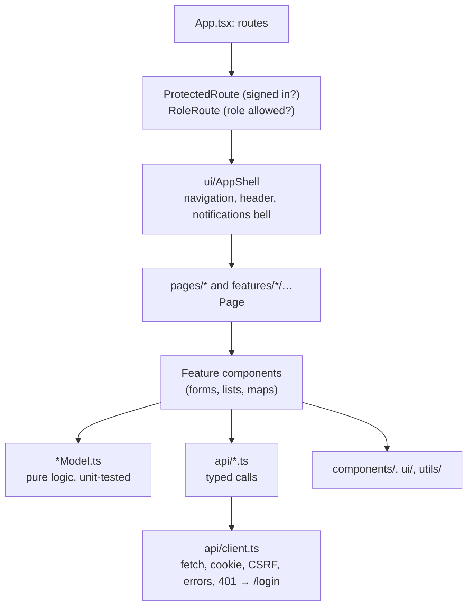

# Web app guide

The ERIS web app: React 19, TypeScript 5.9, Vite 7, Tailwind CSS 4, React
Router 7 and the ArcGIS Maps SDK for JavaScript. In production nginx serves
the built files and proxies `/api` to the API in the same pod.

## Layout

```
web/
├── src/
│   ├── main.tsx            # React root, providers, error boundary
│   ├── App.tsx             # every route, wrapped in ProtectedRoute / RoleRoute
│   ├── config.ts           # reads VITE_* settings once
│   ├── index.css           # Tailwind + design tokens (CSS variables per theme)
│   ├── api/                # one module per API area; client.ts is the only fetch()
│   ├── auth/               # AuthContext, CSRF header, route guards
│   ├── pages/              # top-level pages (some delegate to features/)
│   ├── features/           # one folder per area: components + *Model.ts logic + tests
│   ├── components/         # shared complex components (maps, 3D terrain, workflow tree)
│   ├── ui/                 # app shell, header search, dialogs, settings
│   └── utils/              # role model, districts, formatting, geometry
├── nginx.conf              # production server config (headers, /api proxy, caching)
├── Dockerfile              # build + nginx image
└── package.json            # scripts; the test list
```

## Component layers



Put logic that can be tested without a browser in a `*Model.ts` file next to
the component (for example `features/incidents/triageDecisionModel.ts`) and
test it there. Components stay mostly rendering and wiring.

## Sign-in and sessions in the browser

- `AuthContext` asks `GET /auth/me` on load: a 200 means signed in, a 401 means
  not. The session itself is an HttpOnly cookie the code never sees.
- `auth/token.ts` reads the readable CSRF cookie and adds `X-CSRF-Token` to
  writes; `api/client.ts` does this for every call. The password sign-in also
  sends `X-ERIS-Client: web`, so older browsers still get a cookie, never a
  bearer token.
- Any other 401 sends the person to `/login` with a "session expired" notice.
- With Entra on and password sign-in off, `/login` starts Entra sign-in
  automatically; after a sign-out or a failure it shows a button instead, so
  it never loops.
- Nothing about the session goes in `localStorage`. `localStorage` holds UI
  preferences only (`eris.ui.settings.v1`: theme, collapsed navigation, page
  transitions); `sessionStorage` holds one-off flags.

Design detail: [authentication and sessions](../security/authentication-and-sessions.md).

## Roles in the UI

`utils/roleModel.ts` mirrors the backend's role groups (for example
`WORK_QUEUE_ROLE_NAMES`, `WORKFORCE_ROLE_NAMES`). `RoleRoute` hides pages a
role cannot use, and components hide buttons the person cannot press. **This
is convenience, not security**: the API enforces every rule again. When you
change a role rule, change the backend first, then mirror it here.

## Styling and themes

- Tailwind 4 utility classes, with colors from CSS variables in `index.css`
  (`--ink`, `--panel`, `--line`, `--accent`, `--good`, `--warn`, `--bad`, and so
  on) so every theme works.
- Three themes: `light`, `dark` and `coastal`, chosen in **Settings** and
  applied as `data-theme` on `<html>`. Never hard-code a color; use a variable.
- Shared building blocks are in `ui/` (`AppShell`, `ModalDialog`,
  `HeaderSearch`). Reuse them before writing a new dialog or layout.
- Accessibility: every control needs a visible label or `aria-label`, focus
  must be visible, dialogs trap focus (`ModalDialog` does), and color must not
  be the only signal. Check new screens with the keyboard alone.

## Maps and 3D

`@arcgis/core` provides 2D maps (`MissionCenterMap`, `SubmissionArcGisMap`) and
the 3D terrain scene (`InteractiveTerrainScene`). These modules are large:
load heavy views lazily (`React.lazy`), as
`features/submissions/SubmissionMeasurementContext.tsx` does for the 3D scene. The optional browser key `VITE_ARCGIS_API_KEY` must be restricted to the
site's origin.

## Configuration

`VITE_*` variables are **inlined at build time and public**: never put a
secret in them. They are listed in `web/.env.example` and
[configuration](../operations/configuration.md#web-app).

| Variable | Default | Purpose |
| --- | --- | --- |
| `VITE_API_BASE_URL` | `/api` | Keep same-origin so cookies work |
| `VITE_DEV_API_TARGET` | `http://127.0.0.1:8000` | Where `npm run dev` proxies `/api` |
| `VITE_ARCGIS_API_KEY` | empty | Browser-safe, origin-restricted key for 3D |
| `VITE_CALTRANS_HIGHWAYS_URL`, `VITE_CALTRANS_POSTMILE_LAYER_URL`, `VITE_GOOGLE_MAPS_EMBED_KEY` | see the example file | Optional map layers and Street View |

The production image is built by `deploy/podman/build-web.sh`, which also bakes
the sign-in mode (Entra on, passwords off).

## Releases and stale pages

After a release, a tab still running the old build may request a file that no
longer exists. `staleRelease.ts` detects that error and reloads once (never in
a loop). `nginx.conf` serves `index.html` with `no-cache` (browsers revalidate it on
every visit) and answers a missing `/assets/` file with 404 rather than the
start page, so a reload always gets the new release.

## Tests

```bash
cd web
npm test          # node --test over the files listed in package.json
npm run build     # tsc type check + production build
```

The `test` script lists each test file explicitly. **When you add a
`*.test.ts` file, add it to that list**, or it will not run. Tests use Node's
built-in test runner and import pure model files, so they need no browser.

## Adding a page

1. Create the page in `features/<area>/` (or `pages/`), with its logic in a
   `*Model.ts` and a `*Model.test.ts` (added to `package.json`).
2. Add API calls to `api/<area>.ts` with types in `api/types.ts`.
3. Register the route in `App.tsx`, inside `ProtectedRoute` and, if limited,
   `RoleRoute roles={...}`.
4. Add it to the navigation in `ui/AppShell.tsx` for the roles that use it.
5. `npm test && npm run build`.
6. Describe the new screen in the [user guides](../user-guides/README.md).
