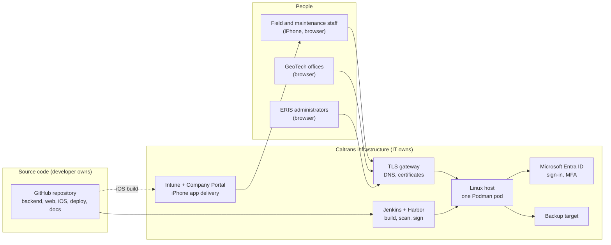

# Handover guide

For whoever takes over ERIS: the Caltrans IT staff who run it, and the
developer or intern who maintains the code. Read this first; it links to
everything else.

## What you are taking over

ERIS is a web application, an iPhone app and a small server stack:

| Part | What it is | Owner after handover | Start with |
| --- | --- | --- | --- |
| ERIS web app and API | The system people use | Developer (code), IT (servers) | [System overview](../overview/README.md) |
| The Podman pod (5 containers, 2 volumes) | Production and staging servers | Caltrans IT | [Caltrans Podman runbook](../operations/caltrans-podman.md) |
| Release pipeline | Jenkins builds, scans, signs and releases images | Caltrans IT + developer | [Supply chain](../security/supply-chain.md) |
| Sign-in | Entra ID app registrations (web + ERIS Mobile) | Caltrans identity team | [Authentication and sessions](../security/authentication-and-sessions.md) |
| ERIS iPhone app | Native Swift app, delivered through Intune | Developer (code), IT (Intune, Apple account) | [iOS app](../development/ios.md) |
| ERIS accounts and roles | Who may do what inside ERIS | ERIS administrators (at least two) | [Administration guide](../user-guides/administration.md) |
| Backups | Matched DB + files + config | Caltrans IT | [Backup and restore](../operations/caltrans-podman.md#backup-and-restore) |
| Documentation | This folder | Everyone; update it with every change | [Conventions](../development/conventions.md#documentation) |

## Before the original author leaves (checklist)

These items depend on accounts that belong to one person today. Each must move
to Caltrans before the handover is complete. Tick them off in a tracked ticket.

- [ ] **Source code.** The repository is `Alexeitor292/ERIS_REACT_native`, under a
      personal GitHub account. Transfer it to a Caltrans-owned GitHub organization
      (or import it into Caltrans's Git service). Then update the clone URLs in
      [getting started](../development/getting-started.md) and in Jenkins.
- [ ] **GitHub Actions.** Confirm CI runs in the new location (secrets: none are
      required today; the iOS workflow uses only the built-in token).
- [ ] **Two Caltrans administrators** are linked to their Entra accounts in ERIS,
      and `bash deploy/podman/eris-pod.sh handover-check` passes.
- [ ] **Apple Developer Enterprise account.** Caltrans staff hold the Account
      Holder or Admin role, the distribution certificate, the in-house
      provisioning profile and the APNs auth key (`.p8`).
- [ ] **Signing and secrets.** The cosign key pair, the Entra client certificate and
      every `deploy/podman/*.env` value are in Caltrans's approved secret store, not
      on a personal machine or in email.
- [ ] **Campos Labs rehearsal servers** (Proxmox, Cloudflare, Caddy; see
      [history](../operations/history/proxmox-podman-cutover.md)). Decide with
      Caltrans whether its data is deleted or handed over, then shut it down. It is
      personal infrastructure and must not keep a copy of Caltrans data.
- [ ] **The Caltrans Mac mini** used for iOS builds, with Claude Code and Xcode.
      Hand it over with its login and the `claude/ios-swift-app` branch state recorded.
- [ ] **Open work** is merged or recorded: open pull requests, the iOS port status
      ([ios/README.md on the iOS branch](../development/ios.md)), and the open items
      in the [readiness audit](../caltrans/readiness-audit.md#open--needs-a-caltrans-decision-or-further-work).
- [ ] **Remove the author's own access** after the above: ERIS admin role, Jenkins,
      Harbor, Apple account, GitHub organization.

## First day for Caltrans IT

1. Read the [system overview](../overview/README.md) and the
   [deployment topologies](../architecture/deployment-topologies.md).
2. Get access: the ERIS hosts (service account), Jenkins, Harbor, the backup
   target, and an ERIS administrator account linked to your Entra identity.
3. On the staging host, run the read-only checks:
   `bash deploy/podman/eris-pod.sh status`,
   `bash deploy/podman/eris-pod.sh cert-check`,
   `bash deploy/podman/eris-pod.sh handover-check`, and
   `ERIS_VERIFY_PROFILE=production bash deploy/podman/verify-rehearsal.sh https://<web> https://<files>`.
4. Take a backup and restore it into new volumes on staging
   ([procedure](../operations/caltrans-podman.md#backup-and-restore)). If you can do
   that, you can recover the system.
5. Put the [maintenance calendar](#recurring-maintenance-calendar) dates in your
   team calendar.

## First week for a new developer

| Day | Do | Read |
| --- | --- | --- |
| 1 | Set up the local stack and sign in with a mock account | [Getting started](../development/getting-started.md) |
| 1 | Run every test suite once | [Testing](../development/testing.md) |
| 2 | Follow one incident through the system: report → triage → assessment → review | [User guides](../user-guides/README.md), [workflows](../architecture/workflows.md) |
| 2 | Read how a request is authenticated and authorized | [Request flows](../architecture/request-flows.md), [roles and permissions](../security/roles-and-permissions.md) |
| 3 | Tour the backend code and add a trivial endpoint on a branch (and its test) | [Backend guide](../development/backend.md) |
| 4 | Tour the web code and change one screen | [Web guide](../development/web.md) |
| 5 | Make a schema change on a branch: migration, init SQL, regenerated ERD | [Migrations](../data/migrations.md) |
| 5 | Open a pull request following the conventions | [Conventions](../development/conventions.md) |

Ground rules that keep ERIS safe: never commit secrets or populated `.env`
files; never put a session token in a URL; every new route needs a role guard
(a test enforces it); every schema change is a migration **and** an update to
`database/init/010_schema.sql`; update the docs in the same pull request.

## Recurring maintenance calendar

| When | Task | How | Owner |
| --- | --- | --- | --- |
| Every release | Build, gate, sign, release to staging, approve, release to prod | [Releases](../operations/caltrans-podman.md#releases-one-command-automatic-rollback) | IT + developer |
| Daily (or per Caltrans backup policy) | Matched backup, moved off-host | [Backup](../operations/caltrans-podman.md#backup-and-restore) | IT |
| Weekly | Review `releases.log`, container health, disk space, failed push or email | [Monitoring](../operations/monitoring-and-troubleshooting.md) | IT |
| Monthly | Dependency and base-image updates (Python, npm, Swift packages, MariaDB, SeaweedFS); run the pipeline so Trivy re-scans | [Dependency updates](../development/conventions.md#dependency-updates) | Developer |
| Monthly | Review `.trivyignore` and remove expired exceptions | [Supply chain](../security/supply-chain.md#vulnerability-exceptions) | Developer + security |
| Quarterly | Restore drill on staging from a real backup; record the result | [Restore](../operations/caltrans-podman.md#backup-and-restore) | IT |
| Quarterly | Access review: ERIS administrators, disabled leavers, Entra app assignments | [Administration](../user-guides/administration.md), [secrets](../security/secrets-and-keys.md) | ERIS admins + IT |
| 30 days before expiry | Renew the Entra client certificate (`eris-pod.sh cert-check` warns) | [Rotation](../security/secrets-and-keys.md#rotation-procedures) | IT |
| 30 days before expiry | Renew TLS certificates at the gateway | Caltrans PKI process | IT |
| **Yearly** | Renew the iOS **in-house provisioning profile**, re-sign and re-upload to Intune. If it lapses, the app stops opening on every phone | [iOS distribution](../development/ios.md) | Developer + IT |
| Every 3 years | Renew the Apple Enterprise distribution certificate | Apple Developer portal | IT |
| Yearly, or on staff change | Rotate the cosign key, APNs key, database and S3 credentials, JWT signing key (ends all sessions) | [Rotation](../security/secrets-and-keys.md#rotation-procedures) | IT |

## Where to get help without the author

| Question | Where |
| --- | --- |
| How does X work? | Search this folder; the [glossary](../overview/glossary.md) explains the domain terms |
| Why was it built this way? | [Architecture decision records](../decisions/README.md) and `git log` / `git blame` on the file |
| Which endpoint does Y? | [API reference](../reference/api.md) (generated) |
| Which table holds Z? | [ERD](../data/erd.md) and [schema reference](../data/schema-reference.md) (generated) |
| Something is broken | [Troubleshooting FAQ](troubleshooting.md), then [incident response](../security/incident-response.md) if it may be a security event |
| Vendor documentation | [FastAPI](https://fastapi.tiangolo.com/), [SQLAlchemy](https://docs.sqlalchemy.org/), [Alembic](https://alembic.sqlalchemy.org/), [React](https://react.dev/), [Podman](https://docs.podman.io/), [Microsoft identity platform](https://learn.microsoft.com/en-us/entra/identity-platform/), [MSAL for iOS](https://learn.microsoft.com/en-us/entra/msal/objc/), [ArcGIS Maps SDKs](https://developers.arcgis.com/), [SeaweedFS](https://github.com/seaweedfs/seaweedfs/wiki), [MariaDB](https://mariadb.com/kb/) |
