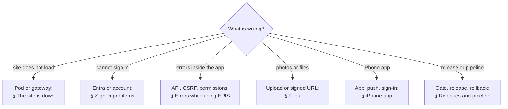

# Troubleshooting FAQ

Symptoms, their usual cause, and the fix. Commands run on the ERIS host as the
service account from the repository folder (`/opt/eris`) unless noted. Logs:
`podman logs eris-api` (also `eris-web`, `eris-worker`, `eris-mariadb`,
`eris-seaweedfs`). Sign-in events are on the `eris.auth` logger in the API log.

## The site is down

| Symptom | Likely cause | Fix |
| --- | --- | --- |
| Gateway shows 502/504 | Pod stopped (host reboot without user lingering) | `bash deploy/podman/eris-pod.sh status`; `start`. Enable lingering for the service account so the user systemd unit starts at boot ([runbook](../operations/caltrans-podman.md#first-installation)). |
| `eris-api` keeps restarting; log says the database is behind the Alembic head | Images were updated without running migrations | Use `eris-pod.sh release` (it migrates), or `eris-pod.sh remove` then `up`. |
| API log: `ENV=prod requires …` and the API exits | A production safety check failed: JWT secret shorter than 32 characters, `WEB_BASE_URL` not https, session limits out of bounds, Entra on without a certificate, a client secret present, or a partial APNs configuration | Fix the named setting in `deploy/podman/app.env` ([configuration](../operations/configuration.md)), then recreate the pod. |
| `eris-pod.sh` says "Deployment configuration still contains example values" | A `CHANGE_ME`, `example.gov` or all-zero GUID remains in an env file | Replace every placeholder; the message names no secret, so grep the files. |
| `eris-pod.sh` says the secrets directory must be private | `deploy/podman/secrets` or a file in it is readable by others | `chmod 700 deploy/podman/secrets && chmod 600 deploy/podman/secrets/*` |
| API log: the S3 bucket check failed | SeaweedFS not ready, or `S3_*` credentials differ between `app.env` and `storage.env` | Check `podman logs eris-seaweedfs`; make the keys match. |

## Sign-in problems

The web returns to `/login?entra=<reason>` after a failed Entra sign-in:

| Reason shown | Meaning | Fix |
| --- | --- | --- |
| `cancelled` | The person closed Entra, or Entra refused (Conditional Access, MFA not completed) | Entra sign-in logs show why. |
| `failed` | ERIS could not verify the Entra token: wrong tenant or client ID, clock skew on the host, network to `login.microsoftonline.com` blocked | Check `ENTRA_TENANT_ID`/`ENTRA_CLIENT_ID`, host time (NTP), egress. API log line `entra_sign_in_failed`. |
| `not_linked` | Entra signed the person in, but no **active** ERIS account is linked to that object ID | An ERIS administrator creates or enables the account with the person's Entra **user object ID** ([administration](../user-guides/administration.md)). Log line `entra_sign_in_refused` shows tenant and object ID. |
| `unavailable` | ERIS's Entra configuration is unusable: certificate missing, expired or not matching its key, or a bad callback URL | `bash deploy/podman/eris-pod.sh cert-check`; [rotate the certificate](../security/secrets-and-keys.md#rotation-procedures). |

| Symptom | Cause | Fix |
| --- | --- | --- |
| "Your ERIS session expired" often | Web sessions end after 30 minutes without a request and 12 hours in total | Expected ([sessions](../security/authentication-and-sessions.md)). Change `SESSION_IDLE_MINUTES` only with security approval. |
| Someone who left still has access | Disabling in Entra stops new sign-ins, not an open ERIS session | Disable the ERIS account (ends its sessions at once) or use **Sign out everywhere** ([incident response](../security/incident-response.md#a-person-must-lose-access-now)). |
| Nobody can administer ERIS | Every administrator disabled or gone | Recovery: `podman exec eris-api python -m app.tools.create_admin --email … --name … --entra-object-id …` under change control ([secrets and recovery](../security/secrets-and-keys.md#administrator-recovery)). |
| Password form appears in production | `LOCAL_LOGIN_ENABLED=true` in `app.env` | Set it `false` and recreate the pod. Production is Entra-only. |

## Errors while using ERIS

| Symptom | Cause | Fix |
| --- | --- | --- |
| "Missing or invalid CSRF token" (403) | The CSRF cookie and the page are out of step, typically an old tab after a session change | Reload the page. If it persists for everyone: a gateway is stripping cookies or the `X-CSRF-Token` header. |
| "Cross-origin request refused" (403) | A browser write came from an origin not in `CORS_ORIGINS`/`WEB_BASE_URL` | Make `WEB_BASE_URL` exactly the public https origin. |
| "Insufficient permissions" (403) | The role does not allow it | Expected; see [roles and permissions](../security/roles-and-permissions.md). Roles come from where a person sits in the organization ([administration](../user-guides/administration.md)). |
| A record "not found" for a Guest | Guests see approved records only | Expected ([what Guests see](../architecture/workflows.md#8-what-guests-see)). |
| Notifications never arrive by email | SMTP not configured or the relay refuses | `SMTP_*` settings ([configuration](../operations/configuration.md#email-notifications)); `python -m app.tools.flush_email_outbox` retries. |

## Files

| Symptom | Cause | Fix |
| --- | --- | --- |
| Upload fails for large files | File over `MAX_UPLOAD_MB` (95 MB default) or over the gateway's body limit | Raise the gateway limit to at least `MAX_UPLOAD_MB` ([runbook](../operations/caltrans-podman.md#first-installation)). |
| Photos do not display; signed URL returns 403 | The gateway rewrites the S3 `Host`, path or query, or host clocks differ | Forward `eris-files` unchanged to port 9800; check NTP. |
| Photos do not display; URL points at the wrong host | `S3_PUBLIC_ENDPOINT` is not the public file hostname | Fix it in `app.env`, recreate the pod. |
| Terrain package stays queued | Worker stopped or its bucket missing | `podman logs eris-worker`; [offline scene packages](../operations/offline-scene-packages.md). |

## iPhone app

| Symptom | Cause | Fix |
| --- | --- | --- |
| The app will not open on any phone | The in-house provisioning profile or distribution certificate expired | Re-sign and re-upload to Intune ([iOS](../development/ios.md)); see the [calendar](README.md#recurring-maintenance-calendar). |
| "This ERIS server has not enabled the mobile app yet" | `ENTRA_MOBILE_CLIENT_ID` not set | Set it and `ENTRA_API_SCOPE` in `app.env` ([iOS sign-in](../operations/caltrans-podman.md#mobile-sign-in-entra)). |
| Sign-in loops back to the app with an error | ERIS Mobile registration missing the iOS redirect (`msauth.<bundle id>://auth`) or the API permission | Fix the app registration. |
| No push notifications | `APNS_*` not configured, outbound to `api.push.apple.com` blocked, or the device registered as `apns-sandbox` from an Xcode build | [APNs setup](../development/ios.md#push-notifications-apns). |

## Releases and pipeline

| Symptom | Cause | Fix |
| --- | --- | --- |
| Jenkins fails at "SBOM and vulnerability gate" | A fixable HIGH/CRITICAL vulnerability or an embedded secret | Read `release/sbom/<image>.vulns.json`; update the dependency or base image. Exceptions only with approval ([supply chain](../security/supply-chain.md#vulnerability-exceptions)). |
| `eris-pod.sh pull` fails with a signature error | The image is not signed by the key in the host policy, or the policy points at the wrong key | Use only digests from a successful pipeline run; check `cosign.pub` on the host. |
| `release` printed "Release FAILED; rolling back" | The new release did not become healthy or failed verification | The host is back on the previous images and data (`releases.log`, `volumes.env`). Investigate on staging before retrying. |
| `release` printed "ROLLBACK FAILED" | Rare: the restore also failed | Recover manually from the pre-release backup it names ([restore](../operations/caltrans-podman.md#backup-and-restore)). |
| "Another release is in progress" | A previous run was interrupted | Confirm no release is running, then `rmdir deploy/podman/.release.lock`. |
