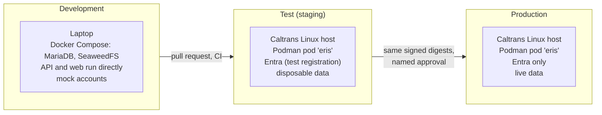
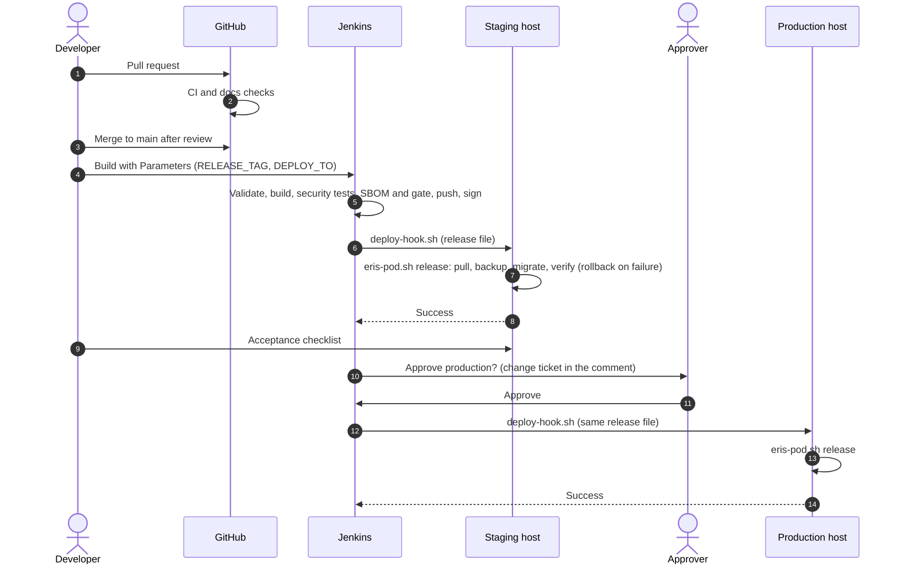

# Operations

How to launch, release, run and recover ERIS in each environment. Where each
part runs: [deployment topologies](../architecture/deployment-topologies.md).

| Page | For |
| --- | --- |
| This page | Launching development, test (staging) and production; releasing; daily operations |
| [Caltrans Podman runbook](caltrans-podman.md) | The authoritative production procedure: files, Entra, Jenkins and Harbor, releases, backup and restore, verification |
| [Configuration](configuration.md) | Every setting |
| [Monitoring and troubleshooting](monitoring-and-troubleshooting.md) | Health, logs, alerts, diagnosing problems |
| [Offline scene packages](offline-scene-packages.md) | Operating the 3D terrain worker |
| [Compose deployment](compose-deployment.md) | The older Docker Compose server stack (development parity, history) |
| [History](history/) | Dated records of rehearsals and cutovers |

## The three environments



| | Development | Test (staging) | Production |
| --- | --- | --- | --- |
| Purpose | Write and debug code | Prove a release before production; rehearse restores and rotations | Serve Caltrans staff |
| `ENV` | `dev` | `prod` (same checks as production) | `prod` |
| Sign-in | Mock accounts with passwords | Entra, staging app registration (or the production one with a staging redirect URI) | Entra only |
| Images | Run from source | Signed digests from Jenkins | The same digests, after approval |
| Who launches | The developer | Jenkins (`DEPLOY_TO=staging`) or the IT host admin | Jenkins after approval, or the IT host admin |

## Development

Full guide: [getting started](../development/getting-started.md). In short:

```bash
# 1. Database and object storage
cd deploy/compose && cp .env.example .env     # replace every CHANGE_ME
docker compose up -d
# load database/dev/030_mock_accounts.sql (see getting started)

# 2. API (new terminal)
cd backend && python -m venv .venv && . .venv/bin/activate   # Windows: .\.venv\Scripts\Activate.ps1
pip install -r requirements.txt && cp .env.example .env      # match DB_PASS and S3 keys
alembic stamp 0001_baseline && alembic upgrade head          # stamp only on a new database
# load database/dev/040_mock_placements.sql
./run.sh                                                     # http://127.0.0.1:8000

# 3. Web (new terminal)
cd web && npm ci && cp .env.example .env && npm run dev      # http://localhost:5173
```

Success: <http://localhost:5173> shows the sign-in page, and a mock account
(password `password`) reaches its landing page.

Stop: `Ctrl+C` in the API and web terminals; `docker compose down` in
`deploy/compose` (add `-v` only to **erase** the development data).

## Test (staging)

Staging is a separate Caltrans Linux host (or a separate service account and
volumes on a non-production host) built exactly like production, so that every
release, restore and rotation is rehearsed there first.

### First launch

1. **IT prerequisites** ([decisions to obtain](caltrans-podman.md#decisions-to-obtain-from-caltrans-it)):
   host with rootless Podman and a service account, DNS names for the web and
   file hostnames, TLS gateway routes, Harbor pull robot, Entra app
   registrations for staging.
2. **Files** as the service account:
   ```bash
   git clone <caltrans repository URL> /opt/eris && cd /opt/eris
   for name in images db storage app bootstrap release; do
     cp "deploy/podman/$name.env.example" "deploy/podman/$name.env"
   done
   chmod 600 deploy/podman/{db,storage,app,bootstrap}.env
   ```
   Fill every `CHANGE_ME` and `example.gov` value with staging values
   (separate secrets from production). Set `ENV=prod` in `app.env`: staging must
   run the production checks.
3. **Secrets:** the Entra certificate and key in `deploy/podman/secrets/`
   ([client certificate](caltrans-podman.md#client-certificate-no-client-secret)),
   APNs key if push is tested.
4. **Signature policy:** install `policy.json` and `cosign.pub`
   ([runbook](caltrans-podman.md#on-the-host-pinned-digests-and-enforced-signatures)).
5. **Images:** copy the `release-images.env` from a Jenkins build into
   `deploy/podman/images.env`.
6. **Start and check:**
   ```bash
   podman login <harbor host>
   bash deploy/podman/eris-pod.sh pull
   bash deploy/podman/eris-pod.sh up
   bash deploy/podman/eris-pod.sh status
   bash deploy/podman/eris-pod.sh cert-check
   bash deploy/podman/verify-rehearsal.sh https://<staging web host> https://<staging file host>
   ```
7. **Systemd:** install `deploy/podman/eris.service.example` as the service
   account's user unit and enable it, so the pod survives reboots.
8. **Jenkins:** add the staging host's forced-command key
   ([releases from Jenkins](caltrans-podman.md#releases-from-jenkins-no-shell-access-for-jenkins)).
9. **Accounts:** sign in as the bootstrap administrator, link test users, run
   `eris-pod.sh handover-check`, delete `bootstrap.env`.

### Test data

Staging data is disposable. Create test incidents through the web app with
test accounts. Copying production data into staging requires Caltrans data
owner approval, because it contains staff details and engineering records.

### Acceptance checklist for a release on staging

- [ ] `verify-rehearsal.sh` passes in the production profile.
- [ ] Entra sign-in works for a linked account; an unlinked account sees
      "not linked"; a disabled account is refused.
- [ ] A report goes through triage, routing, authoring, review and approval.
- [ ] Upload a photo; download it through the file hostname.
- [ ] Offline terrain package generates (if the worker changed).
- [ ] iPhone app signs in and receives a push (if those parts changed).
- [ ] Nothing new in `podman logs eris-api` at ERROR level.

## Production

Production is installed the same way as staging, with production values, by
the IT host administrator under a change request. Follow the
[Caltrans Podman runbook](caltrans-podman.md) end to end; it is the
authoritative procedure. Differences from staging:

- Run verification with `ERIS_VERIFY_PROFILE=production`: warnings become
  failures (images without digests, no HSTS, password sign-in on, a leftover
  `bootstrap.env`).
- Backups go to the approved off-host target, encrypted.
- `LOCAL_LOGIN_ENABLED=false` (the template's default).
- Handover: at least two Entra-linked administrators,
  `eris-pod.sh handover-check` passes, `bootstrap.env` deleted.

## Releasing a change



1. Merge the reviewed pull request to `main`.
2. In Jenkins, run the ERIS job (Script Path `deploy/ci/Jenkinsfile.podman`)
   with `RELEASE_TAG` (for example `2026.11.0`) and `DEPLOY_TO=staging` or
   `staging-then-production`.
3. Complete the staging acceptance checklist.
4. A named approver approves the production stage, quoting the change ticket.
5. Watch `deploy/podman/releases.log` on the host and the Jenkins console. A
   failed release rolls itself back and fails the build.

Without Jenkins (emergency, under change control), copy the archived
`release-images.env` to the host and run
`bash deploy/podman/eris-pod.sh release /path/to/release-images.env`.

## Daily operations

| Task | Command (as the service account, in `/opt/eris`) |
| --- | --- |
| Status | `bash deploy/podman/eris-pod.sh status` |
| Logs | `bash deploy/podman/eris-pod.sh logs api` (or `web`, `worker`, `mariadb`, `seaweedfs`); `podman logs --since 1h eris-api` |
| Stop / start | `bash deploy/podman/eris-pod.sh stop` / `start` (or `systemctl --user stop/start eris`) |
| Recreate the pod (keeps data) | `bash deploy/podman/eris-pod.sh remove && bash deploy/podman/eris-pod.sh up` |
| Backup | `bash deploy/podman/eris-pod.sh backup /secure/eris-backups/$(date +%F)` then `verify-backup` |
| Restore | [Backup and restore](caltrans-podman.md#backup-and-restore) (into new volumes only) |
| Verify | `ERIS_VERIFY_PROFILE=production bash deploy/podman/verify-rehearsal.sh https://<web> https://<files>` |
| Certificate expiry | `bash deploy/podman/eris-pod.sh cert-check` |
| Administrator check | `bash deploy/podman/eris-pod.sh handover-check` |
| Flush email | `podman exec eris-api python -m app.tools.flush_email_outbox` |
| Add an administrator without the UI | [Administrator recovery](../security/secrets-and-keys.md#administrator-recovery) |

Recurring tasks (backups, restore tests, certificate renewals, patching) are
in the [maintenance calendar](../handover/README.md#recurring-maintenance-calendar).
