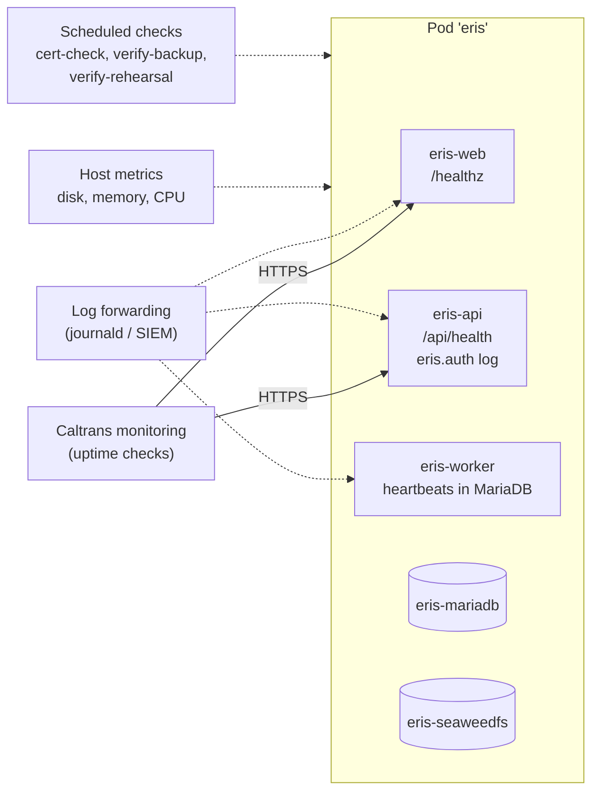
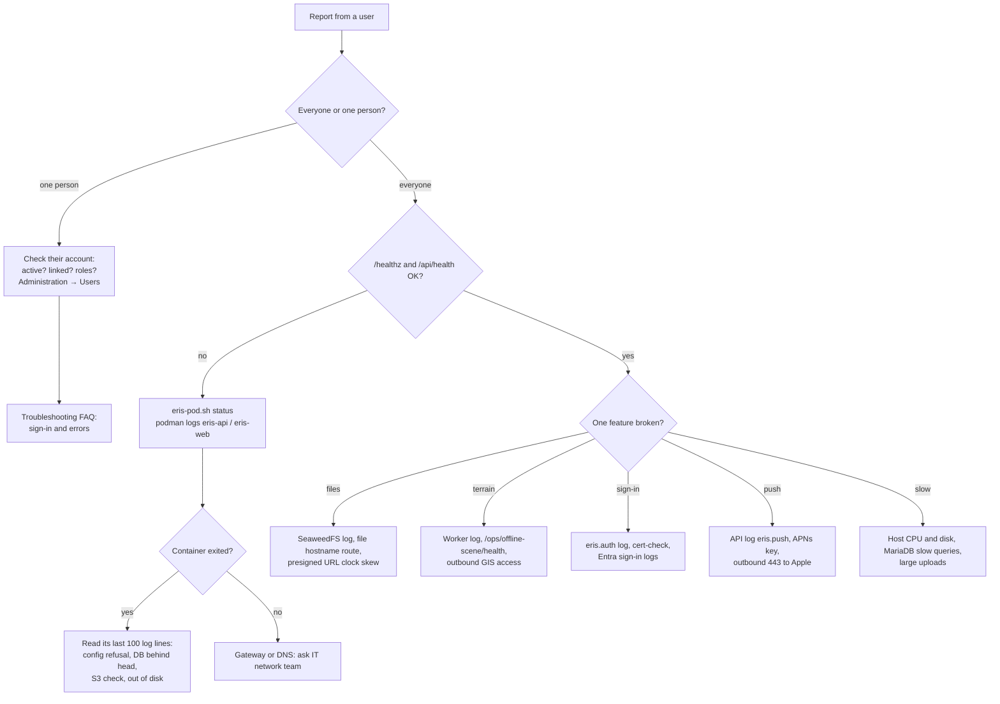

# Monitoring and troubleshooting

What to watch on a running ERIS, how to read its signals, and how to diagnose
a problem. For a symptom-by-symptom list, use the
[troubleshooting FAQ](../handover/troubleshooting.md).

## Signals



| Signal | How | Healthy | Alert when |
| --- | --- | --- | --- |
| Web up | `GET https://<web>/healthz` | `200 ok` | Two consecutive failures |
| API up | `GET https://<web>/api/health` | `200 {"ok": true}` | Two consecutive failures |
| Terrain worker | `GET /api/ops/offline-scene/health` (signed in as an administrator) | Bucket OK, a live worker, small queue, no unresolved orphans | No live worker for 10 minutes, or queue growing |
| Containers | `eris-pod.sh status` | Five containers `Up` | Any container restarting |
| Disk | `df -h` on the volume filesystem | Under 75 % | Over 85 % (terrain packages and photos grow) |
| Entra certificate | `eris-pod.sh cert-check` (weekly) | Expiry over 30 days | 30 days or less |
| Backups | `eris-pod.sh verify-backup <dir>` after each | `OK` | Missing or failing backup |
| Deployment drift | `verify-rehearsal.sh` (weekly, production profile) | Exit 0 | Any failure |
| Sign-in failures | `eris.auth` log | Occasional `cancelled` | Spike in `failed` or `unavailable` |

`/healthz` and `/api/health` show only that the process answers; they do not
touch the database. `verify-rehearsal.sh` is the deep check.

## Logs

All containers log to standard output; Podman keeps them with the journald or
k8s-file driver according to host configuration. Ask IT to forward them to the
Caltrans log platform with at least 90 days of retention.

```bash
podman logs --since 30m eris-api            # recent API log
podman logs -f eris-worker                  # follow the worker
podman logs eris-api 2>&1 | grep eris.auth  # security events
podman logs eris-api 2>&1 | grep -E "ERROR|Traceback" | tail -50
```

### Security events (`eris.auth`)

| Event | Meaning |
| --- | --- |
| `entra_sign_in user_id=… client=web\|mobile` | Successful sign-in |
| `entra_sign_in_refused` | Verified Entra identity with no active linked account (tenant and object ID logged) |
| `entra_sign_in_failed reason=…` | Token or configuration failure |
| `entra_sign_in_cancelled` | The person or Entra cancelled |
| `entra_mobile_sign_in_failed reason=…` | iPhone token refused |
| `password_sign_in`, `password_sign_in_failed` | Development and rehearsals only; must not appear in production |
| `sign_out`, `sign_out_everywhere`, `sessions_revoked`, `account_disabled` | Session ends and account changes |

Tokens, cookies, authorization codes and passwords are never logged. If you
find one in a log, treat it as an [incident](../security/incident-response.md).

## Diagnosing a problem



### Useful commands

```bash
# Containers and images
bash deploy/podman/eris-pod.sh status
podman ps --format '{{.Names}} {{.Image}} {{.Status}}'
podman stats --no-stream

# Database
podman exec -it eris-mariadb sh -c 'mariadb -u"$MARIADB_USER" -p"$MARIADB_PASSWORD" "$MARIADB_DATABASE"'
#   SHOW PROCESSLIST;                         -- running queries
#   SELECT version_num FROM alembic_version;  -- schema revision
#   SELECT status, COUNT(*) FROM offline_scene_jobs GROUP BY status;

# Storage
du -sh "$(podman volume inspect eris-seaweedfs --format '{{.Mountpoint}}')"
du -sh "$(podman volume inspect eris-mariadb --format '{{.Mountpoint}}')"

# Release history
tail -20 deploy/podman/releases.log
```

### Common root causes

| Root cause | Typical symptom | Prevention |
| --- | --- | --- |
| Host clock drift | Entra sign-in `failed`, presigned URLs refused | NTP on the host |
| Disk full | MariaDB or SeaweedFS stops; uploads fail | Disk alert at 85 %; prune old terrain packages per policy |
| Expired Entra certificate | Sign-in `unavailable` for everyone | Weekly `cert-check`; calendar reminder |
| Expired Apple enterprise profile | iPhone app will not open | Renewal reminder in the Apple account |
| Mismatched keys after a manual edit | API exits at startup | Edit both files of each pair; use the [rotation procedures](../security/secrets-and-keys.md#rotation-procedures) |
| Outbound access removed | Terrain jobs fail; push stops | Keep the [outbound list](../architecture/deployment-topologies.md#outbound-traffic-the-host-needs) in the firewall request |

## Capacity

ERIS is sized for Caltrans GeoTech and district Maintenance staff: hundreds of
users, not thousands. The heaviest loads are photo uploads (up to 100 MB per
request) and terrain package generation (one job at a time per worker). Watch
disk growth monthly; storage grows with photos, drone surveys and terrain
packages, not with the number of users.
