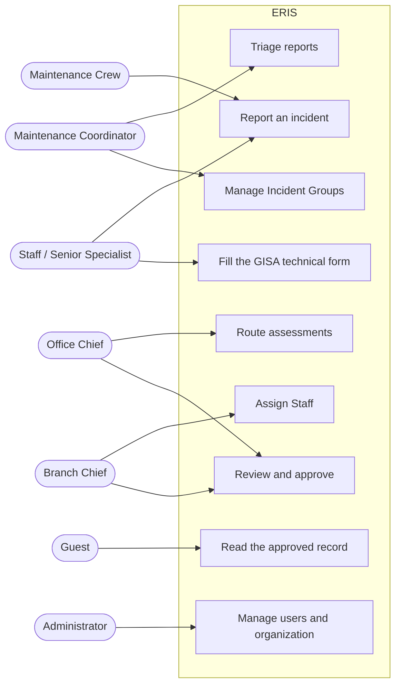
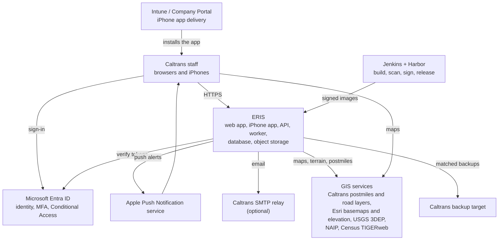
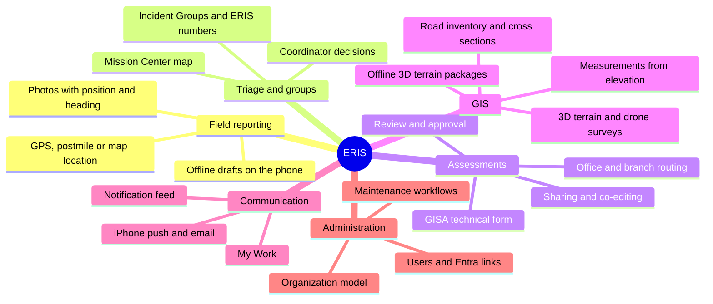

# System overview

## What ERIS does

When a slope fails, a rock falls or an embankment washes out on a California
state highway, ERIS carries the case from the first field report to an approved
geotechnical assessment:

1. A **Maintenance Crew** member reports the incident from the field, with
   location, photos and a description.
2. The district's **Maintenance Coordinator** triages it: assessment needed,
   not needed, duplicate, or more information required.
3. If needed, an **assessment** is routed to the GeoTech office serving the
   district. The **Office Chief** routes it to a **Branch Chief** (who assigns a
   **Staff** member) or directly to a **Senior Specialist**.
4. The author fills the **GISA technical form**: site, measurements, 3D terrain,
   drone surveys, photos, actions and memos.
5. A chief reviews it and approves it or asks for revision. Approved records
   become readable statewide by **Guests**.

Everyone sees a **My Work** list of the steps waiting on them, and a
notification feed (with push on the iPhone app).

## Who uses it

Role details: [roles and permissions](../security/roles-and-permissions.md).
Step-by-step guides per role: [user guides](../user-guides/README.md).

## System context

ERIS and everything it talks to (C4 level 1):

## Main parts

| Part | Technology | Code | More |
| --- | --- | --- | --- |
| Web app | React 19, TypeScript, Tailwind, ArcGIS Maps SDK for JavaScript; served by nginx | `web/` | [Web guide](../development/web.md) |
| iPhone app | Swift, SwiftUI, MSAL (Entra), APNs | `ios/` (branch `claude/ios-swift-app`) | [iOS](../development/ios.md) |
| Expo app (reference) | React Native / Expo; being replaced by the Swift app | `mobile/` | [Expo app](../development/mobile-expo.md) |
| API | Python 3.12, FastAPI, SQLAlchemy (hand-written SQL), Alembic | `backend/app/` | [Backend guide](../development/backend.md) |
| Terrain worker | Same code base, GIS stack (rasterio, numpy) | `backend/app/worker/` | [Offline terrain](../architecture/offline-terrain.md) |
| Database | MariaDB 11, 61 tables | `database/`, `backend/migrations/` | [Data model](../data/README.md) |
| Object storage | SeaweedFS (S3 API): photos, files, PDFs, terrain packages | — | [Data model](../data/README.md#object-storage) |
| Deployment | One rootless Podman pod (Caltrans); Docker Compose (development) | `deploy/` | [Operations](../operations/README.md) |

## Capability map

## Where to go next

- How the pieces fit: [architecture](../architecture/README.md)
- How a request travels: [request flows](../architecture/request-flows.md)
- How work moves: [workflows](../architecture/workflows.md)
- Words you will meet: [glossary](glossary.md)
