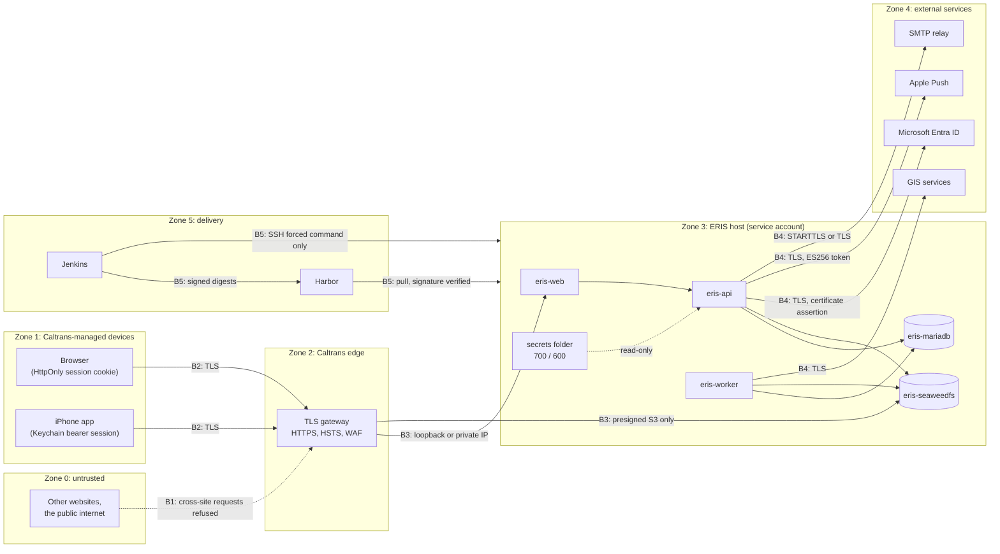
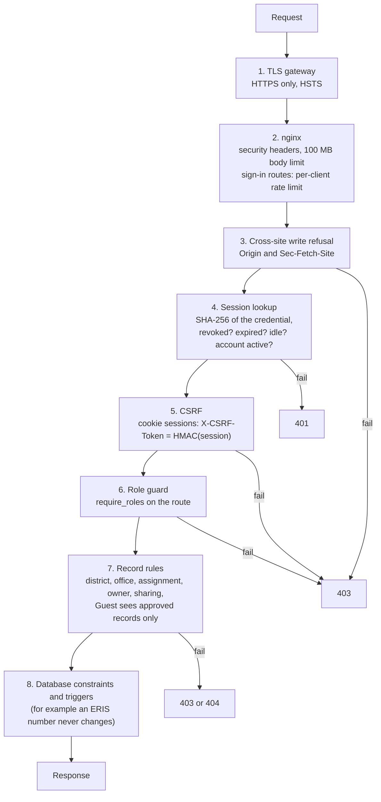

# Security architecture

How ERIS protects its data, who it trusts, and where each control lives in the
code. Read this before changing sign-in, sessions, roles, the release pipeline
or anything that touches secrets.

| Page | Covers |
| --- | --- |
| [Authentication and sessions](authentication-and-sessions.md) | Entra sign-in (web and iPhone), the session model, CSRF, expiry, revocation |
| [Roles and permissions](roles-and-permissions.md) | The eight roles, special permits, account linking, the first administrator |
| [Supply chain](supply-chain.md) | SBOM, vulnerability gate, image signing, the host signature policy, exceptions |
| [Secrets and keys](secrets-and-keys.md) | Every secret, where it lives, who owns it, how to rotate it |
| [Incident response](incident-response.md) | What to do when something goes wrong: lost device, leaked key, compromised account |

## Principles

1. **Caltrans identity, ERIS authority.** Microsoft Entra ID proves who a person
   is (with MFA and Conditional Access set by Caltrans). ERIS alone decides what
   they may do: roles live in the ERIS database, never in Entra claims.
2. **No passwords in production.** `LOCAL_LOGIN_ENABLED=false`; the API refuses
   to set one. Passwords exist only for development mock accounts.
3. **No credential in reach of page scripts.** The browser session is an
   HttpOnly cookie; nothing is stored in `localStorage`.
4. **Deny by default.** Every API route requires a session except six sign-in,
   configuration and health routes, and a test fails the build if a new route
   forgets its guard.
5. **Fail closed at startup.** With `ENV=prod` the API refuses to start on a
   weak signing key, unbounded sessions, plain HTTP, a client secret instead of
   a certificate, or incomplete push settings.
6. **Only signed, scanned images run.** Production pulls by digest under a
   policy that rejects unsigned images.
7. **Least exposure.** Two host ports, on loopback or a private interface, both
   behind the Caltrans TLS gateway. The database is never published.

## Trust boundaries

| Boundary | What crosses it | Controls |
| --- | --- | --- |
| B1 Other sites → ERIS | Forged requests riding the person's cookie | SameSite=Strict cookie, Origin / `Sec-Fetch-Site` check before any route, signed CSRF token on every write, `frame-ancestors 'self'` |
| B2 Device → gateway | Every request and response | TLS and HSTS at the Caltrans gateway; Entra MFA and Conditional Access before a session exists |
| B3 Gateway → pod | Proxied requests | Only 8080 (web + API) and 9800 (S3) published, on loopback or a private interface; API docs off in production; the S3 bucket refuses anonymous listing and reads |
| B4 ERIS → external | Tokens, push, email, GIS fetches | TLS; Entra tokens verified against Microsoft's signing keys; certificate client assertion instead of a secret; APNs ES256 provider token; SMTP TLS settings validated at startup |
| B5 Delivery → host | Images and release commands | Trivy gate, cosign signatures and SBOM attestations, `policy.json` requires signatures, Jenkins can only run `deploy-hook.sh` through an SSH forced command |

## Layers of defense for one request

## Controls matrix

| Area | Control | Code | Tested by |
| --- | --- | --- | --- |
| Identity | Entra OIDC code + PKCE, nonce, state cookie; issuer, audience, tenant and signature verified | `backend/app/entra.py` | `tests/test_entra_oidc.py` |
| Identity | Certificate client assertion (PS256, `x5t#S256`); production refuses a client secret | `backend/app/entra_credential.py`, `config.py` | `tests/test_entra_certificate_and_mobile.py` |
| Identity | iPhone tokens must be v2, for the ERIS API, scope `access_as_user`, `azp` = ERIS Mobile; refused from browsers | `backend/app/entra.py` (`native`) | `tests/test_entra_certificate_and_mobile.py` |
| Identity | Accounts linked by tenant + object ID, never by email | `backend/app/entra.py`, `admin_users.py` | `tests/test_entra_oidc.py`, `tests/test_admin_handover.py` |
| Sessions | Server-side sessions, SHA-256 stored, 256-bit random credential | `backend/app/sessions.py` | `tests/test_session_security.py` |
| Sessions | `__Host-` cookie, HttpOnly, Secure, SameSite=Strict | `backend/app/sessions.py` | `tests/test_session_security.py` |
| Sessions | Idle 30 min, absolute 12 h, bounded in production | `sessions.py`, `config.py` | `tests/test_session_security.py` |
| Sessions | Revocation: sign out, sign out everywhere, admin revoke, disable | `routes/auth.py`, `admin_users.py` | `tests/test_session_security.py` |
| Requests | Cross-site write refusal; signed double-submit CSRF | `main.py`, `sessions.py` | `tests/test_session_security.py` |
| Authorization | Every route but six needs a session; role guards declared on routes | `deps.py`, `roles.py` | `tests/test_route_guards.py` |
| Authorization | Record rules: Guests read approved records only; district and office scoping; sharing | `services/public_visibility.py`, `services/form_access.py`, `services/share_rules.py` | `tests/test_viewer_visibility_db.py`, `tests/test_share_rules.py`, `tests/test_sharing_db.py` |
| Administration | Cannot disable yourself or the last active administrator; no password field | `admin_users.py` | `tests/test_admin_handover.py` |
| Administration | Handover check: two Entra-linked admins, no passwords, bootstrap removed | `eris-pod.sh handover-check` | `deploy/podman/tests` |
| Files | Private buckets; short presigned URLs on a separate hostname; no bytes in the database | `storage.py` | `tests/test_storage_presign.py`, `verify-rehearsal.sh` |
| Configuration | Production refuses unsafe settings at startup | `config.py` (`_validate_production_session`) | `tests/test_session_security.py` |
| Supply chain | SBOM, fixable HIGH/CRITICAL and secret gate, signature and attestation | `deploy/ci/release-gate.sh`, `Jenkinsfile.podman` | `deploy/ci/tests` |
| Supply chain | Host runs signed digests only | `deploy/podman/signature-policy/`, `eris-pod.sh` | `deploy/podman/tests`, `verify-rehearsal.sh` |
| Hosting | Rootless Podman, internal ports unpublished, env files 600, secrets 700 | `eris-pod.sh` | `verify-rehearsal.sh` |
| Push | APNs token auth, key file mounted read-only, dead tokens retired | `services/apns.py`, `services/push.py` | `tests/test_apns_push.py` |
| Audit | `eris.auth` logger: sign-ins by user ID, refusals with tenant and object ID, never tokens | `routes/auth.py`, `entra.py` | `tests/test_entra_oidc.py` |
| Abuse | Per-client sliding-window limit on every sign-in route; 429 with `Retry-After` | `app/rate_limit.py` | `tests/test_rate_limit.py` |
| Browser | `nosniff`, referrer policy, framing limits, Permissions-Policy, Cross-Origin-Opener-Policy, report-only CSP; API responses `no-store` | `web/nginx.conf`, `main.py` | `tests/test_web_nginx_headers.py`, `tests/test_rate_limit.py` |
| Dependencies | Known-vulnerability audit of Python and web dependencies on every pull request | `.github/workflows/ci.yml` (`dependency-audit`) | CI |

## Threat model (STRIDE)

| Threat | Example against ERIS | Mitigation | Residual risk / owner |
| --- | --- | --- | --- |
| **Spoofing** | Someone signs in as another person | Entra with MFA and Conditional Access; ERIS admits only accounts linked to the exact tenant + object ID | Depends on Caltrans Entra policy (IT) |
| Spoofing | A forged Entra token is posted to `/auth/entra/native` | Signature checked against Microsoft's keys; issuer, tenant, audience, scope and `azp` checked | Low |
| **Tampering** | Another site submits a form as a signed-in user | SameSite=Strict, Origin check, CSRF token | Low |
| Tampering | A modified image is deployed | Signed digests; host policy rejects unsigned images | Cosign key custody (IT) |
| Tampering | An accepted report is renumbered or erased | MariaDB triggers: the ERIS number (`incident_key`) can never change, and accepted incidents cannot be hard-deleted | Database administrators can still edit other columns: restrict DB access |
| **Repudiation** | "I never approved that" | Workflow history records actor and time for every step; `eris.auth` records sign-ins | Container logs must be shipped to Caltrans log retention (IT) |
| **Information disclosure** | XSS steals a session | HttpOnly cookie; React escapes output; rich text sanitized server-side | No full Content-Security-Policy yet (see open items) |
| Information disclosure | A presigned file link is forwarded | URLs expire in about 15 minutes and are issued only after visibility checks | Gateway must not log query strings |
| Information disclosure | A Guest reads unapproved work | `public_visibility` filters every list and record | Low; tested |
| Information disclosure | Backups leak | Backups contain secrets: encrypt and store off-host per Caltrans policy | IT |
| **Denial of service** | Flooding the sign-in routes, the API or uploads | Per-client limit on every sign-in route (429); Caltrans gateway/WAF; 100 MB body limit; Starlette 1.x bounds form parsing; worker processes one job at a time | Authenticated routes rely on the gateway; the limit is per API process |
| **Elevation of privilege** | A new route is added without a guard | Route-guard census test fails the build | Low |
| Elevation of privilege | A user changes their own role | Only administrators manage roles; roles are re-read on every request | Low |
| Elevation of privilege | A compromised Jenkins runs commands on the host | SSH forced command limited to `deploy-hook.sh release`, which only accepts signed digests | Jenkins credential custody (IT) |

## Open items

These are known and tracked; none is hidden:

| Item | Why it matters | Proposed fix |
| --- | --- | --- |
| The full Content-Security-Policy is **report-only** | Enforced, it stops injected scripts running even if an XSS bug appears | Exercise every screen on staging with DevTools open, add any source the console reports to `web/nginx.conf`, then rename the header to enforce it |
| The sign-in limit needs the gateway's `X-Forwarded-For` | Without it every client shares one limit | Confirm the gateway sends it, set `TRUSTED_PROXY_HOPS=2` ([configuration](../operations/configuration.md#authentication)) |
| Logs stay on the host | Investigations need retained, tamper-resistant logs | Forward container logs to the Caltrans SIEM |
| The iPhone app is not yet through Caltrans app review | MAM/Intune app protection policy is IT's decision | See [iOS](../development/ios.md) |
| Rehearsal infrastructure is personal | Not a Caltrans environment | Shut down per the [handover checklist](../handover/README.md#before-the-original-author-leaves-checklist) |

## Standards referenced

- OWASP Application Security Verification Standard 4.0, Session Management and
  Cross-Site Request Forgery cheat sheets.
- NIST SP 800-63B (AAL2 session bounds), SP 800-218 (Secure Software
  Development Framework), SP 800-190 (container security).
- Microsoft identity platform: authorization code flow with PKCE, certificate
  credentials, access token validation.
- SLSA build provenance concepts (signed artifacts and SBOMs).
