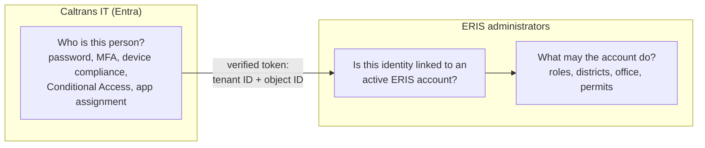
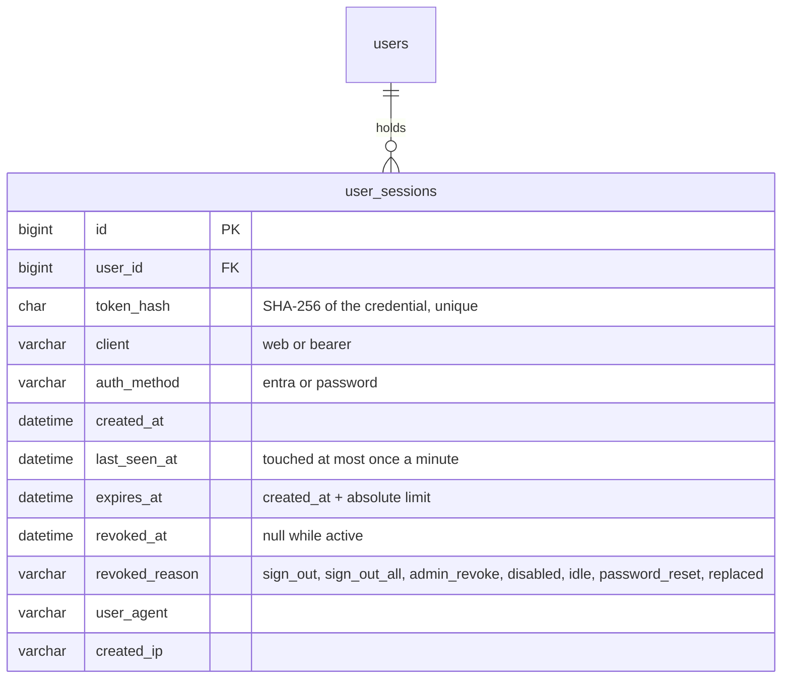
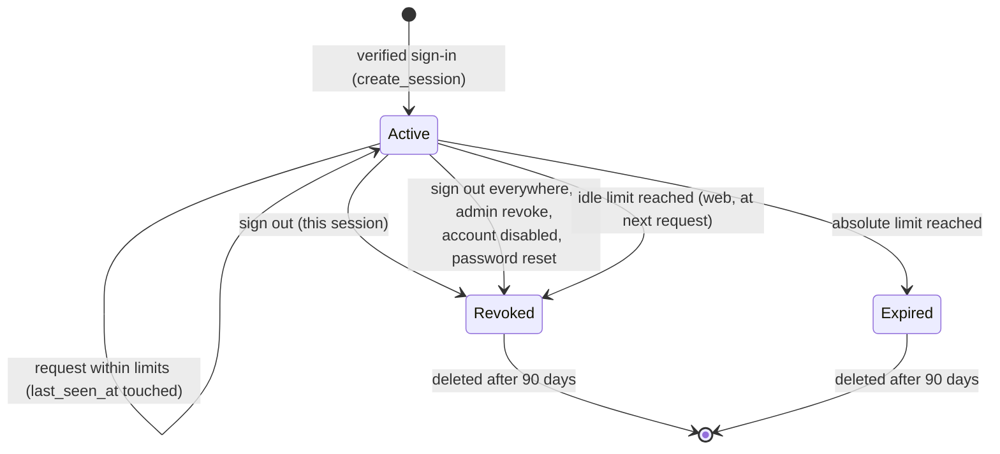
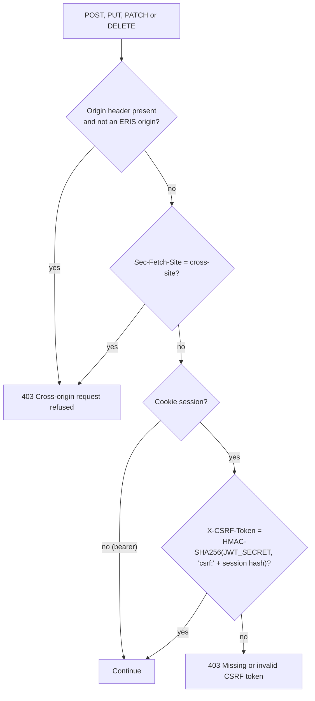

# Authentication and sessions

How a person proves who they are and how ERIS remembers them afterwards. The
operator's view (Entra registration, certificate files, handover steps) is in
the [Caltrans Podman runbook](../operations/caltrans-podman.md#entra-sign-in-and-handover);
this page is the design and the code.

## Who decides what

Entra never grants ERIS roles, and ERIS never checks MFA itself: each side
owns its half. An Entra user without a linked, active ERIS account is refused
with `not_linked` (web) or 403 (iPhone).

## Sign-in methods

| Method | Who uses it | Route | Allowed in production |
| --- | --- | --- | --- |
| Entra, authorization code + PKCE | Browsers | `GET /auth/entra/start`, `GET /auth/entra/callback` | Yes: the only browser method |
| Entra access token exchange | The iPhone app (MSAL) | `POST /auth/entra/native` | Yes |
| Email + password | Development mock accounts, rehearsals | `POST /auth/login` | No: `LOCAL_LOGIN_ENABLED=false` refuses it |

Step-by-step sequence diagrams for each: [request flows](../architecture/request-flows.md#web-sign-in-through-entra).

### What the API verifies on an Entra token

| Check | Web (ID token) | iPhone (access token) |
| --- | --- | --- |
| Signature against Microsoft's published keys (JWKS) | Yes | Yes |
| Issuer is the configured tenant on the configured cloud | Yes | Yes (v2 tokens only) |
| Tenant ID (`tid`) equals `ENTRA_TENANT_ID` | Yes | Yes |
| Audience | `ENTRA_CLIENT_ID` (the web app) | The ERIS API (`api://…` or its client ID) |
| Nonce equals the one in the signed state cookie | Yes | n/a |
| Scope contains `access_as_user` | n/a | Yes |
| Authorized party (`azp`) is the ERIS Mobile app | n/a | Yes |
| Caller is not a browser | n/a | Yes (browsers must use the cookie flow) |
| Object ID (`oid`) is linked to an active account | Yes | Yes |

The API proves its own identity to Entra with a certificate-signed client
assertion (`backend/app/entra_credential.py`); there is no client secret in
production.

## The session model

After a verified sign-in, ERIS creates its own session. Entra tokens are
discarded; ERIS never stores or forwards them.

| Property | Value | Why |
| --- | --- | --- |
| Credential | 256 random bits (`secrets.token_urlsafe(32)`) | Unguessable |
| Stored as | SHA-256 hex | A database leak does not yield usable sessions |
| Browser transport | `__Host-eris_session` cookie: HttpOnly, Secure, SameSite=Strict, Path=/, no expiry | Scripts cannot read it; other sites cannot send it; it dies with the browser |
| Native transport | `Authorization: Bearer …`, stored in the iPhone Keychain (this device only) | Apps have no cookie jar to protect |
| Transport binding | A web session is accepted only from the cookie, a bearer session only from the header | A leaked cookie value cannot be replayed as a header, and the reverse |
| Idle limit | `SESSION_IDLE_MINUTES` (30), web sessions | Unattended browsers |
| Absolute limit | `SESSION_ABSOLUTE_MINUTES` (720 = 12 h), all sessions | Bounded lifetime (NIST SP 800-63B AAL2) |
| Account checks | Active flag and roles read on every request | Disabling or demoting takes effect at the next request |
| Retention | Ended sessions kept 90 days for audit, then deleted at the account's next sign-in | Investigations |

### Session lifecycle

## CSRF and cross-site protection

Three independent checks stop another website from acting as a signed-in user:

1. **SameSite=Strict** means the browser does not send the cookie on requests
   started by another site.
2. **Origin check** (`sessions.check_origin`, run by middleware before any
   route): ERIS origins are `WEB_BASE_URL` plus `CORS_ORIGINS`.
3. **Signed double-submit token**: the readable `__Host-eris_csrf` cookie holds
   an HMAC of the session hash. The web client copies it into `X-CSRF-Token`
   (`web/src/auth/token.ts`). Another site can neither read the cookie nor
   compute the HMAC.

`JWT_SECRET` is now only the HMAC key for CSRF tokens and the Entra state
cookie (the name is historical). Changing it invalidates every CSRF token, so
browsers must sign in again.

## How the API tells a browser from an app

`sessions.is_browser` treats a request as a browser when it carries
`Sec-Fetch-Mode` or `Sec-Fetch-Site` (sent by every modern browser and not
removable by page scripts) or `X-ERIS-Client: web` (sent by the web client for
older browsers). Browsers always get cookies; only non-browsers can receive a
bearer credential. This stops a cross-site script from obtaining a bearer token
it could read.

## Revocation

| Action | Route or place | Ends |
| --- | --- | --- |
| Sign out | `POST /auth/logout` | This session; clears cookies |
| Sign out everywhere (self) | `POST /auth/sessions/revoke-all` | Every session of the account |
| Sign out everywhere (admin) | Administration → Users, `POST /admin/users/{id}/revoke-sessions` | Every session of that account |
| Disable account | Administration → Users | Every session; future sign-ins refused |
| Disable only in Entra | Entra admin center | New sign-ins only. Existing ERIS sessions last until they expire. **Always disable in ERIS too.** |

## Rate limiting

Every anonymous sign-in route (`/auth/login`, `/auth/entra/start`,
`/auth/entra/callback`, `/auth/entra/native`) shares a per-client sliding
window of `AUTH_RATE_LIMIT_PER_MINUTE` requests (30). Beyond it the API answers
429 with `Retry-After`; `/start` and `/callback`, which the browser opens as
pages, send the person back to `/login?entra=busy` instead of a JSON error. The client is the address the outermost trusted proxy
recorded in `X-Forwarded-For` (`TRUSTED_PROXY_HOPS`: 2 behind the Caltrans
gateway and nginx), so a client cannot dodge the limit by sending its own
header. The window lives in the API process (`app/rate_limit.py`); the image
runs one process. The Caltrans gateway or WAF limits everything else.

## Code map

| File | Responsibility |
| --- | --- |
| `backend/app/entra.py` | `/auth/entra/start`, `/callback`, `/native`; token validation; account lookup |
| `backend/app/entra_credential.py` | Certificate loading, client assertion signing, thumbprint |
| `backend/app/sessions.py` | Session create, authenticate, revoke; cookies; CSRF; origin check; browser detection |
| `backend/app/deps.py` | `current_session`, `get_current_user`, `require_roles`, `deny_public_only` |
| `backend/app/routes/auth.py` | `/auth/config`, `/auth/login`, `/auth/logout`, `/auth/sessions/revoke-all`, `/auth/me` |
| `backend/app/admin_users.py` | Linking accounts, disabling, admin revoke, last-admin protection |
| `backend/app/config.py` | Production refusals for unsafe session and Entra settings |
| `backend/app/rate_limit.py` | Per-client limit on the sign-in routes |
| `web/src/auth/` | `AuthContext` (session = `/auth/me`), CSRF header, route guards |
| `web/src/api/client.ts` | Sends cookies and CSRF; redirects to sign-in on 401 |
| `ios/ERISKit/Sources/ERISKit/Auth/` | MSAL token → native session; Keychain storage; renewal on 401 |

## Tests that guard this design

| Test | Proves |
| --- | --- |
| `backend/tests/test_session_security.py` | Cookie flags, CSRF, origin refusal, idle and absolute expiry, transport binding, revocation, production config refusals |
| `backend/tests/test_entra_oidc.py` | Web flow: state, nonce, PKCE, issuer, audience, tenant, unknown and disabled accounts |
| `backend/tests/test_entra_certificate_and_mobile.py` | Certificate assertion; native token checks (scope, `azp`, version, browser refusal) |
| `backend/tests/test_route_guards.py` | Every route except the six public ones requires a session |
| `backend/tests/test_admin_handover.py` | No passwords for admins, last-admin protection, handover check |

Run them with `pytest tests/test_session_security.py tests/test_entra_oidc.py tests/test_entra_certificate_and_mobile.py tests/test_route_guards.py tests/test_admin_handover.py`
from `backend/` (see [testing](../development/testing.md)). Jenkins runs them
again inside the built image before anything is published.

## Rules for changing this code

- Never put a session credential, Entra token or authorization code in a URL,
  a log line, `localStorage` or a response body to a browser.
- A new route needs a guard (`get_current_user`, `require_roles(...)` or
  `deny_public_only`). If it truly must be public, add it to the public set in
  `tests/test_route_guards.py` and explain why in the pull request.
- Keep roles in ERIS. Do not map Entra groups to roles without a security review.
- Run the five test files above and update this page in the same pull request.
