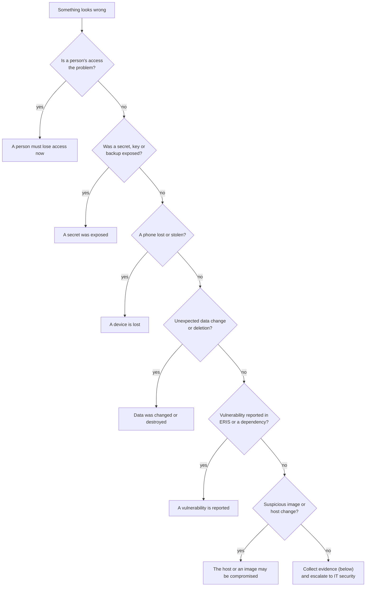

# Security incident response

What to do, in order, when something security-relevant happens to ERIS. These
steps support Caltrans's own incident process; they do not replace it. **Report
every suspected incident to the Caltrans IT service desk and Information
Security Office first**, then use the playbooks below for the ERIS-specific
actions.

## Triage



## Evidence to collect first

Before changing anything (unless access must be cut immediately):

```bash
# As the service account on the host
date -u > /secure/ir/$(date +%F)/timeline.txt
podman ps --all --format '{{.Names}} {{.Image}} {{.Status}}' > /secure/ir/$(date +%F)/containers.txt
for c in eris-api eris-web eris-worker eris-mariadb eris-seaweedfs; do
  podman logs --timestamps "$c" > "/secure/ir/$(date +%F)/$c.log" 2>&1
done
podman image inspect $(podman ps --format '{{.Image}}') > /secure/ir/$(date +%F)/images.json
```

Useful database queries (read-only; run in `podman exec -it eris-mariadb mariadb -u… -p eris`):

```sql
-- Sessions of one account, newest first
SELECT id, client, auth_method, created_at, last_seen_at, expires_at, revoked_at, revoked_reason, created_ip, user_agent
  FROM user_sessions WHERE user_id = ? ORDER BY created_at DESC LIMIT 50;

-- Every active session right now
SELECT user_id, COUNT(*) FROM user_sessions
 WHERE revoked_at IS NULL AND expires_at > UTC_TIMESTAMP() GROUP BY user_id;
```

The `eris.auth` log lines (`podman logs eris-api | grep eris.auth`) record
each sign-in by user ID and each refusal with tenant and object ID. Workflow
history tables record who did each step and when.

## Playbooks

### A person must lose access now

For a departure, a compromised account or a misuse concern:

1. **ERIS:** Administration → Users → the person → **Disable**. This ends
   every session immediately (at their next request) and refuses new sign-ins.
   If you only want to end sessions: **Sign out everywhere**.
2. **Entra (IT):** disable the account or revoke its refresh tokens
   (*Revoke sessions* in the Entra admin center), and remove it from the ERIS
   enterprise application assignment.
3. **iPhone:** if the person had the app, Intune can retire the device or wipe
   the app's data.
4. If the person was an administrator, check `handover-check` still passes
   (at least two other Entra-linked admins).
5. Review their recent activity (sessions query above, workflow history).

Disabling in Entra alone is **not enough**: an ERIS session already issued
lasts until it expires (up to 12 hours).

### A secret was exposed

Rotate first, investigate second, following
[secrets and keys](secrets-and-keys.md#rotation-procedures):

| Exposed | Immediate action | Then |
| --- | --- | --- |
| Entra certificate private key | Delete the certificate from the app registration (sign-in stops), create and upload a new one, restart | Review Entra sign-in logs for the ERIS app |
| `JWT_SECRET` | Replace and restart: every browser signs in again | An attacker could have forged CSRF tokens for sessions they also held; review recent writes |
| Database password | Rotate; check the database port was never published (`verify-rehearsal.sh`) | Review database logs if enabled |
| S3 keys | Rotate; restart | Check bucket listing for unexpected objects |
| cosign key | Rotate; replace `cosign.pub` on hosts; rebuild and re-sign the current release | Verify every running digest was signed by the real pipeline (Jenkins archive) |
| APNs key | Revoke in the Apple account; install a new one | Anyone with it could push notifications to ERIS phones: warn users |
| Apple distribution certificate | Revoke and reissue in the Apple account; rebuild and redeploy the app through Intune | Revoking stops the current app launching: plan the rebuild first |
| A backup | Treat every secret inside it as exposed; rotate all | Report the data exposure through Caltrans's privacy process |
| A session credential | Admin **Sign out everywhere** for that person | Find how it leaked |

### A device is lost

1. The person reports it to the IT service desk; Intune locks or wipes it.
2. An ERIS administrator uses **Sign out everywhere** for the person. The
   iPhone app's bearer session dies at its next request.
3. The ERIS app keeps its session in the Keychain with "this device only"
   access and offline drafts inside the app's sandbox; a wiped or retired
   device loses both.

### Data was changed or destroyed

1. Do not restore over the live system. Identify the time and scope from
   workflow history and logs.
2. Restore the last good backup **into new volumes** on staging or a separate
   pod (`eris-pod.sh restore` refuses to overwrite volumes) and compare.
3. Repair specific records under change control, or, if the damage is broad,
   restore production from backup and accept the loss after that point. See
   [backup and restore](../operations/caltrans-podman.md#backup-and-restore).
4. Find the cause (an account, a bug, a direct database change) before
   reopening write access.

### A vulnerability is reported

1. Record it privately (see [`SECURITY.md`](../../SECURITY.md)); do not open a
   public issue.
2. Assess: is the code reachable in ERIS? What data or role does it expose?
3. Fix in a pull request; add a test that would have caught it.
4. Release through the normal pipeline (the gate scans the new images).
5. For a dependency with no fix yet, follow
   [vulnerability exceptions](supply-chain.md#vulnerability-exceptions).

### The host or an image may be compromised

1. Isolate: ask IT to block the gateway route to ERIS (users see it down).
2. Collect evidence (above), including `podman image inspect` digests.
3. Compare running digests with the signed release in the Jenkins archive
   (`release-images.env`). Any mismatch is a compromise.
4. Rebuild the host from a clean image per IT policy, reinstall from the last
   **known-good** signed release, restore the last known-good backup, and
   rotate every secret on the host.

## After any incident

- Write a short timeline: what happened, when it was detected, what was done.
- Add a test, a check in `verify-rehearsal.sh`, or a doc change that would
  catch it sooner.
- Update this page if a step was missing or wrong.
