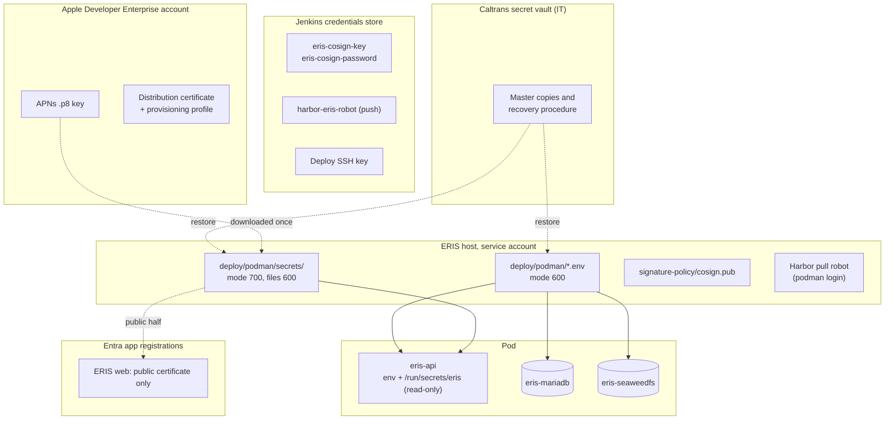

# Secrets and keys

Every secret ERIS depends on, where it lives, who owns it, and how to replace
it. No secret is ever in Git, an image, a Jenkins build parameter, a ticket or
a chat message.

## Where secrets live



## Inventory

| Secret | Lives in | Used by | Owner | Expires | Rotate |
| --- | --- | --- | --- | --- | --- |
| `MARIADB_ROOT_PASSWORD` | `db.env` | MariaDB (first start only) | IT host admin | No | Yearly / on staff change |
| `MARIADB_PASSWORD` = `DB_PASS` | `db.env`, `app.env` | API, worker | IT host admin | No | Yearly / on staff change |
| `AWS_*` = `S3_ACCESS_KEY` / `S3_SECRET_KEY` | `storage.env`, `app.env` | SeaweedFS, API, worker | IT host admin | No | Yearly / on staff change |
| `JWT_SECRET` (CSRF and Entra state HMAC key) | `app.env` | API | IT host admin | No | Yearly; signs everyone out |
| Entra client certificate + key | `secrets/entra-client.crt`, `.key`; certificate also in the Entra app registration | API → Entra | IT identity team + host admin | Yes (365 days if self-signed) | Before expiry; `cert-check` warns at 30 days |
| APNs auth key (`.p8`) + Key ID + Team ID | `secrets/apns-*.p8`, `app.env` | API → Apple | ERIS app owner in the Apple Enterprise account | No | If exposed, or when the owner leaves |
| SMTP relay credentials | `app.env` (`SMTP_USER`, `SMTP_PASSWORD`) | API | Caltrans email team | Per relay policy | Per relay policy |
| ArcGIS keys (`ARCGIS_API_KEY`, `VITE_ARCGIS_API_KEY`) | `app.env`, web build variable | Phone runtime, web 3D view | GIS team | Per ArcGIS account | Yearly; restrict the browser key by origin |
| Bootstrap admin object ID | `bootstrap.env` | First start only | IT | n/a | **Delete the file** after handover |
| cosign private key + password | Jenkins credentials | Release signing | IT DevOps | No | Every 2 years / on exposure |
| Harbor robot (push) | Jenkins credential | Image push | IT DevOps | Harbor robot expiry | Per Harbor policy |
| Harbor robot (pull) | Service account's Podman auth file | Host pulls | IT DevOps | Harbor robot expiry | Per Harbor policy |
| Jenkins deploy SSH key | Jenkins; public half in `authorized_keys` | Release trigger | IT DevOps | No | Yearly / on staff change |
| Apple distribution certificate + profile | Apple Enterprise account; Mac signing keychain | iPhone app builds | Apple program agent / admin | Yes (cert ~3 years, profile 1 year) | Before expiry: an expired profile stops the app launching |
| Backups | Approved backup target, encrypted | Restore | IT backup team | Retention policy | n/a: they **contain** the secrets above |

Development values (`deploy/compose/.env`, `backend/.env`) are throwaway and
must never be reused in staging or production.

## Rules

1. Generate secrets with `openssl rand -hex 32` (or the vault's generator).
   Each environment gets its own.
2. Files: `chmod 600` for env files and keys, `chmod 700` for the `secrets`
   folder. `eris-pod.sh` refuses to start otherwise, and
   `verify-rehearsal.sh` fails.
3. Pairs must match: `MARIADB_PASSWORD` = `DB_PASS`; `AWS_ACCESS_KEY_ID` =
   `S3_ACCESS_KEY`; `AWS_SECRET_ACCESS_KEY` = `S3_SECRET_KEY`.
4. After any change, keep the vault copy current. A backup taken before the
   change restores the old values.
5. The repository's `.gitignore` excludes the runtime env files,
   `deploy/podman/secrets/`, and `*.key`, `*.pem`, `*.p8`, `*.p12`, `*.pfx`,
   `*.mobileprovision`. The Jenkins gate
   also scans every image for embedded secrets. Never weaken either.

## Rotation procedures

Do every rotation on **staging first**, during a change window, with a fresh
backup (`eris-pod.sh backup`). Run `verify-rehearsal.sh` afterwards.

### Database password (`MARIADB_PASSWORD` / `DB_PASS`)

`MARIADB_PASSWORD` is read only when the database volume is first created, so
the password must also be changed inside MariaDB:

```bash
NEW="$(openssl rand -hex 32)"
podman exec -i eris-mariadb sh -c 'mariadb -uroot -p"$MARIADB_ROOT_PASSWORD"' <<SQL
ALTER USER '$(grep ^MARIADB_USER= deploy/podman/db.env | cut -d= -f2)'@'%' IDENTIFIED BY '$NEW';
SQL
# Put $NEW in db.env MARIADB_PASSWORD and app.env DB_PASS, then:
bash deploy/podman/eris-pod.sh remove && bash deploy/podman/eris-pod.sh up
```

The root password is rotated the same way (`ALTER USER 'root'@'%'` and
`'root'@'localhost'`), then `MARIADB_ROOT_PASSWORD` in `db.env`.

### Object storage keys

1. Generate a new key pair.
2. Put it in `storage.env` (`AWS_ACCESS_KEY_ID`, `AWS_SECRET_ACCESS_KEY`) and
   `app.env` (`S3_ACCESS_KEY`, `S3_SECRET_KEY`).
3. `eris-pod.sh remove` then `up`. SeaweedFS reads its identity at start.
4. Confirm an upload and a download in the web app. Presigned links issued
   before the change stop working; users simply reopen the file.

### `JWT_SECRET`

Replace it in `app.env` and recreate the pod. Every browser must sign in again
(on a Caltrans device this is usually silent). iPhone bearer sessions are not
affected.

### Entra client certificate

Follow the runbook's [client certificate](../operations/caltrans-podman.md#client-certificate-no-client-secret)
steps: upload the new certificate beside the old one, replace both files,
recreate the pod, confirm with `eris-pod.sh cert-check` and a sign-in, then
delete the old certificate from the app registration. Put a calendar reminder
30 days before the new expiry.

### APNs key

1. In the Apple Developer Enterprise account: Certificates, Identifiers &
   Profiles → Keys → create a key with Apple Push Notifications enabled.
   Download the `.p8` (only possible once).
2. Copy it to `deploy/podman/secrets/` (mode 600); set `APNS_KEY_FILE` and
   `APNS_KEY_ID` in `app.env`.
3. Recreate the pod; send a test notification to a test phone.
4. Revoke the old key in the Apple account.

### cosign signing key

```bash
podman run --rm -it -v "$PWD:/keys:Z" ghcr.io/sigstore/cosign/cosign:v2.4.1 generate-key-pair --output-key-prefix /keys/eris-cosign
```

1. Store `eris-cosign.key` and its password as the Jenkins credentials
   `eris-cosign-key` and `eris-cosign-password` (replacing the old ones).
2. Install the new `eris-cosign.pub` on every host as
   `deploy/podman/signature-policy/cosign.pub`. **Until the next release, the
   currently running images were signed with the old key**: keep the old key
   in the policy as a second `sigstoreSigned` entry until a release signed
   with the new key is running, then remove it.
3. Run a release to staging and confirm the pull succeeds.
4. Destroy the old private key.

### Jenkins deploy SSH key

Generate a new Ed25519 key in Jenkins, add its public half to the service
account's `authorized_keys` with the same `restrict,command="…/deploy-hook.sh"`
prefix, run a staging deploy, then remove the old line.

### Apple distribution certificate and provisioning profile

Renew in the Apple Enterprise account before expiry, re-sign and rebuild the
app on the Mac, and publish the new build through Intune. An expired
enterprise profile makes the installed app refuse to open on every phone.

## Administrator recovery

There are no passwords in production, so there is nothing to reset. If every
ERIS administrator has left or been disabled:

1. Open a change request. Identify the new administrator's Entra **user object
   ID** (Entra admin center → Users → the person → Object ID).
2. On the host, as the service account:
   ```bash
   podman exec -it eris-api python -m app.tools.create_admin \
     --email jane.doe@dot.ca.gov --name "Jane Doe" --entra-object-id <object-id>
   ```
   This links (or creates) the account, grants Administrator and reactivates
   it. It refuses to relink an account already linked to another identity.
3. The person signs in through Entra and adds a second administrator from
   **Administration → Users**.
4. Run `bash deploy/podman/eris-pod.sh handover-check` and attach its output to
   the change record.

If Entra itself is unavailable, ERIS is unavailable for sign-in; Caltrans's
Entra emergency-access (break-glass) accounts cover the identity side. Do not
turn on password sign-in in production as a workaround.

## When a secret is exposed

Treat it as a security incident: [incident response](incident-response.md).
Rotate first, investigate second.
