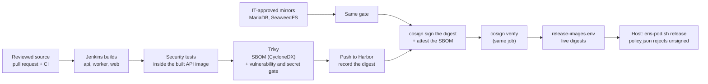
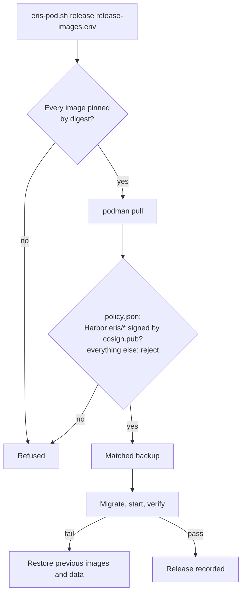

# Software supply chain

How ERIS makes sure that what runs in production is exactly what was built
from reviewed source, scanned, and approved. The commands and Jenkins setup are
in the [runbook](../operations/caltrans-podman.md#jenkins-and-harbor); this
page explains the chain and how to work with it.

## The chain



| Step | Where | Fails the release when |
| --- | --- | --- |
| Pull request checks | GitHub Actions `ci.yml`, `docs.yml` | Any test, type check, migration or docs check fails |
| Validate | Stage *Validate* | A shell script has a syntax error, or the deployment and release-gate script tests (stub Podman) fail |
| Build | Stage *Build* | An image fails to build or the API code fails to compile |
| Security tests | Stage *Backend security checks* | Any session, Entra, route-guard, handover or push test fails inside the image that will ship |
| SBOM and gate | Stage *SBOM and vulnerability gate*, `deploy/ci/release-gate.sh scan` | A HIGH or CRITICAL vulnerability **with a fix available**, or an embedded secret, not listed in `.trivyignore` |
| Publish, sign, attest | Stage *Publish, sign and attest* | Push, signing or the verification of the signature fails |
| Staging deploy | `deploy-hook.sh` → `eris-pod.sh release` | Signature policy rejects a pull; migration, health or verification fails (automatic rollback) |
| Production deploy | Same, after a named approver in Jenkins | Same |

Nothing is pushed to Harbor before the gate passes, so a failed scan publishes
nothing.

## What gets produced per release

| File (Jenkins archive) | Content |
| --- | --- |
| `release/sbom/<image>.cdx.json` | CycloneDX SBOM of every package in the image (five images) |
| `release/sbom/<image>.vulns.json` | Trivy findings at the gate severity, after exceptions |
| `release/<image>.ref` | `harbor…/eris/<image>@sha256:…` |
| `release/cosign.pub` | The public key the hosts trust |
| `release/release-images.env` | The five digests and `ERIS_REQUIRE_DIGESTS=true`: the release file the hosts consume |

The SBOMs are also attached to each image in Harbor as signed attestations, so
an auditor can fetch the SBOM of exactly what is running:

```bash
cosign verify-attestation --key cosign.pub --type cyclonedx harbor.example.gov/eris/api@sha256:...
```

## On the host



The policy file (`deploy/podman/signature-policy/policy.json.example`, installed
to `~/.config/containers/policy.json` of the service account) has a default of
**reject**, so only Harbor's ERIS repository, signed with the ERIS key, can be
pulled. `verify-rehearsal.sh` checks that the running containers use the images
`images.env` names.

Jenkins never gets a shell on the host. Its SSH key is restricted in
`authorized_keys` to `deploy-hook.sh`, which accepts a release file on standard
input (size-limited) and runs `eris-pod.sh release` with it.

## Vulnerability exceptions

The gate fails on fixable HIGH and CRITICAL findings. When a fix is not yet
possible, an exception may be added to [`.trivyignore`](../../.trivyignore):

1. Confirm the finding is real for ERIS (is the vulnerable code reachable?).
2. Prefer a fix: upgrade the package (`backend/requirements.txt`,
   `web/package.json`), or rebuild on a newer base image.
3. If an exception is unavoidable, get approval from Caltrans security and add
   the ID with a comment giving the reason, the approver, the date and an
   **expiry no later than 90 days**:
   ```
   # Not reachable: ERIS never parses untrusted XML with this library.
   # Approved: <name>, Caltrans security, 2026-11-02. Expires 2027-02-01.
   CVE-0000-00000
   ```
4. The change goes through a pull request like any code.
5. At every release, remove expired entries. An expired entry is a finding.

Unfixed vulnerabilities (no fix published) do not fail the gate but appear in
the `vulns.json` report; review them monthly
([maintenance calendar](../handover/README.md#recurring-maintenance-calendar)).

## Dependencies

| Ecosystem | Manifest | Lock | How to update |
| --- | --- | --- | --- |
| Python (API, worker) | `backend/requirements.txt` | Pinned versions in the file | [Dependency updates](../development/conventions.md#dependency-updates) |
| JavaScript (web) | `web/package.json` | `web/package-lock.json` | `npm ci` in CI; update with `npm install <pkg>@<version>` |
| Swift (iPhone) | `ios/` Swift Package Manager (branch `claude/ios-swift-app`) | `Package.resolved` | Xcode → Update to latest package versions; MSAL from Microsoft only |
| Base images | `backend/Dockerfile`, `backend/Dockerfile.worker`, `web/Dockerfile` | Pinned tags; production pins digests | Rebuild monthly to pick up OS patches |
| Third-party runtime images | MariaDB, SeaweedFS | Mirrored into Harbor by IT | IT mirrors a new version; Jenkins scans and signs it |
| Pipeline tools | Trivy, cosign | Pinned in `release-gate.sh` | Mirror into Harbor, update `TRIVY_IMAGE` / `COSIGN_IMAGE` |

## Keys

| Key | Holder | Rotation |
| --- | --- | --- |
| cosign private key + password | Jenkins credentials `eris-cosign-key`, `eris-cosign-password` | [Secrets and keys](secrets-and-keys.md#rotation-procedures) |
| cosign public key | Each host: `deploy/podman/signature-policy/cosign.pub` | Distributed with the rotation |
| Harbor robot account | Jenkins credential `harbor-eris-robot` (push); hosts have a pull-only robot | Harbor robot expiry |
| Jenkins deploy SSH key | Jenkins; public half in the service account's `authorized_keys` | Yearly or on staff change |

## Mapping to frameworks

| Framework | Practice | ERIS evidence |
| --- | --- | --- |
| NIST SSDF (SP 800-218) PS.2, PS.3 | Verify and archive releases | Signed digests, archived SBOMs, release file |
| NIST SSDF PW.4 | Reuse vetted components | Pinned dependencies, IT-mirrored base images |
| NIST SSDF RV.1 | Identify vulnerabilities continuously | Trivy gate per release, monthly unfixed review |
| NIST SP 800-190 | Image and registry countermeasures | Private Harbor, signatures enforced at pull, rootless Podman |
| SLSA | Signed artifacts, build on a controlled builder | Jenkins builds, cosign signatures and attestations |
| Executive Order 14028 | SBOM for delivered software | CycloneDX SBOM per image |
