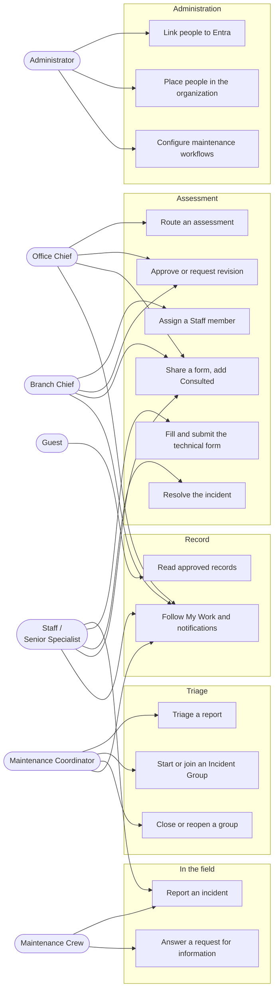
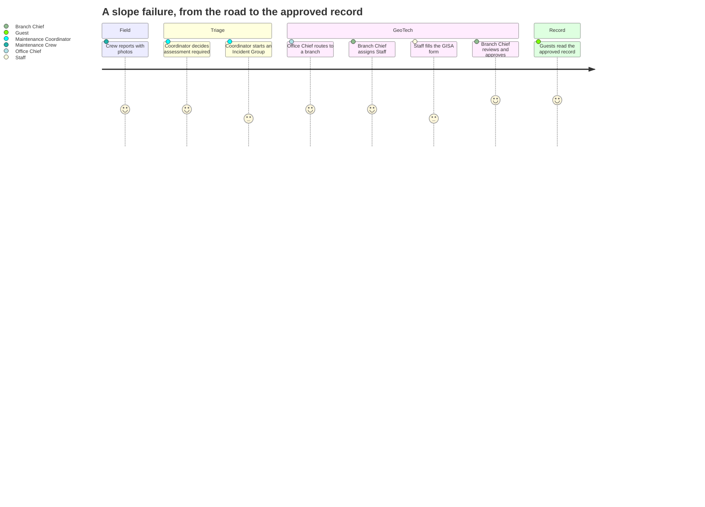

# User guides

How to use ERIS, by role. Each guide shows what that role can do (a use-case
diagram), then step by step how to do it. The rules behind each step are in
[workflows](../architecture/workflows.md); the permissions in
[roles and permissions](../security/roles-and-permissions.md).

| You are | Read |
| --- | --- |
| Maintenance Crew (field reporter) | [Reporting incidents](reporting-incidents.md) |
| Maintenance Coordinator | [Triage and Incident Groups](triage-and-incident-groups.md) |
| Office Chief or Branch Chief | [Routing and review](routing-and-review.md) |
| Staff or Senior Specialist | [Technical forms](technical-forms.md) |
| Guest | [Reading the record](reading-the-record.md) |
| Administrator | [Administration](administration.md), [maintenance workflows](maintenance-workflows.md) |
| Everyone | [Signing in, My Work and notifications](everyday-use.md) |

## Who does what

## What each role sees in the menu

| Menu | Crew | Coordinator | Office / Branch Chief | Staff / Senior Specialist | Guest | Administrator |
| --- | --- | --- | --- | --- | --- | --- |
| Maintenance Work | if in a district maintenance workflow | if in a district maintenance workflow | if in a district maintenance workflow | if in a district maintenance workflow | — | ✓ |
| My Work | — | ✓ | ✓ | ✓ | — | ✓ |
| Mission Center, Incident Groups | — | ✓ | ✓ | ✓ | — | ✓ |
| Incidents | ✓ | ✓ | ✓ | ✓ | ✓ (approved only) | ✓ |
| Assessments | — | ✓ | ✓ | ✓ | ✓ (approved only) | ✓ |
| GIS Tools: Terrain Cross Sections | — | ✓ | ✓ | ✓ | — | ✓ |
| Organization | ✓ view | ✓ view; edits own district's crew | ✓ edits own office or branch | ✓ view | — | ✓ everything |
| Administration: Users, Road Inventory | — | — | — | — | — | ✓ |

Settings (theme, navigation, page transitions) and sign-out are in the profile
menu at the top right for everyone.

## A report's journey

