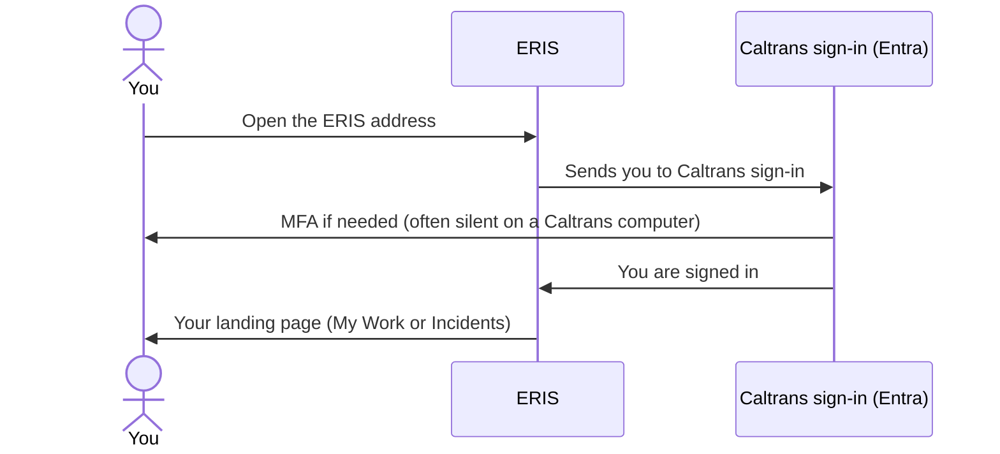

# Signing in, My Work and notifications

For everyone.

## Signing in

- There is no ERIS password. You sign in with your Caltrans account, as with
  other Caltrans web apps.
- **"Your account is not linked"** (`not_linked`): Caltrans knows you, but no
  ERIS account is linked to you yet. Ask an ERIS administrator.
- **iPhone:** install ERIS from Company Portal; it signs in through Microsoft
  Authenticator with the account already on the phone.
- ERIS signs you out after **30 minutes** without activity and after
  **12 hours** in any case; signing in again is usually automatic on a
  Caltrans computer.
- **Sign out** (profile menu) ends this browser's session. **Sign out
  everywhere** ends all of them, for example after losing a phone.

## My Work

**My Work** lists every step waiting on you: reports to triage, assessments to
route, assign, fill in, review or revise, and form shares to approve. **Act on
it** opens the exact step. When someone else takes a step, it leaves your
list.

## Notifications

The bell at the top of every page shows your notifications; the full list is
under **Notifications**. On the iPhone the same feed appears under the bell,
and as push notifications.

- Selecting a notice opens the page where you act on it and marks it read.
- A notice asking for a step is marked **Done** once the step is taken, by you
  or anyone else, with who did it and when.
- You are never notified about your own actions.
- Email copies are sent if Caltrans has set up email for ERIS.

## Settings

Profile menu (top right) → **Settings**: theme (light, dark, coastal),
collapsed navigation, page transitions. Saved in this browser only.

## Getting help

| Problem | Ask |
| --- | --- |
| Cannot sign in, account not linked, wrong role | An ERIS administrator |
| Wrong office, branch or district | Your Office Chief or an ERIS administrator |
| ERIS is down or very slow | Caltrans IT service desk |
| iPhone app will not install or open | Caltrans IT service desk (Company Portal / Intune) |
| Something in ERIS looks wrong | Your supervisor, who forwards it to the ERIS maintainers |
