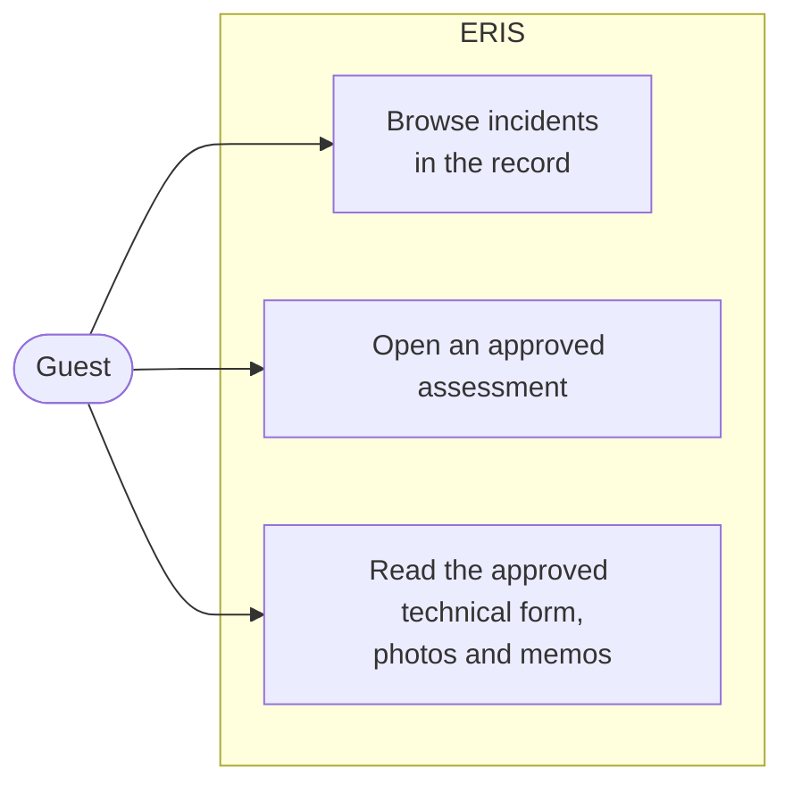

# Reading the record

For **Guests**: people who may read ERIS but not work in it. Rules:
[workflows: what Guests see](../architecture/workflows.md#8-what-guests-see).

## What you can see

- **Incidents** that are in the record (accepted at triage, with an ERIS
  number) and **assessments that are approved**, with their approved technical
  forms.
- Nothing in progress: no drafts, no reports waiting for triage, no queues,
  no Mission Center.

## How to

1. Sign in with your Caltrans account. ERIS opens on **Incidents**.
2. Search or filter the list; open an incident to see its location, photos
   and approved assessment.
3. Open **Assessments** for the approved assessments.

If a record you expect is missing, it is probably not approved yet. Ask the
district's Maintenance Coordinator or the GeoTech office.

## Getting more access

Roles come from where a person sits in the organization. Ask an ERIS
administrator to place you ([administration](administration.md)).
