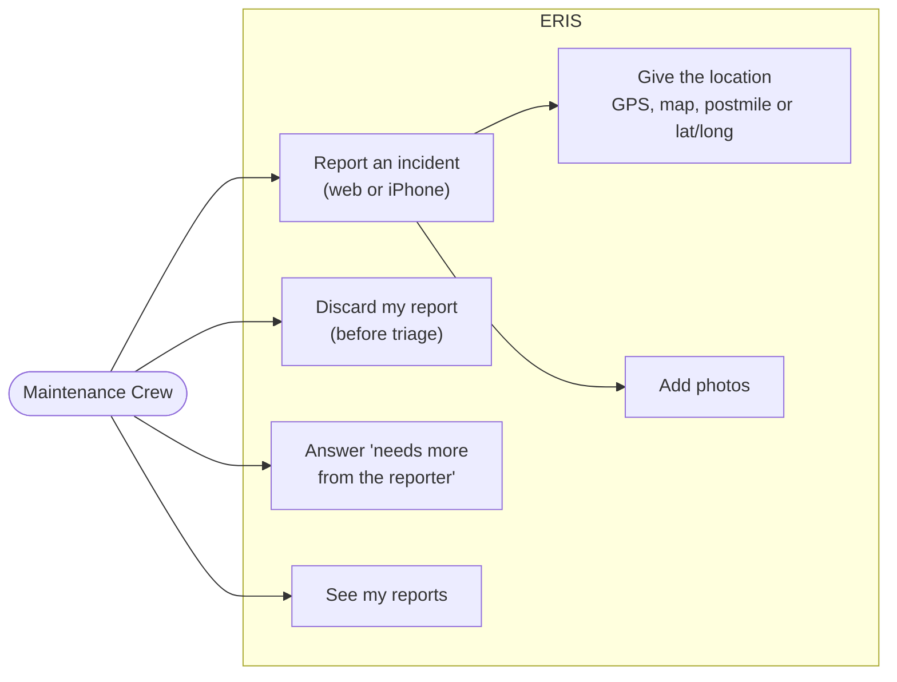
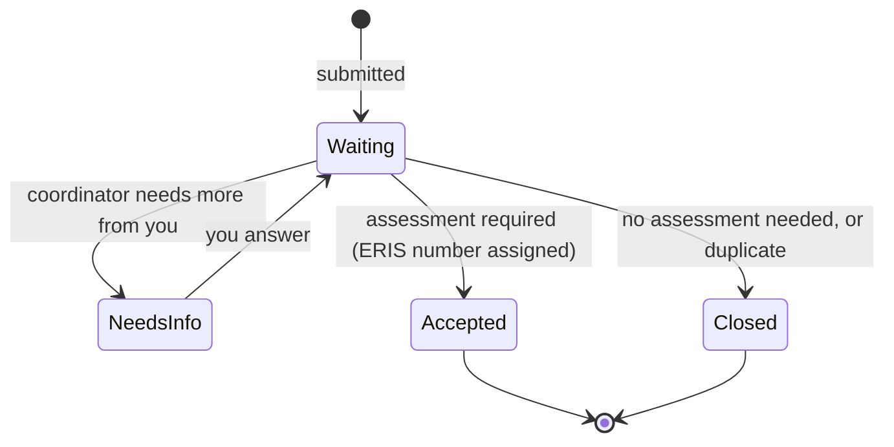

# Reporting incidents

For **Maintenance Crew** members, and for Staff and administrators who report
from the field. Rules behind each step: [workflows: field report](../architecture/workflows.md#1-field-report).

## Report an incident

On the web: **Incidents → Report an incident**. On the iPhone: the report
button on the Incidents screen.

1. **Location.** Choose one way; ERIS fills the others from the Caltrans
   postmile layer:
   - **GPS** (phone) or a **point on the map** (web).
   - **Route and postmile**, with county (for example `PLA 080 R12.35`).
   - **Latitude and longitude.**
   Check that district, county, route and postmile look right before saving.
2. **What happened.** Incident type, when it was first observed, and a short
   description of what you see (cracks, slide, washout, rock on the road).
3. **Photos.** Take them from the phone so each keeps its position and
   compass heading; the map shows where each was taken and which way it faced.
   Several photos from different sides help the engineers most.
4. **Submit.** The report is now **provisional**: it waits for the district's
   Maintenance Coordinator and has no ERIS number yet.

No signal? The iPhone app keeps the report as an offline draft and sends it
when you are back online.

## After you report

- **Needs more from the reporter:** you get a notification. Open it, add what
  is asked (a photo, a better location, details) and send it back.
- **Accepted:** the report enters the incident record with a permanent ERIS
  number and is part of an Incident Group. GeoTech takes it from here.
- **Closed at triage:** no assessment was needed, or it repeats another report.
  It is kept, with the coordinator's decision, but never gets an ERIS number.
- Until triage you can **discard** your own report if it was a mistake.

## Tips

- One report per location. If a storm damaged several slopes, report each one;
  the coordinator groups them.
- A report that repeats an earlier one is fine: the coordinator links it as a
  duplicate, and the earlier report's history shows it.
- If your location is wrong, say so in the description; the coordinator can
  review the location match.
