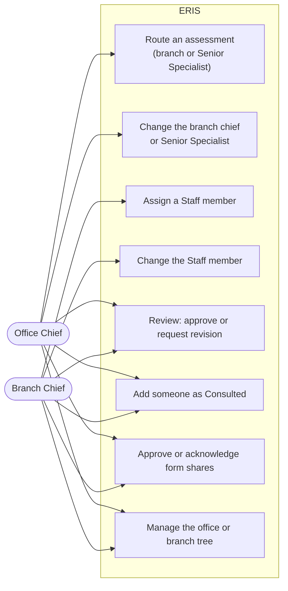
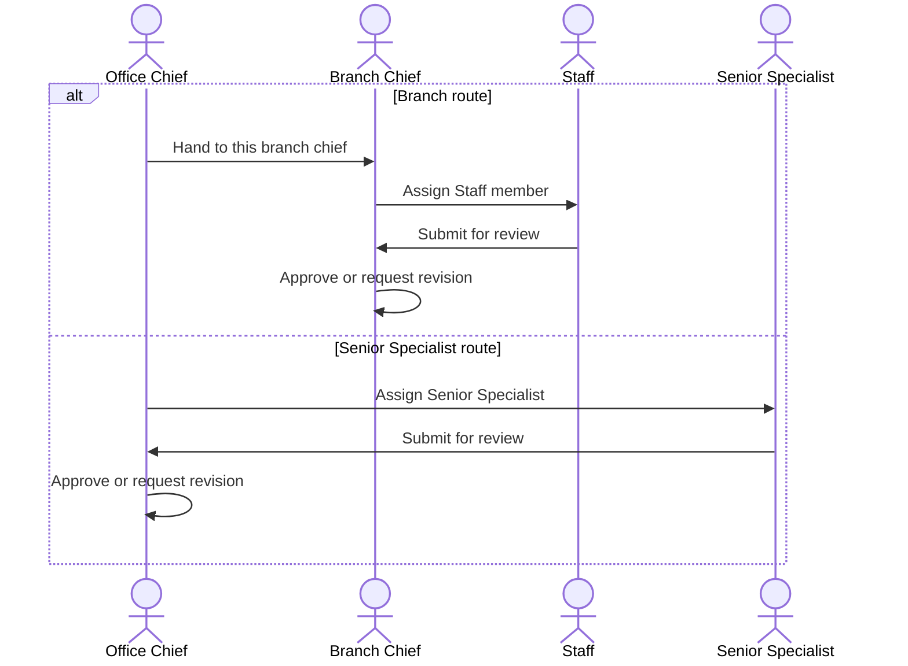

# Routing and review

For **Office Chiefs** and **Branch Chiefs**. You route assessments to the
right engineer and review their technical forms. Rules:
[workflows: assessments](../architecture/workflows.md#4-assessments).

## Office Chief: route an assessment

1. **My Work** lists each new assessment for your office as "to route".
   Select **Act on it**.
2. Choose a route. Nothing is pre-selected:
   - **Branch route:** pick a Branch Chief of your office and **Hand to this
     branch chief**. They will assign a Staff member.
   - **Senior Specialist route:** **Assign Senior Specialist** directly. You
     will review their form yourself.
3. The assessment now shows who has it, with **Change branch chief** (or
   **Change Senior Specialist**) if you need to reassign.

## Branch Chief: assign a Staff member

1. **My Work** shows assessments handed to you as "to assign".
2. Pick a Staff member and **Assign Staff member**. People of your branch are
   listed first. Assigning outside your branch asks for a reason, which is
   recorded; assigning outside the office is not possible.
3. Use **Change Staff member** to reassign later.

## Review a technical form

The reviewer is the Branch Chief on the branch route, or an Office Chief of
the office on the Senior Specialist route. Nobody else can approve.

1. **My Work** shows "to review" when the author submits.
2. Open the form. Check the site, measurements, photos, actions and memos. The
   **Review and record** section shows the history.
3. Decide:
   - **Approve:** final. The district's coordinator is notified and the record
     becomes readable by Guests.
   - **Request revision:** write what must change; the form goes back to the
     author, who resubmits.

## Consulted and sharing

- **Consulted:** add anyone operational to an assessment for information
  only. They can read it and are kept informed; they cannot act on it.
- **Shares:** when an author shares a technical form with someone outside the
  assessment, the branch and office chiefs concerned approve the share or are
  notified of it, depending on the share rules. Those requests appear in My
  Work and the notification bell.

## Your organization

On **Organization**, an Office Chief manages the office tree (Senior
Specialists, branches, branch chiefs, staff) and the Maintenance Coordinators
of the districts the office serves. A Branch Chief adds and removes Staff in
their own branch. Details: [administration](administration.md#who-may-change-what).
