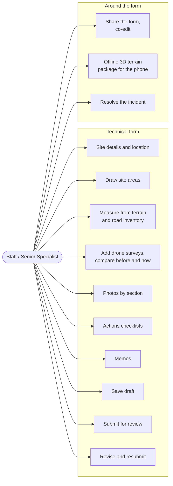
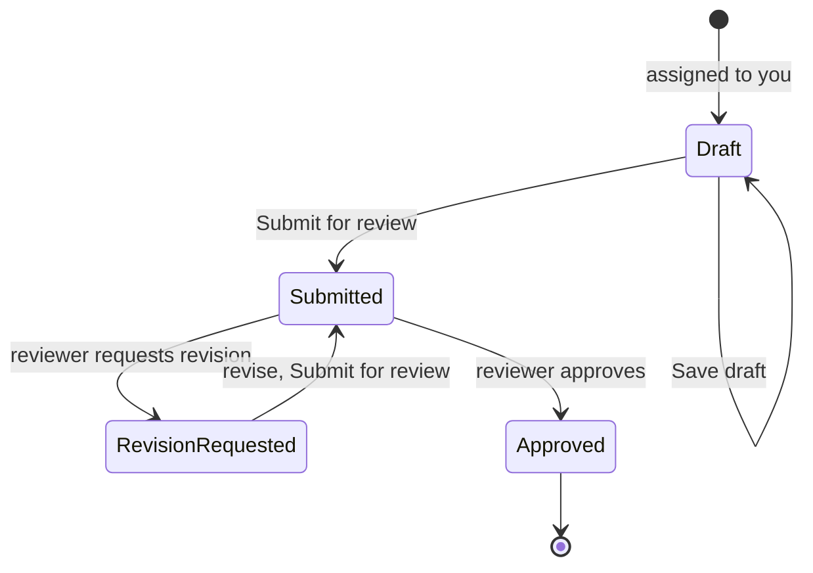

# Technical forms

For **Staff** and **Senior Specialists**: filling the GISA technical form for
an assessment. Every field is defined in the
[GISA data dictionary](../reference/gisa-data-dictionary.md). The full
behavior of each tool is in [workflows: assessments](../architecture/workflows.md#4-assessments).

## The form, top to bottom

| Part | What you do |
| --- | --- |
| **GISA sheet** | Site, highway status, distribution, incident types: the structured fields |
| **Location map → Site areas** | Draw the affected areas (polygons or rectangles); each shows its size in m² and acres; changes save immediately |
| **Measurements** | 3D terrain beside the landslide sketch. **Measure** proposes β, α, Ld, Wd and H from elevation inside and around your areas. **Measure road** proposes Lr and Wr from the road inventory. Proposals fill empty fields or one at a time; Hs stays a field measurement |
| **Drone surveys** | **Add a drone survey**: elevation model (DSM/DEM GeoTIFF) and optional orthomosaic. Switch **Before** / **Now**, compare surfaces, read volumes lost and gained, draw a section line, capture points |
| **Actions** | Immediate and follow-up action checklists |
| **Memos** | Observations, Geotechnical assessment, Recommendations, Sketch notes, in a Word-style editor; **Record of incidents** shows the site's history within 150 m |
| **Review and record** | Where the form stands, the reviewer's note, history, who it is shared with |

## Step by step

1. **My Work** shows the assessment as "to fill in". **Act on it** opens the form.
2. Work through the sections. **Save draft** often; nothing proposed by a
   measuring tool is saved until you save.
3. Upload photos into the section they belong to.
4. **Submit for review** (with an optional comment). The reviewer is notified.
5. If revision is requested, the reviewer's note is at the top; change the
   form and submit again.
6. After approval, **Resolve incident** when the work is done (you or an
   administrator).

## Working with others

- **Share with** someone to let them read or co-edit; depending on the share
  rules, a chief approves the share first. People editing at the same time see
  each other's presence on the form.
- Reports can also be filed by you from the field; see
  [reporting incidents](reporting-incidents.md).

## In the field on the iPhone

Generate an **offline 3D terrain package** for the site from the form; the
worker builds it in the background (minutes) and the phone downloads it for
use without signal. Operator details: [offline scene packages](../operations/offline-scene-packages.md).

## Tips

- Draw site areas before measuring: every measurement uses them.
- The terrain model's lidar date is shown next to **Before**. If the lidar
  was flown after the event, compare with an earlier drone survey instead.
- Drone software often reports ellipsoid heights about 30 m off in
  California; ERIS lines surveys up with the terrain around your areas, and you
  can adjust the shift.
