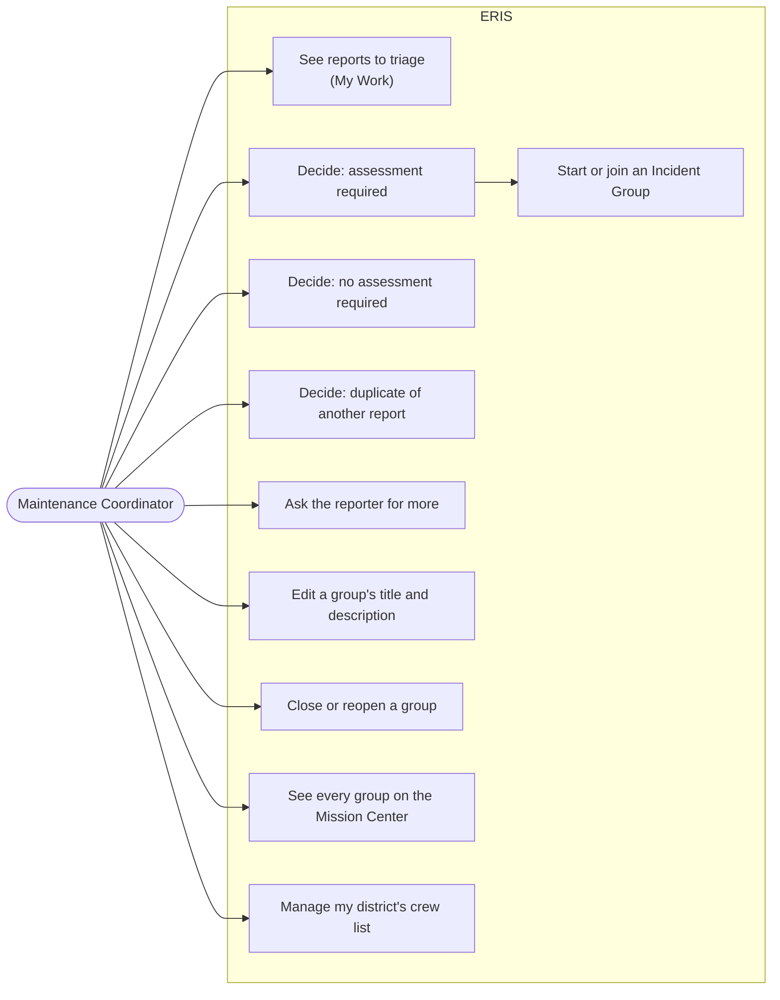
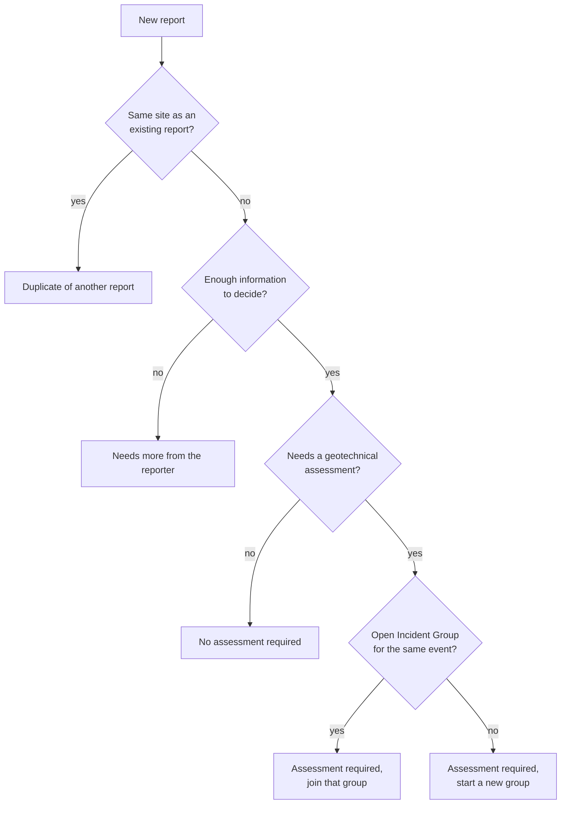

# Triage and Incident Groups

For **Maintenance Coordinators** (and administrators). You decide what happens
to each new report in the districts you cover. Rules:
[workflows: triage](../architecture/workflows.md#2-triage) and
[Incident Groups](../architecture/workflows.md#3-incident-groups).

## Triage a report

1. Open **My Work**. Each new report in your districts appears as "to triage".
   Select **Act on it**.
2. Read the report, look at the photos and the map. Check the location match
   (district, route, postmile).
3. Choose one decision:

| Decision | Use when | What happens |
| --- | --- | --- |
| **Assessment required** | GeoTech should assess the site | Choose an open Incident Group nearby or start a new one. The report gets its permanent ERIS number and goes to the GeoTech office serving the district. |
| **No assessment required** | Maintenance can handle it without engineering | Closed at triage; kept with your decision; no ERIS number. |
| **Duplicate of another report** | Someone already reported this | Closed at triage and linked to the original. |
| **Needs more from the reporter** | You cannot decide yet | Goes back to the reporter; returns to you when they answer. |

The decision is final for that report. An ERIS number, once given, never
changes.

## Incident Groups

An Incident Group gathers reports from one event (a storm on one route, say).

- **Start** a group while triaging (there is no separate "create group"
  button). Give it a clear title, for example "Jan 2027 storm, US-50 PM 40–60".
- **Join** an open group when the new report comes from the same event.
- **Edit** title and description from the group's page (**Incident Groups**).
- **Close** a group when every report in it is resolved; the system refuses
  while any is still open. You can **reopen** it if needed.
- A group that ends up with no reports is archived automatically.
- Moving an accepted report to another group is for administrators only.

The **Mission Center** shows every group with reports in the record on a map.
Select a group or a report to zoom to it.

## Your district's crew

On **Organization**, open your district's lists to add or remove Maintenance
Crew members. Only people already in ERIS can be added; an administrator
creates new accounts ([administration](administration.md)).

## After triage

You are notified when an assessment of one of your district's reports is
approved, in the app and by email if email is set up. The incident's page shows
its **workflow tree**: every step, who has it now and what happened.
